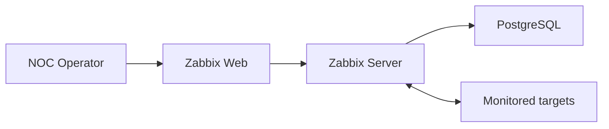
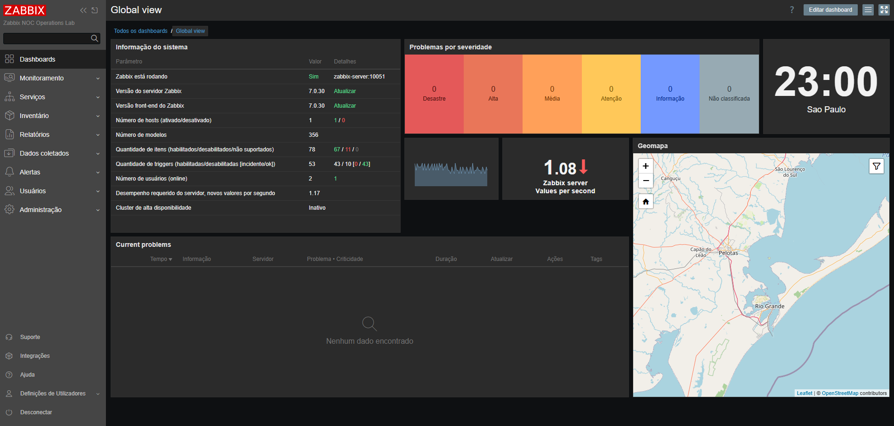

# Lab 01 — Zabbix Platform Deployment

[Back to the main README](../../README.md)

## Objective

Deploy and validate a reproducible Zabbix 7.0 LTS monitoring platform using Docker Compose.

This stage establishes the core services required for the subsequent Linux, Windows, network, service-monitoring, and incident-response laboratories.

## Learning Outcomes

After completing this laboratory, the operator can:

- validate container image availability;
- manage local environment variables without publishing secrets;
- validate a Docker Compose model before deployment;
- deploy PostgreSQL, Zabbix Server, and Zabbix Web;
- verify container state, database health, and restart counters;
- confirm server and frontend versions;
- test local HTTP availability;
- replace default administrative credentials;
- identify and acknowledge a monitoring problem;
- distinguish acknowledgment from resolution;
- investigate an incorrectly applied monitoring template;
- reduce monitoring noise from unused optional components;
- confirm platform recovery after corrective action.

## Platform Components

| Component | Image | Purpose |
|:---:|---|---|
| PostgreSQL | `postgres:16.15-alpine3.24` | Persistent Zabbix configuration and monitoring database |
| Zabbix Server | `zabbix/zabbix-server-pgsql:ubuntu-7.0.30` | Data collection, trigger evaluation, event processing, and monitoring logic |
| Zabbix Web | `zabbix/zabbix-web-nginx-pgsql:ubuntu-7.0.30` | Web administration and NOC operations interface |

Image versions are explicitly pinned in `.env.example` to make the laboratory reproducible and to prevent an unreviewed upgrade caused by a floating tag.

## Architecture



The platform uses three Docker networks with distinct responsibilities.

| Network | Purpose |
|:---:|---|
| `backend` | Isolated communication between PostgreSQL, Zabbix Server, and Zabbix Web |
| `frontend` | Access to the Zabbix web interface |
| `monitoring` | Communication between Zabbix Server and monitored services |

The `backend` network is internal. PostgreSQL is not published to the Windows workstation.

During the original Stage 01 deployment, only the following ports were published:

| Workstation endpoint | Container endpoint | Purpose |
|:---:|---|---|
| `127.0.0.1:8080` | `zabbix-web:8080` | Local Zabbix web interface |
| `127.0.0.1:10051` | `zabbix-server:10051` | Zabbix Server communication |

Binding these ports to `127.0.0.1` prevents direct access from other devices on the local network during this stage.

**Compose configuration evolution:** Stage 01 was originally implemented and validated with three core services: PostgreSQL, Zabbix Server, and Zabbix Web. The current repository uses an expanded Compose configuration that also includes `monitored-web`, `mailpit`, and `snmp-target`, introduced during subsequent stages. The original Stage 01 observations and evidence describe the three-service deployment and must not be interpreted as validation of the expanded stack.

**Published endpoints in the current Compose model:** The table above records the two original Stage 01 loopback endpoints. The later `mailpit` service also publishes TCP `127.0.0.1:8025` by default, and `snmp-target` publishes UDP `127.0.0.1:161` by default; both are configurable through `.env`. The later `monitored-web` service has no host-published port. These additional endpoints are outside the historical Stage 01 deployment.

## Persistent Data

The named volume `postgres-data` stores the PostgreSQL database.

Stopping and removing Compose containers without the `--volumes` option does not remove this volume. The following command affects the **entire current Compose project**, including services added after Stage 01; it is **not** a three-service shutdown procedure and must only be used when a project-wide shutdown is intended:

```powershell
docker compose --env-file .env down
```

For routine Stage 01-only operations, use the service-scoped commands in [Routine Operations](#routine-operations).

Removing the database volume is intentionally excluded from the routine shutdown procedure. Destructive cleanup must only be performed when the loss of all local Zabbix configuration and history is explicitly intended.

## Security Controls

- PostgreSQL is reachable only through the internal Docker network.
- Published ports listen only on the loopback interface.
- The real `.env` file is excluded by `.gitignore`.
- `.env.example` contains placeholders instead of operational credentials.
- Container logs use rotation to limit uncontrolled local growth.
- Default Zabbix administrative credentials are replaced after the first sign-in.
- Screenshots are reviewed before publication.

## Environment Preparation

Run the commands from the repository root.

Create the local environment file:

```powershell
Copy-Item .env.example .env
```

Edit `.env` and replace the example PostgreSQL password with a strong password used only by this local laboratory.

The current `compose.yaml` also references required SNMP settings from later stages. All required variable references must be satisfied when Compose parses the full model, even if only the three Stage 01 services are selected. The current `.env.example` includes these settings as example values; do not treat the example SNMP community as a production credential. The `snmp-target` build context is needed only when that later service is built or started.

The `.env` file must never be committed.

Confirm its ignore status:

```powershell
git check-ignore -v .env
```

## Pre-deployment Validation

Run the workstation validation again because available ports and Docker state may have changed since Stage 00:

```powershell
powershell.exe -NoProfile -ExecutionPolicy Bypass `
    -File .\scripts\powershell\validate-workstation.ps1
```

Validate variable interpolation and the **current full Compose model** (including later-stage service definitions):

```powershell
docker compose --env-file .env config -q
```

To inspect the full resolved configuration or image list, use `docker compose --env-file .env config` or `docker compose --env-file .env config --images`; their output is **not limited to Stage 01**.

Pull the pinned images for the three Stage 01 core services only:

```powershell
docker compose --env-file .env pull postgres zabbix-server zabbix-web
```

## Deployment

Start only the three Stage 01 core services in detached mode, using the current Compose model:

```powershell
docker compose --env-file .env up -d postgres zabbix-server zabbix-web
```

This service selection does not stop later-stage services already running in the same Compose project, and `up` may recreate selected services if their configuration has changed. Use an isolated project for a three-service exercise. This procedure selects the **Stage 01 service scope**; it is not an exact replay of the original historical Compose revision.

The expected startup order is:

1. PostgreSQL starts and passes `pg_isready`;
2. Zabbix Server starts after the database is healthy;
3. Zabbix Web starts and connects to PostgreSQL and Zabbix Server.

## Platform Validation

### Container state

Inspect service state and published ports for the three Stage 01 core services:

```powershell
docker compose --env-file .env ps postgres zabbix-server zabbix-web
```

Inspect service state and health information in a structured format:

```powershell
docker compose --env-file .env ps --format json postgres zabbix-server zabbix-web |
    ConvertFrom-Json |
    Select-Object Name, Service, State, Health, ExitCode
```

Inspect container restart counters:

```powershell
docker compose --env-file .env ps -q postgres zabbix-server zabbix-web |
    ForEach-Object {
        docker inspect `
            --format '{{.Name}} restart_count={{.RestartCount}}' $_
    }
```

Expected conditions:

- all three Stage 01 core services are running (other later-stage services may exist in the same project);
- PostgreSQL reports a healthy state;
- no service is repeatedly restarting;
- PostgreSQL has no host-published port;
- Zabbix Web is available only at `127.0.0.1:8080`;
- Zabbix Server is available only at `127.0.0.1:10051`.

### Database validation

Validate database readiness inside the PostgreSQL container:

```powershell
docker compose --env-file .env exec postgres `
    pg_isready -U zabbix -d zabbix
```

Confirm that Zabbix tables were created:

```powershell
docker compose --env-file .env exec postgres `
    psql -U zabbix -d zabbix -tAc `
    "SELECT COUNT(*) FROM information_schema.tables WHERE table_schema = 'public';"
```

A nonzero result confirms that the application initialized the database schema. The exact table count may vary between supported Zabbix releases.

### Zabbix Server validation

Review recent server logs:

```powershell
docker compose --env-file .env logs `
    --tail 100 zabbix-server
```

The validation must confirm that the server started, connected to PostgreSQL, and did not enter a restart loop.

### HTTP validation

Test the local frontend:

```powershell
$response = Invoke-WebRequest `
    -Uri http://127.0.0.1:8080 `
    -UseBasicParsing

$response.StatusCode
```

The expected HTTP status is `200`.

Open the interface:

```text
http://127.0.0.1:8080
```

After the first sign-in, replace the default administrative password before continuing with monitoring configuration.

## Operational Finding and Corrective Action

During initial platform validation, an inappropriate monitoring template created alerts for optional components that were not part of the deployed architecture.

This provided an early NOC workflow exercise:

1. the generated problem was reviewed;
2. the event was acknowledged with an operational note;
3. acknowledgment was treated as a record of operator action, not as resolution;
4. the host and linked template were inspected;
5. the unnecessary template relationship was corrected;
6. the platform was observed until the problem cleared;
7. the dashboard was checked again to confirm recovery.

The finding demonstrates why a monitoring operator must validate whether an alert represents a real service failure, an incorrect configuration, or an unused component before escalating or changing infrastructure.

## Validation Evidence



The final dashboard confirms:

- Zabbix Server is running;
- server version `7.0.30`;
- frontend version `7.0.30`;
- communication between the frontend and Zabbix Server;
- no current monitoring problems after corrective action.

The image contains no credentials or unrelated desktop content.

## Acceptance Criteria

| Requirement | Acceptance condition | Result |
|---|---|:---:|
| Compose model | Configuration renders without missing variables | Passed |
| PostgreSQL | Container starts and reports healthy | Passed |
| Database isolation | PostgreSQL has no host-published port | Passed |
| Zabbix Server | Server starts and communicates with PostgreSQL | Passed |
| Zabbix Web | Frontend responds locally | Passed |
| Version alignment | Server and frontend report Zabbix 7.0.30 | Passed |
| Persistence | Named database volume is defined | Passed |
| Port exposure | Published ports bind to `127.0.0.1` | Passed |
| Credentials | Runtime `.env` remains outside version control | Passed |
| Initial monitoring noise | Incorrect template relationship investigated and corrected | Passed |
| Final platform state | Dashboard reports no current problems | Passed |

## Troubleshooting

### A required variable is missing

If Compose reports that an image, password, or port variable must be set:

1. confirm that `.env` exists in the repository root;
2. compare its variable names with `.env.example`;
3. run the command with `--env-file .env`;
4. run `docker compose --env-file .env config` again.

### PostgreSQL remains unhealthy

Inspect its state and recent logs:

```powershell
docker compose --env-file .env ps
docker compose --env-file .env logs --tail 100 postgres
```

Check the database name, user, password, volume state, and available disk space before recreating any resource.

### Zabbix Server cannot connect to PostgreSQL

```powershell
docker compose --env-file .env logs `
    --tail 100 postgres zabbix-server
```

Confirm that both services share the `backend` network and use identical PostgreSQL variables.

### The web interface does not respond

```powershell
docker compose --env-file .env ps
docker compose --env-file .env logs --tail 100 zabbix-web
Test-NetConnection 127.0.0.1 -Port 8080
```

Verify that the port is published, the frontend container is running, and another local service has not taken TCP 8080.

### A problem remains after acknowledgment

Acknowledgment does not resolve the monitored condition. It records that an operator reviewed or acted on the event.

Inspect the affected host, template, item, trigger, and latest data. Correct the underlying condition and wait for the next evaluation cycle.

## Routine Operations

These service-scoped commands target only the Stage 01 core services. They do not intentionally stop later-stage services in the current Compose project.

Display core-service state:

```powershell
docker compose --env-file .env ps postgres zabbix-server zabbix-web
```

Display recent core-service logs:

```powershell
docker compose --env-file .env logs --tail 100 postgres zabbix-server zabbix-web
```

Stop the core services while preserving their containers and data:

```powershell
docker compose --env-file .env stop zabbix-web zabbix-server postgres
```

Restart the stopped core services:

```powershell
docker compose --env-file .env start postgres zabbix-server zabbix-web
```

**Warning — project-wide operation:** The following command is not scoped to Stage 01. It stops and removes containers and networks for the current Compose project, potentially disrupting `monitored-web`, `mailpit`, and `snmp-target` as well as the core services. Run it only when intentionally shutting down the entire project. The named PostgreSQL volume is preserved unless volumes are explicitly removed.

```powershell
docker compose --env-file .env down
```

## Outcome

Stage 01 delivered a reproducible and locally isolated Zabbix 7.0 LTS platform composed of PostgreSQL, Zabbix Server, and Zabbix Web.

The deployment was validated from the container, database, server, HTTP, security, monitoring, and operator-workflow perspectives. An initial configuration-related problem was acknowledged, investigated, corrected, and confirmed as recovered.

Stage 02 subsequently added an Ubuntu 24.04 LTS host running under WSL 2, monitored through Zabbix Agent 2. The completed implementation validated passive agent connectivity, resource metrics, processes, filesystems, and network-interface monitoring. See the [Stage 02 documentation](../02-linux-host-monitoring/README.md) for the implementation and technical evidence.
