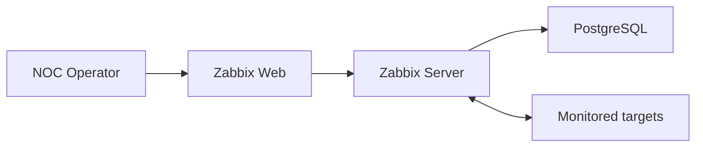
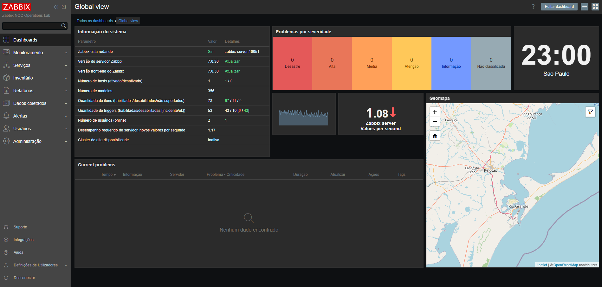

# Lab 01 — Implantação da plataforma Zabbix

[English](README.md) | **Português (Brasil)**

[Voltar ao README principal](../../README.pt-BR.md)

## Objetivo

Implantar e validar uma plataforma de monitoramento reproduzível com Zabbix 7.0 LTS, utilizando Docker Compose.

Esta etapa estabelece os serviços centrais necessários aos laboratórios posteriores de Linux, Windows, redes, monitoramento de serviços e resposta a incidentes.

## Resultados de aprendizagem

Após concluir este laboratório, o operador será capaz de:

- validar a disponibilidade das imagens de contêineres;
- gerenciar variáveis de ambiente locais sem publicar segredos;
- validar um modelo Docker Compose antes da implantação;
- implantar PostgreSQL, Zabbix Server e Zabbix Web;
- verificar o estado dos contêineres, a integridade do banco de dados e os contadores de reinicialização;
- confirmar as versões do servidor e da interface web (*frontend*);
- testar a disponibilidade HTTP local;
- substituir as credenciais administrativas padrão;
- identificar e reconhecer um problema de monitoramento;
- diferenciar reconhecimento de resolução;
- investigar um template de monitoramento aplicado incorretamente;
- reduzir alertas desnecessários de monitoramento gerados por componentes opcionais não utilizados;
- confirmar a recuperação da plataforma após uma ação corretiva.

## Componentes da plataforma

| Componente | Imagem | Finalidade |
|:---:|:---:|:---:|
| PostgreSQL | `postgres:16.15-alpine3.24` | Banco de dados persistente de configuração e monitoramento do Zabbix |
| Zabbix Server | `zabbix/zabbix-server-pgsql:ubuntu-7.0.30` | Coleta de dados, avaliação de *triggers*, processamento de eventos e lógica de monitoramento |
| Zabbix Web | `zabbix/zabbix-web-nginx-pgsql:ubuntu-7.0.30` | Interface web de administração e operações de NOC |

As versões das imagens são fixadas explicitamente em `.env.example` para tornar o laboratório reproduzível e impedir atualizações não revisadas causadas por tags que apontam para versões variáveis.

## Arquitetura



A plataforma utiliza três redes Docker com responsabilidades distintas.

| Rede | Finalidade |
|:---:|:---:|
| `backend` | Comunicação isolada entre PostgreSQL, Zabbix Server e Zabbix Web |
| `frontend` | Acesso à interface web do Zabbix |
| `monitoring` | Comunicação entre o Zabbix Server e os serviços monitorados |

A rede `backend` é interna. O PostgreSQL não é publicado na estação de trabalho Windows.

Somente as seguintes portas são publicadas:

| Endpoint da estação de trabalho | Endpoint do contêiner | Finalidade |
|:---:|:---:|:---:|
| `127.0.0.1:8080` | `zabbix-web:8080` | Interface web local do Zabbix |
| `127.0.0.1:10051` | `zabbix-server:10051` | Comunicação com o Zabbix Server |

Vincular essas portas a `127.0.0.1` impede o acesso direto de outros dispositivos da rede local durante esta etapa.

## Dados persistentes

O volume nomeado `postgres-data` armazena o banco de dados PostgreSQL.

Parar e remover os contêineres não remove esse volume:

```powershell
docker compose --env-file .env down
```

A remoção do volume do banco de dados é intencionalmente excluída do procedimento rotineiro de desligamento. Uma limpeza destrutiva somente deve ser realizada quando houver a intenção explícita de perder toda a configuração e todo o histórico local do Zabbix.

## Controles de segurança

- O PostgreSQL pode ser acessado apenas pela rede interna do Docker.
- As portas publicadas escutam somente na interface de loopback.
- O arquivo `.env` real está excluído pelo `.gitignore`.
- O `.env.example` contém marcadores substitutos em vez de credenciais operacionais.
- Os logs dos contêineres utilizam rotação para limitar o crescimento local descontrolado.
- As credenciais administrativas padrão do Zabbix são substituídas após o primeiro acesso.
- As capturas de tela são revisadas antes da publicação.

## Preparação do ambiente

Execute os comandos a partir da raiz do repositório.

Crie o arquivo de ambiente local:

```powershell
Copy-Item .env.example .env
```

Edite `.env` e substitua a senha de exemplo do PostgreSQL por uma senha forte, utilizada exclusivamente neste laboratório local.

O arquivo `.env` nunca deve ser incluído em um commit.

Confirme que ele está sendo ignorado pelo Git:

```powershell
git check-ignore -v .env
```

## Validação antes da implantação

Execute novamente a validação da estação de trabalho, pois as portas disponíveis e o estado do Docker podem ter mudado desde a etapa 00:

```powershell
powershell.exe -NoProfile -ExecutionPolicy Bypass `
    -File .\scripts\powershell\validate-workstation.ps1
```

Valide a interpolação das variáveis e o modelo Compose final:

```powershell
docker compose --env-file .env config
```

Liste as imagens referenciadas pelo modelo:

```powershell
docker compose --env-file .env config --images
```

Baixe as imagens com versões fixadas antes de iniciar a plataforma:

```powershell
docker compose --env-file .env pull
```

## Implantação

Inicie os serviços em modo desacoplado (*detached*):

```powershell
docker compose --env-file .env up -d
```

A ordem de inicialização esperada é:

1. O PostgreSQL inicia e passa na verificação `pg_isready`;
2. O Zabbix Server inicia após o banco de dados ficar saudável;
3. O Zabbix Web inicia e se conecta ao PostgreSQL e ao Zabbix Server.

## Validação da plataforma

### Estado dos contêineres

Inspecione o estado dos serviços e as portas publicadas:

```powershell
docker compose --env-file .env ps
```

Inspecione o estado dos serviços e as informações de integridade em formato estruturado:

```powershell
docker compose --env-file .env ps --format json |
    ConvertFrom-Json |
    Select-Object Name, Service, State, Health, ExitCode
```

Inspecione os contadores de reinicialização dos contêineres:

```powershell
docker compose --env-file .env ps -q |
    ForEach-Object {
        docker inspect `
            --format '{{.Name}} restart_count={{.RestartCount}}' $_
    }
```

Condições esperadas:

- todos os três serviços estão em execução;
- o PostgreSQL apresenta estado saudável;
- nenhum serviço está reiniciando repetidamente;
- o PostgreSQL não possui porta publicada no host;
- o Zabbix Web está disponível apenas em `127.0.0.1:8080`;
- o Zabbix Server está disponível apenas em `127.0.0.1:10051`.

### Validação do banco de dados

Valide a prontidão do banco de dados dentro do contêiner PostgreSQL:

```powershell
docker compose --env-file .env exec postgres `
    pg_isready -U zabbix -d zabbix
```

Confirme que as tabelas do Zabbix foram criadas:

```powershell
docker compose --env-file .env exec postgres `
    psql -U zabbix -d zabbix -tAc `
    "SELECT COUNT(*) FROM information_schema.tables WHERE table_schema = 'public';"
```

Um resultado diferente de zero confirma que a aplicação inicializou o esquema do banco de dados. A quantidade exata de tabelas pode variar entre as versões suportadas do Zabbix.

### Validação do Zabbix Server

Analise os logs recentes do servidor:

```powershell
docker compose --env-file .env logs `
    --tail 100 zabbix-server
```

A validação deve confirmar que o servidor iniciou, conectou-se ao PostgreSQL e não entrou em um ciclo de reinicializações.

### Validação HTTP

Teste a interface web local:

```powershell
$response = Invoke-WebRequest `
    -Uri http://127.0.0.1:8080 `
    -UseBasicParsing

$response.StatusCode
```

O código de status HTTP esperado é `200`.

Abra a interface:

```text
http://127.0.0.1:8080
```

Após o primeiro acesso, substitua a senha administrativa padrão antes de continuar a configuração do monitoramento.

## Constatação operacional e ação corretiva

Durante a validação inicial da plataforma, um template de monitoramento inadequado gerou alertas para componentes opcionais que não faziam parte da arquitetura implantada.

Isso proporcionou um exercício inicial do fluxo operacional de NOC:

1. o problema gerado foi analisado;
2. o evento foi reconhecido com uma anotação operacional;
3. o reconhecimento foi tratado como registro de uma ação do operador, e não como resolução;
4. o host e o template associado foram inspecionados;
5. a associação desnecessária do template foi corrigida;
6. a plataforma foi observada até o desaparecimento do problema;
7. o dashboard foi consultado novamente para confirmar a recuperação.

A constatação demonstra por que um operador de monitoramento deve verificar se um alerta representa uma falha real de serviço, uma configuração incorreta ou um componente não utilizado antes de escalonar o problema ou alterar a infraestrutura.

## Evidências da validação



O dashboard final confirma:

- o Zabbix Server está em execução;
- versão do servidor `7.0.30`;
- versão da interface web `7.0.30`;
- comunicação entre a interface web e o Zabbix Server;
- ausência de problemas de monitoramento ativos após a ação corretiva.

A imagem não contém credenciais nem conteúdo não relacionado da área de trabalho.

## Critérios de aceitação

| Requisito | Condição de aceitação | Resultado |
|---|---|:---:|
| Modelo Compose | Configuração renderizada sem variáveis ausentes | Aprovado |
| PostgreSQL | Contêiner inicia e apresenta estado saudável | Aprovado |
| Isolamento do banco de dados | PostgreSQL não possui porta publicada no host | Aprovado |
| Zabbix Server | Servidor inicia e se comunica com o PostgreSQL | Aprovado |
| Zabbix Web | Interface web responde localmente | Aprovado |
| Alinhamento de versões | Servidor e interface web informam Zabbix 7.0.30 | Aprovado |
| Persistência | Volume nomeado do banco de dados definido | Aprovado |
| Exposição de portas | Portas publicadas vinculadas a `127.0.0.1` | Aprovado |
| Credenciais | Arquivo `.env` de execução permanece fora do controle de versão | Aprovado |
| Alertas iniciais desnecessários | Associação incorreta do template investigada e corrigida | Aprovado |
| Estado final da plataforma | Dashboard não apresenta problemas ativos | Aprovado |

## Diagnóstico e resolução de problemas

### Uma variável obrigatória está ausente

Se o Compose informar que é necessário definir uma variável de imagem, senha ou porta:

1. confirme que `.env` existe na raiz do repositório;
2. compare os nomes das variáveis com os de `.env.example`;
3. execute o comando com `--env-file .env`;
4. execute `docker compose --env-file .env config` novamente.

### PostgreSQL permanece com estado não saudável

Inspecione seu estado e os logs recentes:

```powershell
docker compose --env-file .env ps
docker compose --env-file .env logs --tail 100 postgres
```

Verifique o nome do banco de dados, usuário, senha, estado do volume e espaço livre em disco antes de recriar qualquer recurso.

### O Zabbix Server não consegue se conectar ao PostgreSQL

```powershell
docker compose --env-file .env logs `
    --tail 100 postgres zabbix-server
```

Confirme que ambos os serviços compartilham a rede `backend` e utilizam variáveis idênticas para o PostgreSQL.

### A interface web não responde

```powershell
docker compose --env-file .env ps
docker compose --env-file .env logs --tail 100 zabbix-web
Test-NetConnection 127.0.0.1 -Port 8080
```

Verifique se a porta foi publicada, se o contêiner da interface web está em execução e se outro serviço local não ocupou a porta TCP 8080.

### Um problema permanece após o reconhecimento

Reconhecer um problema não resolve a condição monitorada. O reconhecimento registra que um operador analisou o evento ou realizou alguma ação.

Inspecione o host, o template, o item, a *trigger* e os dados recentes relacionados. Corrija a condição subjacente e aguarde o próximo ciclo de avaliação.

## Operações rotineiras

Exiba o estado da plataforma:

```powershell
docker compose --env-file .env ps
```

Exiba os logs recentes:

```powershell
docker compose --env-file .env logs --tail 100
```

Pare a plataforma preservando os contêineres e os dados:

```powershell
docker compose --env-file .env stop
```

Inicie os serviços parados:

```powershell
docker compose --env-file .env start
```

Remova os contêineres e as redes do projeto, preservando o volume do banco de dados:

```powershell
docker compose --env-file .env down
```

## Resultado

A etapa 01 disponibilizou uma plataforma Zabbix 7.0 LTS reproduzível e isolada localmente, composta por PostgreSQL, Zabbix Server e Zabbix Web.

A implantação foi validada sob as perspectivas dos contêineres, banco de dados, servidor, HTTP, segurança, monitoramento e fluxo de trabalho do operador. Um problema inicial relacionado à configuração foi reconhecido, investigado, corrigido e teve sua recuperação confirmada.

A etapa 02 adicionará um host Linux monitorado com Zabbix Agent 2 e validará disponibilidade do host, métricas de recursos, processos, sistemas de arquivos e interfaces de rede.
