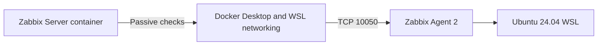
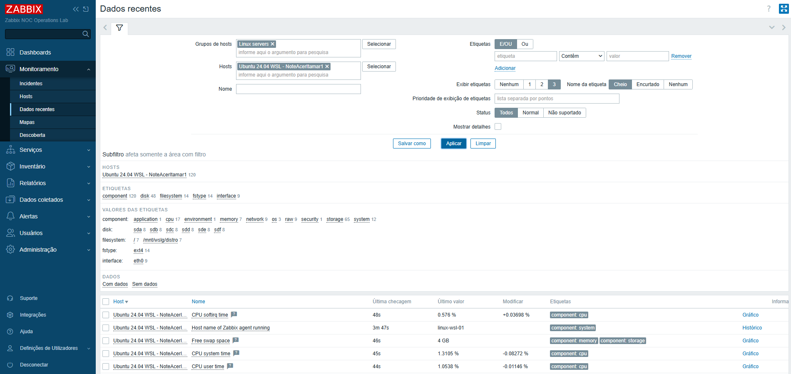
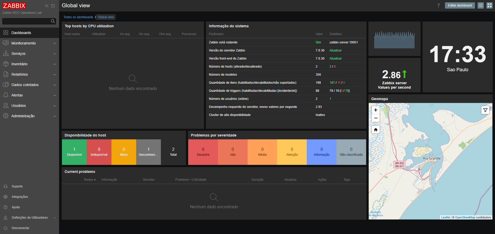
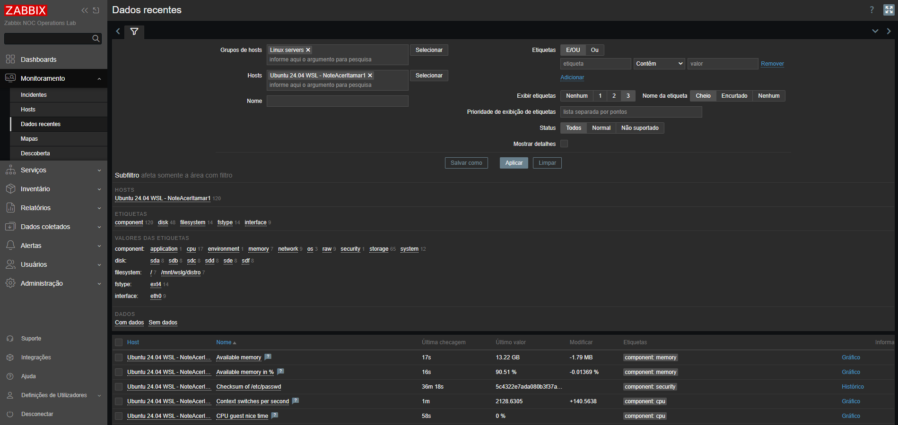
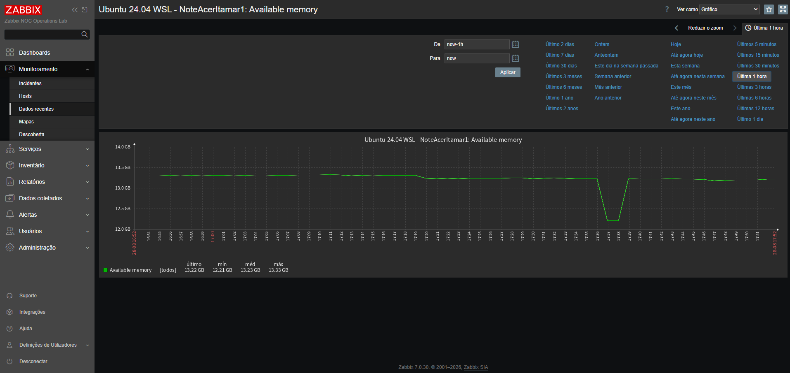

# Stage 02 — Monitoramento de host Linux

[English](README.md) | **Português (Brasil)**

[Voltar ao README principal](../../README.pt-BR.md)

## Visão geral

Esta etapa introduz o primeiro host Linux monitorado no Zabbix NOC Operations Lab.

O alvo monitorado é um ambiente Ubuntu 24.04 LTS executado no WSL 2. O Zabbix Agent 2 coleta dados do sistema operacional, CPU, memória, processos, sistemas de arquivos, armazenamento e interfaces de rede.

A implementação inicial utiliza verificações passivas do agente, iniciadas pelo Zabbix Server em contêiner.

## Situação atual

**Concluída**

Os seguintes marcos foram concluídos:

- alvo Ubuntu 24.04 no WSL selecionado e validado;
- Zabbix Agent 2 instalado a partir do repositório oficial do Zabbix 7.0;
- serviço do agente habilitado e em execução pelo systemd;
- configuração da escuta para verificações passivas na porta TCP `10050`;
- conectividade entre Docker e WSL validada;
- restrições de acesso ajustadas para as redes privadas do Docker e do WSL;
- host cadastrado na interface web do Zabbix;
- template `Linux by Zabbix agent` associado;
- descoberta inicial de itens e coleta de dados confirmadas;
- estado inicial de itens não suportados analisado e confirmado como transitório;
- atividades controladas de CPU, memória, sistema de arquivos e rede validadas;
- inicialização do Agent 2 após o encerramento do WSL validada;
- evidências técnicas finais selecionadas e armazenadas.

## Ambiente

| Componente | Valor |
|:---:|:---:|
| Plataforma de monitoramento | Zabbix 7.0 LTS |
| Zabbix Server | Executado em contêiner |
| Banco de dados | PostgreSQL |
| Interface web | Zabbix Web |
| Sistema monitorado | Ubuntu 24.04.4 LTS |
| Camada de virtualização | WSL 2 |
| Agente | Zabbix Agent 2 |
| Versão do agente | `7.0.30` |
| Nome técnico do host no agente | `linux-wsl-01` |
| Porta do agente | `10050/TCP` |
| Modo de verificação | Passivo |
| Template | `Linux by Zabbix agent` |
| Grupo de hosts | `Linux servers` |

## Arquitetura



O Zabbix Server é executado na rede de monitoramento do Docker. O sistema Ubuntu monitorado é executado no WSL 2 e acessado pela rede privada do WSL.

Como os dois ambientes utilizam faixas de endereços privados, a configuração de acesso do agente deve autorizar a rede de origem do Zabbix Server observada a partir do WSL.

## Pré-requisitos

Antes da instalação, foram confirmadas as seguintes condições:

- Ubuntu 24.04 no WSL disponível;
- systemd em execução dentro da distribuição;
- arquitetura do sistema `amd64`;
- acesso HTTPS de saída ao repositório do Zabbix disponível;
- contêiner do Zabbix Server em estado saudável;
- contêiner do servidor capaz de alcançar o endereço do WSL;
- porta TCP `10050` desocupada antes da instalação do agente.

O ambiente WSL foi inspecionado com:

```bash
hostname
cat /etc/os-release
uname -r
systemctl is-system-running
hostname -I
ip -4 address show
ss -lntp
```

## Instalação do repositório Zabbix

O pacote do repositório oficial do Zabbix 7.0 para Ubuntu 24.04 foi baixado para o diretório pessoal do usuário no WSL:

```bash
curl -fL \
  "https://repo.zabbix.com/zabbix/7.0/ubuntu/pool/main/z/zabbix-release/zabbix-release_latest_7.0+ubuntu24.04_all.deb" \
  -o /home/itamarsbt/zabbix-release.deb
```

O pacote foi inspecionado antes da instalação:

```bash
ls -lh /home/itamarsbt/zabbix-release.deb
dpkg-deb --info /home/itamarsbt/zabbix-release.deb
```

O pacote do repositório foi instalado e os índices de pacotes foram atualizados:

```bash
sudo dpkg -i /home/itamarsbt/zabbix-release.deb
sudo apt-get update
```

A disponibilidade do pacote foi confirmada com:

```bash
apt-cache policy zabbix-agent2
```

O repositório disponibilizou o Zabbix Agent 2 versão `7.0.30` para Ubuntu 24.04.

## Instalação do agente

O Zabbix Agent 2 foi instalado com:

```bash
sudo apt-get install -y zabbix-agent2
```

A versão instalada foi validada com:

```bash
zabbix_agent2 -V
```

Versão validada:

```text
zabbix_agent2 (Zabbix) 7.0.30
```

A instalação do pacote criou e habilitou o serviço systemd.

O estado do serviço foi inspecionado com:

```bash
systemctl status zabbix-agent2 --no-pager
```

Foi confirmado o seguinte estado do serviço:

```text
active (running)
```

## Configuração do agente

O arquivo original de configuração foi preservado antes das alterações:

```bash
sudo cp -p \
  /etc/zabbix/zabbix_agent2.conf \
  /etc/zabbix/zabbix_agent2.conf.pre-stage02
```

A configuração relevante para verificações passivas é:

```ini
Server=172.20.0.0/16,172.31.96.0/20
# ServerActive disabled during passive-check validation
Hostname=linux-wsl-01
ListenIP=0.0.0.0
```

Os parâmetros têm as seguintes finalidades:

| Parâmetro | Finalidade |
|---|---|
| `Server` | Autoriza verificações passivas provenientes das redes privadas do Docker e do WSL |
| `ServerActive` | Desabilitado durante a implementação inicial das verificações passivas |
| `Hostname` | Define a identidade técnica do host utilizada pelo agente |
| `ListenIP` | Faz o agente escutar nas interfaces de rede do WSL |
| `ListenPort` | Utiliza a porta padrão do Agent 2, TCP `10050` |

A configuração foi validada antes de reiniciar o serviço:

```bash
sudo zabbix_agent2 -T -c /etc/zabbix/zabbix_agent2.conf
```

Resultado validado:

```text
Validation successful
```

O agente foi reiniciado e verificado:

```bash
sudo systemctl restart zabbix-agent2
systemctl is-active zabbix-agent2
ss -lntp | grep ':10050'
```

Resultados validados:

```text
active
LISTEN ... *:10050
```

## Conectividade entre Docker e WSL

O endereço IPv4 do Ubuntu no WSL foi obtido pelo PowerShell:

```powershell
$wslIp = (wsl.exe -d Ubuntu-24.04 -- hostname -I).Trim().Split()[0]
Write-Host "Ubuntu WSL IPv4: $wslIp"
```

Durante a validação, o endereço era:

```text
172.31.111.15
```

O contêiner do Zabbix Server foi identificado dinamicamente:

```powershell
$serverContainer = docker ps `
  --filter "label=com.docker.compose.service=zabbix-server" `
  --format "{{.Names}}" |
  Select-Object -First 1

Write-Host "Zabbix Server container: $serverContainer"
```

A conectividade IP básica foi confirmada a partir do contêiner:

```powershell
docker exec $serverContainer ping -c 2 $wslIp
```

O teste foi concluído com sucesso, sem perda de pacotes.

## Validação das verificações passivas do agente

O contêiner do Zabbix Server já incluía o utilitário `zabbix_get`:

```powershell
docker exec $serverContainer which zabbix_get
```

Foram realizadas três verificações passivas diretas:

```powershell
docker exec $serverContainer zabbix_get `
  -s $wslIp `
  -p 10050 `
  -k agent.ping

docker exec $serverContainer zabbix_get `
  -s $wslIp `
  -p 10050 `
  -k system.hostname

docker exec $serverContainer zabbix_get `
  -s $wslIp `
  -p 10050 `
  -k agent.version
```

As respostas validadas foram:

| Chave do item | Resultado |
|---|:---:|
| `agent.ping` | `1` |
| `system.hostname` | `NoteAcerItamar1` |
| `agent.version` | `7.0.30` |

Esses resultados confirmaram:

- comunicação TCP do contêiner Zabbix Server até o WSL;
- disponibilidade do Agent 2;
- autorização bem-sucedida das verificações passivas;
- identificação correta do host no sistema operacional;
- versão esperada do agente.

## Cadastro do host

O host monitorado foi cadastrado na interface web do Zabbix com as seguintes configurações:

| Campo | Valor |
|---|---|
| Nome do host | `linux-wsl-01` |
| Nome visível | `Ubuntu 24.04 WSL - NoteAcerItamar1` |
| Grupo de hosts | `Linux servers` |
| Template | `Linux by Zabbix agent` |
| Interface do agente | Endereço IPv4 do WSL |
| Porta do agente | `10050` |
| Monitorado por | Zabbix Server |

O nome técnico do host corresponde ao valor `Hostname` configurado no agente.

## Coleta inicial de dados

Após o cadastro do host e a associação do template, o Zabbix inicializou 120 itens.

O estado inicial dos itens foi:

| Estado | Quantidade |
|:---:|:---:|
| Normal | 116 |
| Não suportado | 4 |
| Total | 120 |

As informações coletadas incluíram:

- disponibilidade do agente;
- nome do host e versão do agente;
- utilização de CPU;
- tempo de CPU de sistema e de usuário;
- memória disponível;
- capacidade e utilização de swap;
- tempo de atividade do sistema;
- identificação do sistema operacional;
- arquitetura do sistema operacional;
- quantidade de pacotes instalados;
- quantidade de processos;
- descoberta de interfaces de rede;
- descoberta de sistemas de arquivos;
- descoberta de dispositivos de armazenamento.

Os quatro itens inicialmente não suportados apresentaram uma condição transitória durante a descoberta e a inicialização do template. Sem desabilitar itens ou alterar o template, as coletas posteriores mostraram todos os itens suportados funcionando normalmente, sem itens não suportados restantes.

## Validação controlada de recursos

Foram realizadas atividades controladas para confirmar que as métricas coletadas reagiam a alterações reais no host monitorado e retornavam aos intervalos anteriores após a conclusão dos testes.

### Atividade de CPU

Quatro processos com uso intensivo de CPU foram executados durante 90 segundos:

```bash
for i in {1..4}; do
  yes > /dev/null &
done

sleep 90
pkill yes
```

O Zabbix registrou tempo de CPU de sistema de aproximadamente `39.93%` e tempo de CPU de usuário de aproximadamente `10.09%` durante o teste. Ambos os valores retornaram a aproximadamente `1%` após o término da carga de trabalho.

### Atividade de memória

Um processo Python alocou e acessou 1 GiB de memória durante 90 segundos:

```bash
python3 - <<'PY'
import time

memory = bytearray(1024 * 1024 * 1024)

for position in range(0, len(memory), 4096):
    memory[position] = 1

print("1 GB memory allocation active for 90 seconds.")
time.sleep(90)
print("Memory allocation completed.")
PY
```

A memória disponível diminuiu de aproximadamente `13.33 GB` para `12.21 GB`, atingiu o mínimo de aproximadamente `83.60%` e recuperou-se para aproximadamente `13.22 GB` após o encerramento do processo.

### Atividade do sistema de arquivos

Um arquivo temporário de 512 MiB foi criado e removido:

```bash
dd if=/dev/zero \
  of=/tmp/zabbix-stage02-io-test.bin \
  bs=1M \
  count=512 \
  conv=fdatasync \
  status=progress

rm -f /tmp/zabbix-stage02-io-test.bin
```

Durante o teste, o espaço utilizado no sistema de arquivos aumentou de aproximadamente `2.31 GB` para `2.81 GB`, enquanto o espaço disponível diminuiu de aproximadamente `953.33 GB` para `952.83 GB`. Ambas as medições retornaram aos valores anteriores após o *cleanup*. A capacidade total do sistema de arquivos permaneceu estável em aproximadamente `1006.85 GB`.

### Atividade de rede

A primeira tentativa utilizou uma URL fixa do repositório e retornou HTTP `404`. O teste corrigido usou o APT para resolver dinamicamente o caminho atual do pacote:

```bash
test_dir="/tmp/zabbix-stage02-network-test"

mkdir -p "$test_dir"
cd "$test_dir" || exit 1

for i in {1..10}; do
  echo "Download $i of 10"
  rm -f ./*.deb
  apt-get download zabbix-agent2 || exit 1
done

rm -f ./*.deb
cd - >/dev/null
```

Dez downloads do pacote Agent 2, com aproximadamente `5.6 MB` cada, geraram tráfego de entrada controlado. O item `Interface eth0: Bits received` aumentou de sua referência inicial baixa para aproximadamente `2.68 Mbps` e retornou à referência inicial após o término dos downloads.

## Evidências da validação

### Coleta inicial de dados do Linux



Essa evidência confirma o cadastro do host, a associação do template, a inicialização dos 120 itens e os dados atuais de CPU, swap, sistema e agente.

### Plataforma Zabbix após a integração do host Linux



O dashboard confirma que o Zabbix Server permaneceu operacional, o host monitorado estava disponível e não foram gerados problemas ativos após a integração.

### Coleta final de dados do Linux



A visualização final de **Latest data** confirma a continuidade da coleta nas categorias de memória, CPU, sistema operacional, segurança, sistemas de arquivos, armazenamento e rede.

### Atividade controlada de memória



O gráfico registra a alocação controlada de 1 GiB de memória, a redução de aproximadamente `13.33 GB` para `12.21 GB` e a recuperação após a conclusão da carga de trabalho.

As imagens selecionadas não contêm credenciais, senhas, tokens ou material privado de autenticação.

## Diagnóstico e resolução de problemas

### Arquivo temporário indisponível entre comandos WSL

Um pacote inicial do repositório foi baixado para `/tmp`, mas as invocações subsequentes do WSL não conseguiram localizá-lo.

O pacote foi baixado novamente para o diretório pessoal persistente do usuário:

```text
/home/itamarsbt/zabbix-release.deb
```

Isso forneceu um caminho estável entre os comandos de instalação.

### PowerShell alterou a sintaxe dos comandos Linux

Alguns comandos Linux contendo pipes, aspas, expressões regulares e expressões `sed` foram interpretados incorretamente quando invocados diretamente pelo PowerShell.

A ação corretiva foi abrir um shell interativo do Ubuntu no WSL e executar os comandos de configuração Linux dentro dele.

### Agente escutando, mas conexão recusada

Inicialmente, o agente escutava na porta TCP `10050`, porém o contêiner do Zabbix Server não conseguia concluir uma verificação passiva.

A investigação confirmou:

- conectividade ICMP bem-sucedida;
- porta TCP `10050` em estado de escuta;
- serviço do agente ativo;
- origem das requisições não totalmente autorizada pela configuração original de `Server`.

A sub-rede privada do WSL foi adicionada às redes de origem permitidas:

```ini
Server=172.20.0.0/16,172.31.96.0/20
```

Após a validação da configuração e a reinicialização do serviço, todas as três verificações com `zabbix_get` foram bem-sucedidas.

### Ciclo de vida do agente após o encerramento do WSL

A distribuição Ubuntu foi encerrada deliberadamente pelo PowerShell e iniciada novamente:

```powershell
wsl.exe --terminate Ubuntu-24.04
Start-Sleep -Seconds 5
wsl.exe -d Ubuntu-24.04 -- systemctl is-active zabbix-agent2
```

Após a reinicialização, o systemd restaurou automaticamente o Zabbix Agent 2 ao estado `active`, e a porta TCP `10050` voltou a ficar em estado de escuta. As verificações diretas pelo Zabbix Server retornaram:

| Chave do item | Resultado |
|---|:---:|
| `agent.ping` | `1` |
| `system.hostname` | `NoteAcerItamar1` |
| `agent.version` | `7.0.30` |

Não foi necessária intervenção manual no serviço.

### Endereço dinâmico do WSL

O endereço IPv4 do WSL é atribuído dinamicamente e pode mudar após reinicializações do WSL ou do Windows.

O endereço permaneceu `172.31.111.15` durante o teste controlado de encerramento e reinicialização do WSL. Como não há garantia de que os endereços do WSL permaneçam fixos, o procedimento operacional atual consiste em redescobrir o endereço após uma reinicialização e atualizar a interface do host no Zabbix somente se ele tiver mudado.

## Critérios de aceitação

| Critério | Estado |
|---|:---:|
| Ubuntu 24.04 no WSL selecionado como host monitorado | Aprovado |
| Repositório oficial do Zabbix configurado | Aprovado |
| Zabbix Agent 2 instalado | Aprovado |
| Versão do agente validada | Aprovado |
| Configuração do agente validada | Aprovado |
| Serviço do agente ativo | Aprovado |
| Porta TCP `10050` em estado de escuta | Aprovado |
| Zabbix Server consegue acessar o WSL | Aprovado |
| Verificações passivas diretas bem-sucedidas | Aprovado |
| Host cadastrado no Zabbix | Aprovado |
| Template Linux associado | Aprovado |
| Descoberta inicial de itens concluída | Aprovado |
| Coleta inicial de métricas confirmada | Aprovado |
| Itens não suportados investigados | Aprovado |
| Atividade controlada de recursos validada | Aprovado |
| Tratamento do ciclo de vida do WSL avaliado | Aprovado |
| Evidências finais da etapa 02 selecionadas | Aprovado |

## Resultado atual

O primeiro host Linux monitorado está operacional.

O Zabbix Agent 2 versão `7.0.30` está instalado no Ubuntu 24.04 no WSL, é executado pelo systemd, escuta na porta TCP `10050`, aceita verificações passivas autorizadas vindas do Zabbix Server em contêiner e fornece métricas atuais do sistema operacional Linux e de seus recursos.

A validação direta com `zabbix_get`, a coleta de dados na interface web, os testes controlados de recursos e a validação do ciclo de vida do WSL foram bem-sucedidos.

Os quatro itens inicialmente não suportados foram resolvidos durante a inicialização do template, sem supressão manual ou alteração do template. Todos os critérios de aceitação da etapa 02 foram atendidos, e as evidências selecionadas estão armazenadas no repositório.

A etapa 02 está concluída.

## Próximas etapas

A próxima etapa do projeto introduzirá o monitoramento de um host Windows e validará a coleta de dados de sistema operacional, serviços, recursos e rede a partir de um alvo Windows.
