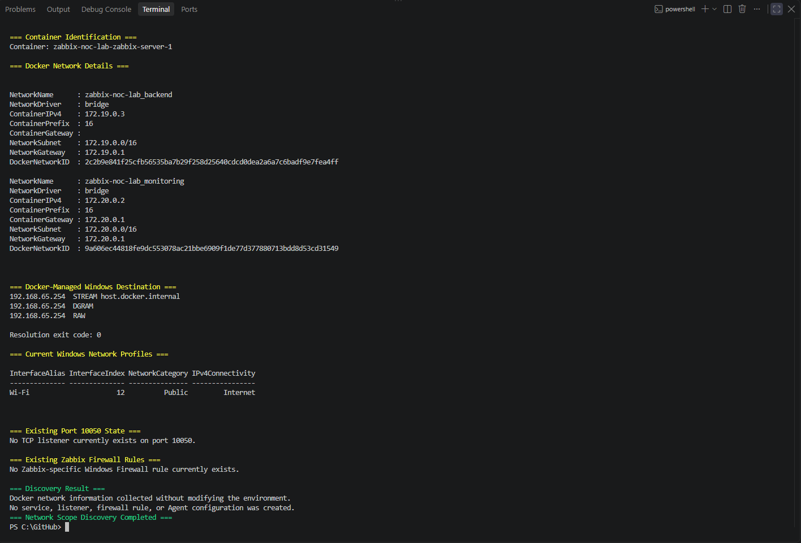
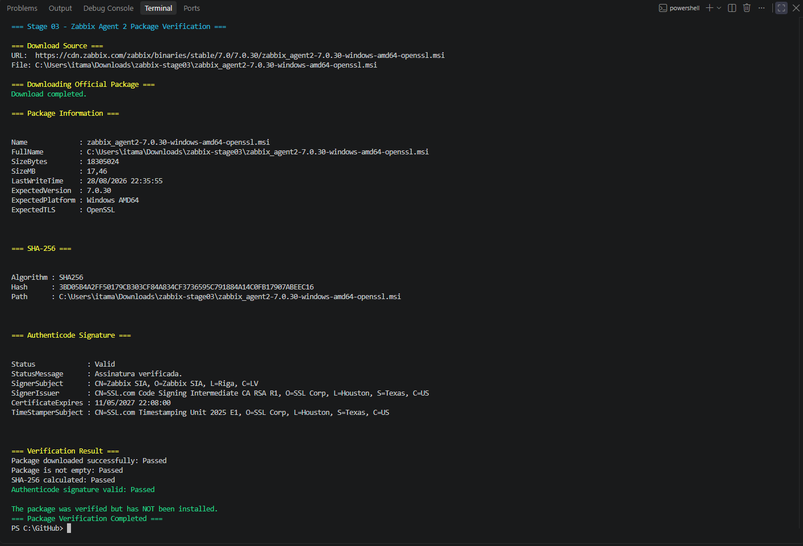
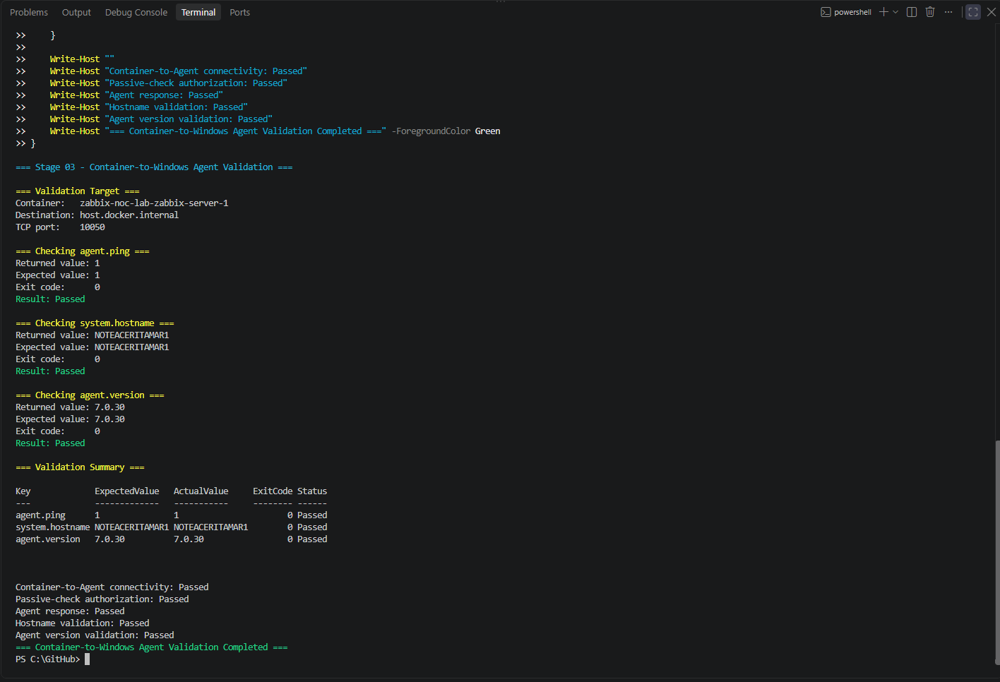
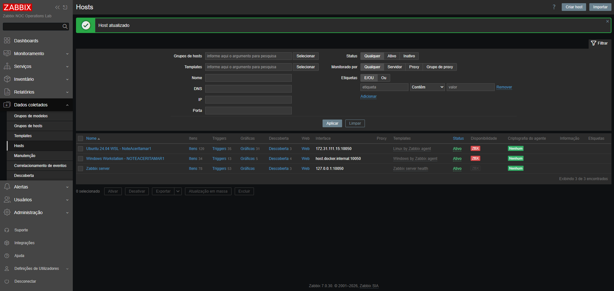
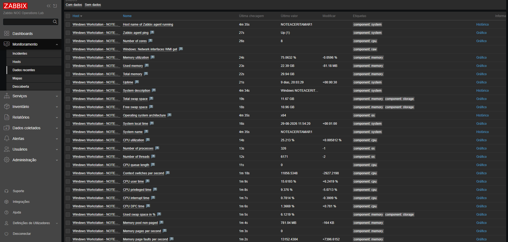
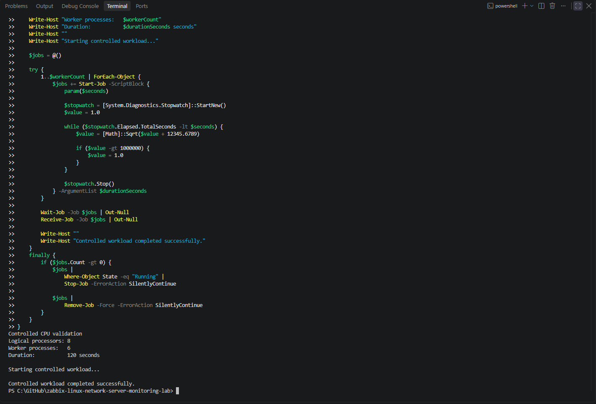
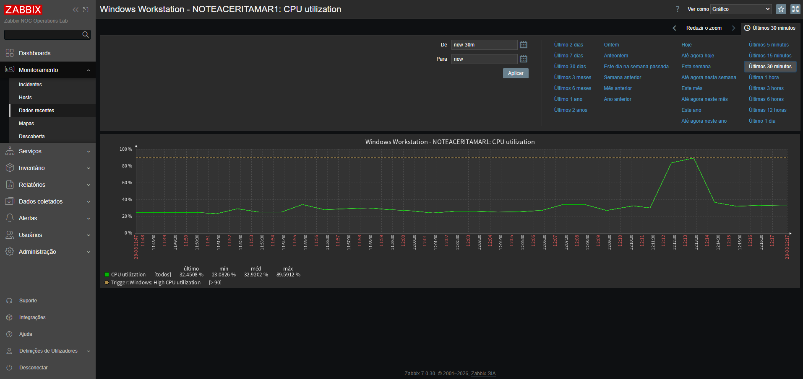

# Stage 03 — Monitoramento de host Windows

[English](README.md) | **Português (Brasil)**

[Voltar ao README principal](../../README.pt-BR.md)

## Visão geral

Esta etapa introduz o primeiro host Windows monitorado no Zabbix NOC Operations Lab.

O alvo de monitoramento é a estação de trabalho Windows 11 Pro que também hospeda o Docker Desktop, o WSL 2 e a plataforma Zabbix executada em contêineres.

O Zabbix Agent 2 é instalado como um serviço nativo do Windows e configurado para verificações passivas iniciadas pelo contêiner do Zabbix Server.

## Situação atual

**Concluída**

Os seguintes marcos foram concluídos:

- configuração inicial do host Windows registrada antes da instalação do Agent 2;
- conectividade IPv4 do contêiner para o Windows validada;
- destino preferencial para comunicação Docker–Windows identificado;
- escopo da rede Docker identificado e documentado;
- pacote oficial do Zabbix Agent 2 baixado e verificado;
- Zabbix Agent 2 instalado como serviço do Windows;
- configuração de verificações passivas aplicada e validada;
- regra restrita do Firewall do Windows criada;
- escuta na porta TCP `10050` validada;
- verificações diretas do contêiner Zabbix Server concluídas com sucesso;
- grupo de hosts Windows criado na interface web do Zabbix;
- host Windows cadastrado com interface do agente baseada em DNS;
- template `Windows by Zabbix agent` associado;
- disponibilidade do agente e coleta inicial de métricas validadas;
- descoberta de baixo nível preenchendo os recursos do Windows;
- atividade controlada de CPU gerada e observada;
- recuperação da CPU após a carga de trabalho controlada validada;
- evidências finais da etapa 03 selecionadas e armazenadas.

A implementação e a validação da etapa 03 estão concluídas.

## Configuração inicial do ambiente

| Componente | Valor validado |
|:---:|:---:|
| Sistema operacional | Microsoft Windows 11 Pro |
| Versão do sistema operacional | `10.0.26200` |
| Número do build | `26200` |
| Arquitetura | 64 bits |
| Nome do computador | `NOTEACERITAMAR1` |
| Fabricante | Acer |
| Modelo | Aspire A315-42G |
| Processador | AMD Ryzen 5 3500U with Radeon Vega Mobile Gfx |
| Processadores lógicos | `8` |
| Memória física | `29.94 GB` |
| Edição do PowerShell | Desktop |
| Versão do PowerShell | `5.1.26100.9168` |
| Agente instalado | Zabbix Agent 2 `7.0.30` |
| Porta do agente | `10050/TCP` |
| Modo de verificação | Passivo |

A última inicialização da estação de trabalho informada durante a validação inicial foi:

```text
19/08/2026 15:50:46
```

## Configuração inicial da rede

Foram identificadas duas interfaces IPv4 ativas:

| Interface | Endereço IPv4 | Gateway padrão |
|:---:|:---:|:---:|
| `vEthernet (WSL (Hyper-V firewall))` | `172.31.96.1` | Nenhum |
| `Wi-Fi` | `192.168.0.179` | `192.168.0.1` |

A interface virtual do WSL permite a comunicação entre o Windows e o ambiente WSL.

A interface Wi-Fi fornece conectividade à rede local e à internet.

## Validação IPv4 do Docker para o Windows

O contêiner do Zabbix Server foi identificado dinamicamente:

```powershell
$serverContainer = docker ps `
    --filter "label=com.docker.compose.service=zabbix-server" `
    --format "{{.Names}}" |
    Select-Object -First 1
```

O contêiner identificado foi:

```text
zabbix-noc-lab-zabbix-server-1
```

Seu estado de execução era:

```text
running
```

### Resolução interna do host pelo Docker

O nome do host gerenciado pelo Docker foi resolvido de dentro do contêiner do Zabbix Server:

```powershell
docker exec `
    $serverContainer `
    getent ahostsv4 host.docker.internal
```

Resultado IPv4 validado:

```text
192.168.65.254
```

O comando foi concluído com código de saída `0`.

Esse resultado confirma que o contêiner consegue resolver um destino IPv4 gerenciado pelo Docker que representa o host Windows.

### Conectividade pela interface virtual do WSL

A interface virtual do WSL foi testada a partir do contêiner do Zabbix Server:

```powershell
docker exec `
    $serverContainer `
    ping -c 2 172.31.96.1
```

Resultado validado:

```text
2 packets transmitted
2 packets received
0% packet loss
Average round-trip time: 2.557 ms
```

O comando foi concluído com código de saída `0`.

### Conectividade pela interface Wi-Fi

A interface Wi-Fi do Windows também foi testada:

```powershell
docker exec `
    $serverContainer `
    ping -c 2 192.168.0.179
```

Resultado validado:

```text
2 packets transmitted
2 packets received
0% packet loss
Average round-trip time: 2.683 ms
```

O comando foi concluído com código de saída `0`.

## Destino de monitoramento selecionado

Foram avaliados os três caminhos relevantes:

| Destino | Finalidade | Resultado |
|---|---|:---:|
| `host.docker.internal` | Destino Windows gerenciado pelo Docker | Resolvido para IPv4 |
| `172.31.96.1` | Interface virtual do WSL no Windows | Acessível |
| `192.168.0.179` | Interface Wi-Fi do Windows | Acessível |

O destino preferencial para as verificações do Agent 2 iniciadas pelo contêiner é:

```text
host.docker.internal
```

Esse nome é preferível à configuração direta de um endereço Wi-Fi ou WSL porque o Docker Desktop gerencia sua resolução.

Assim, a interface web do Zabbix pode utilizar uma interface do agente baseada em DNS, em vez de depender do endereço IPv4 físico ou virtual atual.

A porta TCP `10050` foi validada posteriormente por esse destino, após a instalação do Agent 2 e a configuração do Firewall do Windows.

## Identificação do escopo da rede Docker

O contêiner Zabbix Server está conectado a duas redes bridge do Docker:

| Rede Docker | IPv4 do contêiner | Prefixo | Sub-rede | Gateway |
|---|---|:---:|:---:|:---:|
| `zabbix-noc-lab_backend` | `172.19.0.3` | `16` | `172.19.0.0/16` | `172.19.0.1` |
| `zabbix-noc-lab_monitoring` | `172.20.0.2` | `16` | `172.20.0.0/16` | `172.20.0.1` |

O contêiner resolveu o destino Windows gerenciado pelo Docker como:

```text
host.docker.internal -> 192.168.65.254
```

A interface Wi-Fi do Windows utilizava o perfil de rede `Public` durante a descoberta.

O Docker Desktop pode traduzir o endereço de origem ao encaminhar uma conexão de um contêiner Linux para um serviço hospedado no Windows. Por isso, a autorização de verificações passivas inclui somente as faixas locais e relacionadas ao Docker observadas:

```text
127.0.0.1,172.19.0.0/16,172.20.0.0/16,192.168.65.0/24
```

Trata-se de um escopo controlado, e não de acesso irrestrito. As verificações diretas bem-sucedidas confirmaram que ele é compatível com o caminho atual do Docker Desktop e que poderá ser ainda mais restrito se futuras evidências de endereço de origem permitirem.

### Evidência do escopo de rede



A evidência registra as duas redes Docker, os endereços atuais do Zabbix Server, a resolução do Windows gerenciada pelo Docker, o perfil de rede do Windows e a ausência de um processo já escutando na porta TCP `10050` ou de uma regra de firewall específica do Zabbix.

## Estado anterior à instalação

A inspeção inicial confirmou:

| Verificação | Resultado |
|---|:---:|
| Serviço Zabbix existente no Windows | Não encontrado |
| Porta TCP `10050` já em uso | Não |
| Regra de Firewall do Windows específica do Zabbix | Não encontrada |
| Contêiner Zabbix Server disponível | Sim |
| Estado do contêiner Zabbix Server | Em execução |
| Resolução IPv4 de `host.docker.internal` | Aprovada |
| Conectividade ICMP com a interface WSL | Aprovada |
| Conectividade ICMP com a interface Wi-Fi | Aprovada |
| Caminho IPv4 do contêiner para o Windows | Aprovado |

Como nenhum serviço, listener ou regra de firewall do Zabbix existente foi encontrado, a estação de trabalho estava pronta para a instalação controlada do Agent 2, sem conflito com uma instalação anterior.

## Verificação do pacote oficial do Agent 2

O pacote oficial do Zabbix Agent 2 para Windows foi baixado diretamente da rede de distribuição de conteúdo do Zabbix:

```text
https://cdn.zabbix.com/zabbix/binaries/stable/7.0/7.0.30/zabbix_agent2-7.0.30-windows-amd64-openssl.msi
```

Informações validadas do pacote:

| Propriedade | Valor validado |
|---|---|
| Produto | Zabbix Agent 2 |
| Versão | `7.0.30` |
| Plataforma | Windows AMD64 |
| Implementação TLS | OpenSSL |
| Tipo de pacote | MSI |
| Tamanho do arquivo | `18,305,024 bytes` (`17.46 MB`) |
| SHA-256 | `3BD05B4A2FF50179CB303CF84A834CF3736595C791884A14C0FB17907ABEEC16` |
| Status Authenticode | Válido |
| Signatário | Zabbix SIA |
| Emissor do certificado | SSL.com Code Signing Intermediate CA RSA R1 |
| Validade do certificado até | `11/05/2027 22:08:00` |

O campo de identificação do signatário verificado foi:

```text
CN=Zabbix SIA, O=Zabbix SIA, L=Riga, C=LV
```

O resumo criptográfico SHA-256 fornece um identificador reproduzível para o pacote exato utilizado nesta etapa. A assinatura Authenticode válida confirma que o Windows reconheceu o pacote como assinado pela Zabbix SIA e que o conteúdo assinado passou pela verificação de integridade.

O pacote foi apenas baixado e inspecionado durante essa atividade de verificação. A instalação foi realizada posteriormente, como uma alteração controlada separada.

### Evidência da verificação



A evidência registra a URL oficial de download, os metadados do pacote, o resumo SHA-256, o status válido do Authenticode, a identidade do signatário e a confirmação explícita de que a instalação ainda não havia ocorrido.

## Instalação controlada do Agent 2

O MSI previamente verificado foi instalado silenciosamente com o Windows Installer após o recálculo de seu resumo SHA-256 e a confirmação de correspondência com o valor registrado.

Detalhes validados da instalação:

| Propriedade | Valor validado |
|---|---|
| Produto | Zabbix Agent 2 |
| Versão | `7.0.30` |
| Diretório de instalação | `C:\Program Files\Zabbix Agent 2` |
| Serviço do Windows | `Zabbix Agent 2` |
| Estado do serviço | Em execução |
| Arquivo de configuração | `C:\Program Files\Zabbix Agent 2\zabbix_agent2.conf` |
| Porta de verificação passiva | `10050/TCP` |
| Nome do host no agente | `NOTEACERITAMAR1` |
| Validação da configuração | Aprovada |

Antes de alterar a configuração gerada, o arquivo original foi preservado como:

```text
C:\Program Files\Zabbix Agent 2\zabbix_agent2.conf.pre-stage03-20260828-234136.bak
```

A configuração controlada para verificações passivas é:

```ini
Server=127.0.0.1,172.19.0.0/16,172.20.0.0/16,192.168.65.0/24
ServerActive=
Hostname=NOTEACERITAMAR1
ListenPort=10050
```

O teste de configuração do agente foi concluído com sucesso, com código de saída `0`, antes da inicialização do serviço.

## Configuração do Firewall do Windows

A instalação criou uma regra dedicada de entrada no Firewall do Windows:

| Propriedade | Valor validado |
|---|:---:|
| Nome de exibição | `Zabbix Agent 2 - Passive Checks` |
| Direção | Entrada |
| Ação | Permitir |
| Protocolo | TCP |
| Porta local | `10050` |
| Habilitada | Verdadeiro |
| Perfil | Qualquer |

O escopo dos endereços remotos permitidos está restrito a:

```text
172.19.0.0/16
172.20.0.0/16
192.168.65.0/24
```

A regra não permite que sistemas remotos arbitrários iniciem verificações passivas.

## Validação local do agente

Após a configuração, o serviço do Windows atingiu o estado `Running` e abriu a porta TCP `10050`.

O listener foi informado no endereço curinga IPv6, que também oferece o comportamento de socket necessário no Windows:

```text
State:        Listen
LocalAddress: ::
LocalPort:    10050
```

As verificações locais do agente retornaram:

| Verificação | Valor retornado | Código de saída | Resultado |
|---|:---:|:---:|:---:|
| `agent.ping` | `1` | `0` | Aprovado |
| `system.hostname` | `NOTEACERITAMAR1` | `0` | Aprovado |
| Versão do agente | `7.0.30` | `0` | Aprovado |

## Validação do agente do contêiner para o Windows

Verificações passivas diretas foram iniciadas pelo contêiner Zabbix Server por meio do destino gerenciado pelo Docker selecionado:

```text
host.docker.internal:10050
```

Os resultados validados foram:

| Chave do item | Valor esperado | Valor retornado | Código de saída | Resultado |
|---|:---:|:---:|:---:|:---:|
| `agent.ping` | `1` | `1` | `0` | Aprovado |
| `system.hostname` | `NOTEACERITAMAR1` | `NOTEACERITAMAR1` | `0` | Aprovado |
| `agent.version` | `7.0.30` | `7.0.30` | `0` | Aprovado |

Esses resultados confirmam que:

- a conectividade TCP entre Docker e Windows está operacional;
- a regra do Firewall do Windows permite o escopo de origem Docker documentado;
- o agente aceita verificações passivas do contêiner Zabbix Server;
- o nome de host configurado corresponde ao alvo Windows monitorado;
- a versão do agente em execução corresponde à do pacote verificado.

### Evidência da validação do serviço



A evidência registra as três verificações bem-sucedidas de `zabbix_get`, os valores esperados e retornados, os códigos de saída e o resultado final da validação do contêiner para o Windows.

## Cadastro na interface web do Zabbix

Foi criado um grupo de hosts dedicado aos alvos de monitoramento Windows:

```text
Windows servers
```

Em seguida, a estação de trabalho Windows foi cadastrada na interface web do Zabbix com a seguinte configuração:

| Propriedade | Valor configurado |
|---|---|
| Nome do host | `NOTEACERITAMAR1` |
| Nome visível | `Windows Workstation - NOTEACERITAMAR1` |
| Grupo de hosts | `Windows servers` |
| Template | `Windows by Zabbix agent` |
| Tipo de interface | Agent |
| Conectar por | DNS |
| Nome DNS | `host.docker.internal` |
| Porta | `10050` |
| Monitorado por | Server |
| Estado | Ativo |

A interface baseada em DNS preserva o destino Windows gerenciado pelo Docker, selecionado durante a validação de rede, e evita vincular a configuração do host ao endereço IPv4 atual da interface Wi-Fi ou do WSL.

Após a correção da configuração inicial baseada em IP para DNS, a interface web passou a exibi-la como:

```text
host.docker.internal:10050
```

O indicador de disponibilidade `ZBX` tornou-se ativo, confirmando comunicação bem-sucedida com o agente pela interface cadastrada.

### Evidência de disponibilidade do host



A evidência apresenta uma visualização reconhecível do Zabbix, com os alvos Windows e Linux cadastrados, suas interfaces, templates associados, estado ativo e disponibilidade dos agentes.

## Descoberta inicial e coleta de métricas

O template `Windows by Zabbix agent` iniciou a coleta e a descoberta de baixo nível após o cadastro do host.

O host Windows apresentou `146` valores monitorados na visualização filtrada de dados recentes. O escopo coletado e descoberto incluiu:

- disponibilidade e ping do agente;
- nome do host e descrição do sistema;
- arquitetura do sistema operacional e horário local;
- quantidade de processadores lógicos e utilização de CPU;
- fila da CPU, tempo de usuário, modo privilegiado, interrupções e DPC;
- memória física total e utilizada;
- capacidade e utilização da área de troca (*swap*);
- tempo de atividade do sistema;
- quantidade de processos e threads;
- sistemas de arquivos e volumes de disco;
- interfaces de rede;
- serviços do Windows.

Valores representativos validados:

| Item | Valor validado |
|---|---:|
| Ping do Zabbix Agent | `Up (1)` |
| Nome do host no agente | `NOTEACERITAMAR1` |
| Nome do sistema | `NOTEACERITAMAR1` |
| Arquitetura do sistema operacional | `x64` |
| Processadores lógicos | `8` |
| Memória total | `29.94 GB` |
| Memória utilizada | `22.39 GB` |
| Utilização da memória | `75.0632%` |
| Tempo de atividade | `9 days, 20:03:29` |
| Utilização da CPU no momento da captura | `25.213%` |
| Processos em execução | `326` |
| Threads | `6171` |

Os valores apresentavam horários recentes de verificação e continuavam mudando entre os ciclos de coleta, confirmando ingestão de métricas em tempo real, e não apenas configuração estática.

### Evidência dos dados recentes



A evidência registra o host monitorado, os nomes dos itens, os horários de verificação recentes, valores atuais, alterações dos valores, tags dos componentes e links para históricos ou gráficos.

## Validação controlada de CPU

Uma carga de trabalho PowerShell sem privilégios administrativos gerou atividade controlada de CPU, sem modificar configurações do sistema ou criar arquivos persistentes.

A carga de trabalho utilizou seis processos em segundo plano (*workers*), representando aproximadamente `75%` dos oito processadores lógicos, durante `120` segundos:

```powershell
& {
    $ErrorActionPreference = "Stop"

    $durationSeconds = 120
    $logicalProcessors = [Environment]::ProcessorCount
    $workerCount = [Math]::Max(
        1,
        [Math]::Ceiling($logicalProcessors * 0.75)
    )

    Write-Host "Controlled CPU validation"
    Write-Host "Logical processors: $logicalProcessors"
    Write-Host "Worker processes:   $workerCount"
    Write-Host "Duration:           $durationSeconds seconds"
    Write-Host ""
    Write-Host "Starting controlled workload..."

    $jobs = @()

    try {
        1..$workerCount | ForEach-Object {
            $jobs += Start-Job -ScriptBlock {
                param($seconds)

                $stopwatch = [System.Diagnostics.Stopwatch]::StartNew()
                $value = 1.0

                while ($stopwatch.Elapsed.TotalSeconds -lt $seconds) {
                    $value = [Math]::Sqrt($value + 12345.6789)

                    if ($value -gt 1000000) {
                        $value = 1.0
                    }
                }

                $stopwatch.Stop()
            } -ArgumentList $durationSeconds
        }

        Wait-Job -Job $jobs | Out-Null
        Receive-Job -Job $jobs | Out-Null

        Write-Host ""
        Write-Host "Controlled workload completed successfully."
    }
    finally {
        if ($jobs.Count -gt 0) {
            $jobs |
                Where-Object State -eq "Running" |
                Stop-Job -ErrorAction SilentlyContinue

            $jobs |
                Remove-Job -Force -ErrorAction SilentlyContinue
        }
    }
}
```

A carga de trabalho terminou com sucesso e removeu seus jobs em segundo plano.

### Evidência da carga de trabalho controlada



A evidência registra a quantidade de processadores lógicos, o número selecionado de workers, a duração, a conclusão bem-sucedida e o retorno ao prompt do PowerShell.

### Resposta do monitoramento e recuperação

O Zabbix registrou o ciclo completo de alteração dos recursos:

| Medição | Valor observado |
|---|---:|
| Intervalo normal antes da carga de trabalho | Aproximadamente `23%` a `34%` |
| Utilização máxima de CPU | `89.5912%` |
| Limite do template para CPU elevada | Maior que `90%` |
| Utilização de CPU após a recuperação da carga de trabalho | `36.6596%` |

A carga de trabalho se aproximou do limite da *trigger* de CPU elevada do template, mas não o ultrapassou. Isso foi intencional na etapa 03: a atividade validou a resposta das métricas e a recuperação sem criar deliberadamente um incidente. A ativação de *triggers* e o tratamento de incidentes fazem parte das etapas posteriores de alertas e resposta a incidentes.

### Evidência da resposta da CPU



O gráfico mostra a referência inicial estável, o aumento rápido da utilização, o máximo registrado, o limite configurado da *trigger*, o término da carga de trabalho e o retorno em direção ao intervalo anterior ao teste.

## Comandos de validação inicial

A validação inicial do Windows inspecionou:

- identidade e versão do sistema operacional;
- fabricante e modelo do computador;
- processador e memória;
- versão do PowerShell;
- interfaces IPv4 ativas;
- serviços Zabbix existentes;
- porta TCP `10050`;
- regras do Firewall do Windows;
- disponibilidade do contêiner Zabbix Server;
- resolução de `host.docker.internal` pelo Docker;
- conectividade do contêiner com as interfaces virtuais e físicas do Windows.

A validação inicial e os testes de conectividade não:

- instalaram software;
- criaram ou modificaram serviços;
- criaram regras de firewall;
- abriram portas de rede;
- alteraram a configuração do Zabbix;
- modificaram a rede do Docker ou do WSL.

## Diagnóstico e resolução de problemas

### PowerShell rejeitou blocos `else` separados

Durante a execução interativa, alguns blocos `else` retornaram:

```text
The term 'else' is not recognized as the name of a cmdlet,
function, script file, or operable program.
```

Os blocos `if` anteriores já haviam sido enviados e executados antes de os `else` correspondentes serem colados.

No PowerShell, `if` e `else` devem ser interpretados como partes da mesma instrução composta:

```powershell
if ($condition) {
    Write-Host "Condition is true."
}
else {
    Write-Host "Condition is false."
}
```

O problema de sintaxe não instalou software nem modificou a estação de trabalho.

A ausência de saída das verificações `if` concluídas, juntamente com as mensagens de erro dos `else` isolados, indicou que:

- nenhum serviço Zabbix foi encontrado;
- nenhum processo escutando na porta TCP `10050` foi encontrado;
- nenhuma regra de firewall específica do Zabbix foi encontrada.

Os futuros blocos de validação interativa evitarão separar as instruções `if` e `else`.

### O contêiner não incluía o utilitário `ip`

Uma tentativa de exibir a tabela de roteamento IPv4 do contêiner retornou:

```text
exec: "ip": executable file not found in $PATH
```

A imagem do contêiner Zabbix Server não inclui o utilitário de linha de comando `ip`.

Nenhum pacote foi instalado dentro do contêiner, pois contêineres em execução devem permanecer consistentes com a imagem declarada.

A ausência do utilitário de diagnóstico não indicava falha de conectividade. Posteriormente, as verificações de resolução de nomes IPv4 e ICMP foram bem-sucedidas.

### Continuação da configuração após interrupção do fluxo de instalação

A instalação do MSI terminou com sucesso, mas a primeira função de edição da configuração foi interrompida quando o PowerShell tentou associar conteúdo de configuração contendo linhas vazias a um parâmetro obrigatório do tipo matriz de strings.

A interrupção ocorreu após a instalação e o backup da configuração original, mas antes da criação da regra de firewall ou da conclusão da validação do serviço.

Uma avaliação do estado confirmou os componentes instalados, e o fluxo continuou sem reinstalar o MSI. A rotina corrigida de configuração preservou as linhas vazias com segurança, removeu definições conflitantes de chaves, acrescentou os valores controlados e validou a configuração resultante antes de iniciar o serviço.

Essa recuperação evitou a duplicação da instalação e preservou o backup da configuração original.

## Considerações de segurança

A configuração do Windows Agent 2 segue estes controles:

- utilizar o pacote oficial do Zabbix;
- validar o pacote baixado antes da instalação;
- autorizar somente a origem de monitoramento necessária;
- evitar acesso irrestrito às verificações passivas;
- criar uma regra de entrada de firewall com escopo restrito;
- evitar a publicação de credenciais ou material privado de autenticação;
- preservar a configuração original do Agent 2 antes das alterações;
- revisar todas as evidências de diagnóstico antes dos commits.

Os controles de verificação do pacote concluídos antes da instalação foram:

- baixar por HTTPS do domínio oficial de distribuição do Zabbix;
- confirmar a versão, a arquitetura e o tipo de pacote esperados;
- rejeitar download vazio;
- calcular e registrar o resumo SHA-256;
- exigir uma assinatura Authenticode válida do Windows;
- confirmar a Zabbix SIA como organização signatária;
- encerrar a atividade antes da instalação, mantendo a implantação como uma alteração controlada separada.

A autorização `Server` do agente é:

```text
127.0.0.1,172.19.0.0/16,172.20.0.0/16,192.168.65.0/24
```

A regra do Firewall do Windows utiliza o escopo necessário de endereços remotos relacionados ao Docker, em vez de permitir acesso de sistemas remotos arbitrários. As verificações diretas bem-sucedidas confirmaram que o escopo atual permite o caminho do Docker Desktop sem acesso irrestrito.

## Critérios de aceitação

| Critério | Estado |
|---|:---:|
| Configuração inicial do host Windows coletada | Aprovado |
| Instalação existente do Zabbix verificada | Aprovado |
| Disponibilidade da porta TCP `10050` verificada | Aprovado |
| Regras de firewall existentes verificadas | Aprovado |
| Contêiner do Zabbix Server identificado | Aprovado |
| Resolução IPv4 de `host.docker.internal` validada | Aprovado |
| Conectividade do contêiner com a interface WSL validada | Aprovado |
| Conectividade do contêiner com a interface Wi-Fi validada | Aprovado |
| Conectividade IPv4 do contêiner com o Windows validada | Aprovado |
| Rede backend do Docker identificada | Aprovado |
| Rede de monitoramento do Docker identificada | Aprovado |
| Escopo inicial de autorização das verificações passivas definido | Aprovado |
| Pacote oficial do Zabbix Agent 2 obtido | Aprovado |
| SHA-256 do pacote registrado | Aprovado |
| Assinatura Authenticode do pacote validada | Aprovado |
| Signatário do pacote identificado como Zabbix SIA | Aprovado |
| Autenticidade do pacote validada | Aprovado |
| Zabbix Agent 2 instalado | Aprovado |
| Serviço do Windows ativo | Aprovado |
| Configuração das verificações passivas validada | Aprovado |
| Regra do Firewall do Windows configurada | Aprovado |
| Porta TCP `10050` em estado de escuta | Aprovado |
| Verificações passivas diretas bem-sucedidas | Aprovado |
| Grupo de hosts Windows criado | Aprovado |
| Host Windows cadastrado no Zabbix | Aprovado |
| Interface de agente baseada em DNS configurada | Aprovado |
| Template Windows associado | Aprovado |
| Disponibilidade do agente confirmada | Aprovado |
| Descoberta inicial de itens concluída | Aprovado |
| Coleta inicial de métricas confirmada | Aprovado |
| Atividade controlada de CPU concluída | Aprovado |
| Resposta da CPU observada no Zabbix | Aprovado |
| Recuperação após a carga de trabalho confirmada | Aprovado |
| Evidências finais da etapa 03 selecionadas | Aprovado |

## Resultado atual

A configuração inicial da estação de trabalho Windows, a validação IPv4 do Docker para o Windows, a identificação do escopo das redes Docker, a verificação do pacote oficial do Agent 2, a instalação controlada, a validação direta das verificações passivas, o cadastro na interface web, a descoberta inicial, a coleta de métricas, a validação controlada de CPU e a confirmação da recuperação estão concluídas.

O alvo é um sistema Windows 11 Pro de 64 bits que agora executa o Zabbix Agent 2 `7.0.30` como serviço nativo do Windows.

O contêiner Zabbix Server conseguiu:

- resolver `host.docker.internal` para `192.168.65.254`;
- alcançar a interface virtual WSL do Windows em `172.31.96.1`;
- alcançar a interface Wi-Fi do Windows em `192.168.0.179`;
- concluir os dois testes ICMP sem perda de pacotes.

O destino preferencial para o monitoramento é `host.docker.internal`.

O Zabbix Server utilizava `172.19.0.3` na rede backend e `172.20.0.2` na rede de monitoramento. A autorização do agente contempla a tradução de endereços do Docker Desktop por `192.168.65.0/24` e a validação local por `127.0.0.1`.

O MSI oficial do Zabbix Agent 2 `7.0.30` para Windows AMD64 com OpenSSL foi baixado da rede de distribuição de conteúdo do Zabbix. Seu resumo SHA-256 foi registrado e o Windows informou uma assinatura Authenticode válida da Zabbix SIA.

A configuração original do agente foi preservada, a configuração das verificações passivas passou na validação, a regra restrita de firewall foi criada e a porta TCP `10050` está em estado de escuta. As verificações diretas do contêiner Zabbix Server retornaram `1`, `NOTEACERITAMAR1` e `7.0.30` para `agent.ping`, `system.hostname` e `agent.version`, respectivamente.

O host Windows está cadastrado no grupo `Windows servers` como `Windows Workstation - NOTEACERITAMAR1`. Utiliza `host.docker.internal:10050` como interface do agente baseada em DNS e o template `Windows by Zabbix agent`.

A interface web confirmou a disponibilidade do agente e apresentou `146` valores monitorados após a descoberta inicial. Os dados em tempo real incluíram estado do agente, CPU, memória, swap, tempo de atividade, processos, threads, discos, sistemas de arquivos, interfaces de rede e serviços do Windows.

Uma carga controlada de CPU durante dois minutos utilizou seis dos oito processadores lógicos da estação de trabalho. O Zabbix registrou aumento da utilização do intervalo normal para `89.5912%` e, depois, redução para `36.6596%` após o fim da carga. O caminho de monitoramento permaneceu disponível durante todo o teste.

Os critérios de aceitação da etapa 03 foram atendidos.

## Próximas etapas

A próxima etapa introduzirá o monitoramento de rede, DNS, TCP e serviços HTTP, preservando os caminhos de monitoramento validados dos agentes Linux e Windows.
