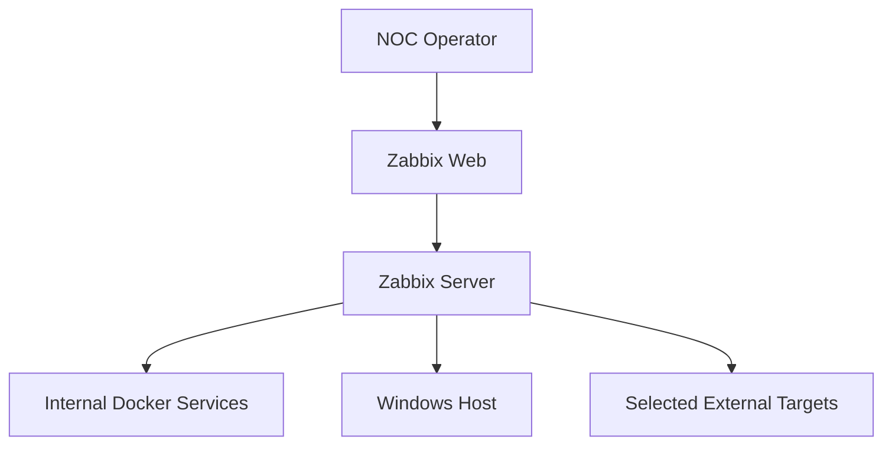
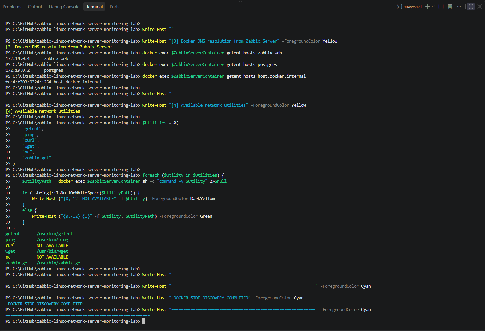
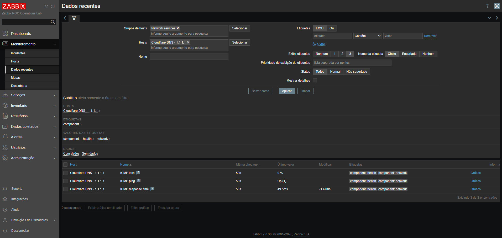
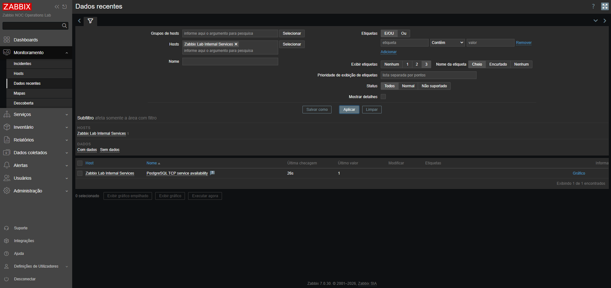
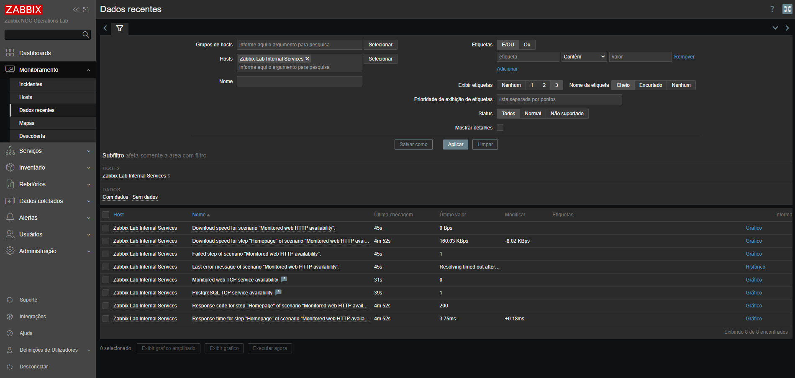
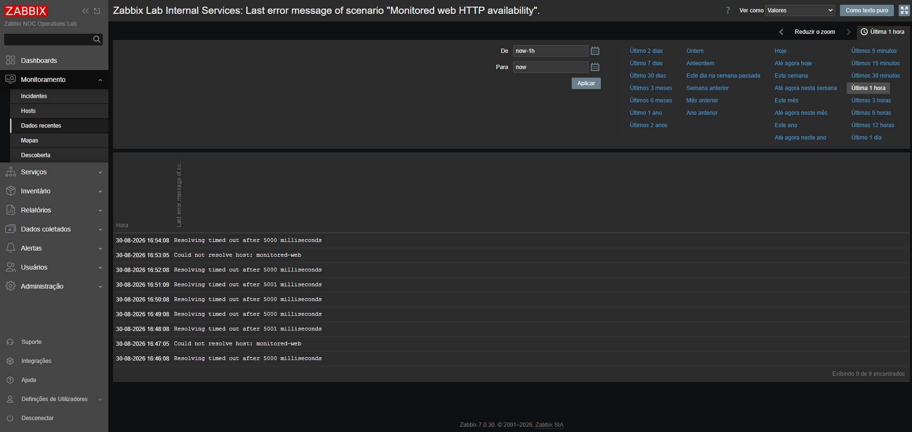
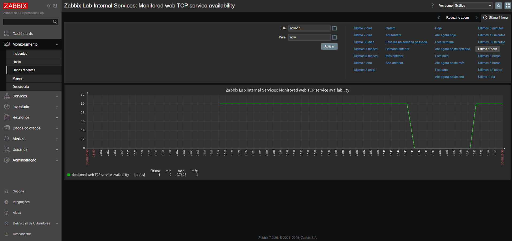
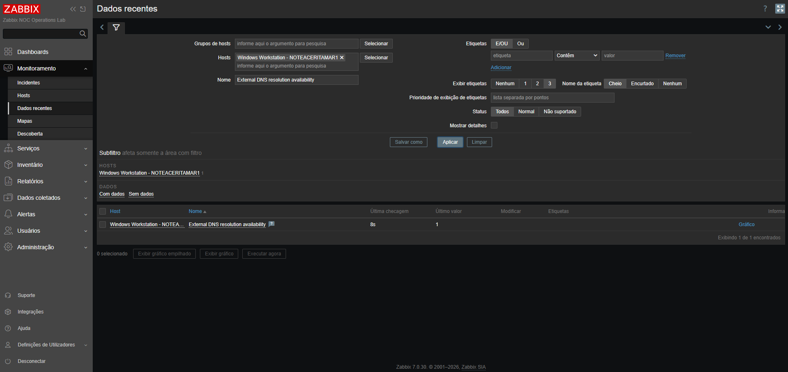

# Stage 04 — Monitoramento de rede, DNS, TCP e serviços HTTP

[English](README.md) | **Português (Brasil)**

[Voltar ao README principal](../../README.pt-BR.md)

## Objetivo

Neste laboratório, o Zabbix Server e o Zabbix Agent 2 acompanham a conectividade de rede e a disponibilidade dos serviços por meio de verificações nativas.

O exercício abrange:

- acessibilidade por ICMP;
- tempo de resposta ICMP e perda de pacotes;
- resolução DNS;
- disponibilidade de serviços TCP;
- disponibilidade de serviços HTTP;
- códigos de resposta HTTP;
- tempo de resposta HTTP;
- falha controlada de serviço;
- alterações no estado do monitoramento durante a falha e a recuperação.

Esta etapa amplia o monitoramento de hosts concluído nas etapas 02 e 03 com verificações de disponibilidade orientadas a serviços, comumente realizadas pelas equipes de Centros de Operações de Rede (NOC).

## Situação registrada

A etapa 04 está concluída.

As verificações iniciais de conectividade e as atividades de monitoramento nativo de ICMP, DNS, TCP e HTTP foram concluídas.

As verificações registradas mostraram:

- disponibilidade local do Zabbix Web na porta TCP `8080`;
- disponibilidade local do Zabbix Server na porta TCP `10051`;
- disponibilidade local do Windows Agent 2 na porta TCP `10050`;
- resposta HTTP bem-sucedida da interface web local do Zabbix;
- funcionamento da resolução DNS pública;
- funcionamento da conectividade ICMP local e externa;
- resolução DNS do Docker a partir do contêiner Zabbix Server;
- acesso a serviços internos do Docker por nomes de serviço estáveis;
- coleta de disponibilidade, perda de pacotes e tempo de resposta por ICMP para `1.1.1.1`;
- monitoramento da resolução DNS externa a partir do host Windows pelo DNS da Cloudflare;
- monitoramento da disponibilidade TCP do PostgreSQL e do alvo HTTP dedicado;
- coleta de disponibilidade HTTP, código de resposta, tempo de resposta e velocidade de download;
- interrupção controlada do serviço HTTP;
- alterações no estado do monitoramento durante a falha;
- recuperação bem-sucedida do serviço com uma transição TCP `1 -> 0 -> 1` registrada;
- preservação do PostgreSQL e da plataforma Zabbix durante toda a falha controlada;
- armazenamento das evidências selecionadas de validação, falha e recuperação.

## Arquitetura de monitoramento



O Zabbix Server realiza as verificações de ICMP, TCP e HTTP sem a necessidade de agentes nos alvos. O Zabbix Agent 2 no host Windows realiza a consulta DNS externa dedicada.

Os serviços internos são acessados por nomes DNS do Docker, e não por endereços IP temporários dos contêineres.

## Alvos de monitoramento

| Área de monitoramento | Alvo | Finalidade da validação | Estado |
|:---:|:---:|:---:|:---:|
| ICMP | `1.1.1.1` | Acessibilidade externa sem dependência de DNS | Concluído |
| Perda de pacotes ICMP | `1.1.1.1` | Coleta de perda de pacotes | Concluído |
| Tempo de resposta ICMP | `1.1.1.1` | Coleta de latência | Concluído |
| DNS interno | `monitored-web` | Resolução do nome do serviço Docker dedicado | Validação inicial concluída |
| TCP interno | `postgres:5432` | Disponibilidade da porta de serviço do PostgreSQL | Concluído |
| TCP interno | `monitored-web:80` | Disponibilidade da porta do alvo HTTP dedicado | Concluído |
| HTTP interno | `http://monitored-web/` | Validação de conteúdo, código de status e tempo de resposta HTTP | Concluído |
| DNS externo | `1.1.1.1` resolvendo `example.com` | Disponibilidade da resolução DNS dedicada | Concluído |

## Validação inicial da conectividade no Windows

A validação inicial foi executada a partir da estação de trabalho Windows.

### Resultados TCP

| Serviço | Destino | Resultado |
|:---:|:---:|:---:|
| Zabbix Web | `127.0.0.1:8080` | Acessível |
| Zabbix Server | `127.0.0.1:10051` | Acessível |
| Windows Agent 2 | `127.0.0.1:10050` | Acessível |

### Resultado HTTP

A interface web local do Zabbix retornou:

```text
URL=http://127.0.0.1:8080/
StatusCode=200
ContentLength=5224
```

Esse resultado confirmou que a porta publicada da interface web estava disponível e fornecia conteúdo HTTP antes da configuração do monitoramento web nativo do Zabbix.

### Resultados de DNS público

A resolução pública de nomes foi bem-sucedida para:

- `example.com`;
- `cloudflare.com`.

O host Windows não conseguiu resolver `host.docker.internal` durante esse teste. Isso não indica falha de monitoramento, pois o nome destina-se principalmente à comunicação dos contêineres com o host.

A resolução foi posteriormente confirmada a partir do contêiner do Zabbix Server.

### Resultados ICMP

| Alvo | Resultado |
|:---:|:---:|
| `127.0.0.1` | Acessível |
| `1.1.1.1` | Acessível |
| `example.com` | Acessível |

Os resultados confirmaram a conectividade ICMP local e externa antes da criação dos itens de monitoramento.

## Identificação da conectividade no Docker

O contêiner ativo do Zabbix Server foi identificado como:

```text
zabbix-noc-lab-zabbix-server-1
```

### Conexões com redes

| Rede Docker | Endereço do Zabbix Server |
|---|:---:|
| `zabbix-noc-lab_backend` | `172.19.0.3` |
| `zabbix-noc-lab_monitoring` | `172.20.0.2` |

A conexão com duas redes permite que o Zabbix Server se comunique com os serviços da plataforma pela rede de backend e com os sistemas monitorados pela rede de monitoramento.

Os endereços documentam apenas o estado no momento da descoberta. A configuração do monitoramento utiliza nomes DNS sempre que possível, evitando a dependência desses endereços temporários.

### Resolução DNS do Docker

O Zabbix Server resolveu com sucesso:

```text
zabbix-web           -> 172.19.0.4
postgres             -> 172.19.0.2
host.docker.internal -> fdc4:f303:9324::254
monitored-web        -> 172.20.0.3
```

Essa validação confirma que o servidor pode acessar:

- a interface web do Zabbix;
- o serviço PostgreSQL;
- o host Windows;
- o serviço HTTP dedicado monitorado;
- por meio dos nomes estáveis disponíveis em seu ambiente de execução.

## Utilitários de diagnóstico disponíveis

A imagem do Zabbix Server contém os seguintes utilitários:

| Utilitário | Disponibilidade | Finalidade |
|:---:|:---:|:---:|
| `getent` | Disponível | Validação de DNS e resolução de nomes |
| `ping` | Disponível | Validação de conectividade ICMP |
| `wget` | Disponível | Validação HTTP complementar |
| `zabbix_get` | Disponível | Verificações diretas do Zabbix Agent |
| `curl` | Indisponível | Não necessário ao monitoramento nativo do Zabbix |
| `nc` | Indisponível | Não necessário ao monitoramento nativo do Zabbix |

A ausência de `curl` e `nc` não impediu a realização da etapa. As verificações simples (*simple checks*) e os cenários web do Zabbix forneceram o monitoramento nativo de TCP e HTTP.

## Implementação do monitoramento nativo

### Monitoramento ICMP

O host `Cloudflare DNS - 1.1.1.1` foi criado no grupo de hosts `Network services` e associado ao template `ICMP Ping`.

O template coleta:

- disponibilidade por ICMP;
- perda de pacotes ICMP;
- tempo de resposta ICMP.

A validação em estado normal confirmou:

- disponibilidade ICMP com valor `1`;
- perda de pacotes ICMP de `0%`;
- coleta do tempo de resposta ICMP pelo item nativo `icmppingsec`, que retorna valores em segundos.

Na captura preservada da tela de Dados recentes do Zabbix, o item **ICMP response time** apresentou `49.5 ms` (aproximadamente `0.0495 s`). Os milissegundos representam o valor exibido na interface, enquanto o item nativo retorna segundos. A captura não permite confirmar independentemente o valor bruto exato armazenado nem o conteúdo do campo *Units* configurado para o item.

### Monitoramento de resolução DNS externa

O item `External DNS resolution availability` foi criado no host `Windows Workstation - NOTEACERITAMAR1` e coletado pelo Zabbix Agent 2.

| Configuração | Valor |
|:---:|:---:|
| Tipo de item | Zabbix agent |
| Chave | `net.dns[1.1.1.1,example.com,A,2,1,udp]` |
| Servidor DNS | `1.1.1.1` |
| Nome consultado | `example.com` |
| Tipo de registro | `A` |
| Transporte | UDP |
| Intervalo de atualização | `1m` |
| Valor normal | `1` |

O item valida se o DNS da Cloudflare consegue resolver o registro A solicitado a partir do host Windows monitorado. O teste direto do item retornou `1` e as coletas periódicas posteriores permaneceram em `1`, confirmando a disponibilidade reproduzível da resolução DNS.

### Monitoramento TCP interno

O host `Zabbix Lab Internal Services` foi criado para representar os serviços acessados diretamente pelo Zabbix Server pela rede Docker.

Foram configuradas as seguintes verificações simples:

| Item | Chave | Valor normal |
|:---:|:---:|:---:|
| Disponibilidade do serviço TCP do PostgreSQL | `net.tcp.service[tcp,postgres,5432]` | `1` |
| Disponibilidade do serviço TCP da aplicação web monitorada | `net.tcp.service[tcp,monitored-web,80]` | `1` |

O item do PostgreSQL confirma a acessibilidade à porta do banco de dados sem interromper ou modificar o banco utilizado pelo Zabbix.

### Alvo HTTP dedicado ao monitoramento

Um serviço Nginx dedicado, denominado `monitored-web`, foi adicionado ao ambiente Docker Compose.

O serviço:

- utiliza a imagem `nginx:1.28.0-alpine`;
- conecta-se apenas à rede de monitoramento;
- expõe a porta TCP `80` internamente;
- inclui uma verificação de integridade (*health check*) do contêiner;
- não é publicado diretamente no host Windows;
- pode ser interrompido com segurança sem afetar o Zabbix ou o PostgreSQL.

A resolução DNS do Docker e a conectividade HTTP foram validadas a partir do contêiner Zabbix Server antes da criação das verificações nativas.

### Cenário web HTTP

O cenário web `Monitored web HTTP availability` contém uma etapa denominada `Homepage`.

| Configuração | Valor |
|:---:|:---:|
| URL | `http://monitored-web/` |
| Intervalo de atualização | `1m` |
| Tentativas | `1` |
| Tempo limite | `5s` |
| Texto obrigatório | `Welcome to nginx!` |
| Status HTTP obrigatório | `200` |

O cenário coleta:

- velocidade de download do cenário;
- velocidade de download da etapa;
- status da etapa com falha;
- última mensagem de erro;
- código de resposta HTTP;
- tempo de resposta HTTP.

A coleta em estado normal confirmou etapa com falha `0`, código de resposta HTTP `200`, disponibilidade TCP `1` e métricas ativas de tempo de resposta e velocidade de download.

## Falha controlada e recuperação

O alvo HTTP dedicado foi interrompido com o Docker Compose enquanto o Zabbix Server, Zabbix Web, PostgreSQL, host Linux e host Windows permaneceram operacionais.

A falha controlada produziu as seguintes alterações de monitoramento:

| Sinal | Estado normal | Estado de falha | Estado recuperado |
|:---:|:---:|:---:|:---:|
| Disponibilidade TCP da aplicação web monitorada | `1` | `0` | `1` |
| Etapa com falha no cenário web | `0` | `1` | `0` |
| Velocidade de download do cenário | Coletada | `0 Bps` | Coletada |
| Código de resposta HTTP | `200` | Nenhuma nova resposta bem-sucedida | `200` |
| Disponibilidade TCP do PostgreSQL | `1` | `1` | `1` |

Durante a indisponibilidade, o cenário web registrou mensagens como:

```text
Could not resolve host: monitored-web
Resolving timed out after 5000 milliseconds
```

Esse comportamento é esperado, pois um contêiner Compose interrompido é desconectado de sua rede Docker e seu nome de serviço é temporariamente removido do DNS do Docker.

Após `monitored-web` ser iniciado novamente, o registro no DNS do Docker retornou, o cenário HTTP retomou a coleta bem-sucedida e o gráfico TCP registrou a transição completa `1 -> 0 -> 1`.

O item de último erro preserva o erro registrado mais recentemente após a recuperação. Portanto, a recuperação é confirmada pelo retorno do valor da etapa com falha para `0`, da disponibilidade TCP para `1`, do status HTTP para `200` e pela retomada da coleta de tempo de resposta e velocidade de download.

### Reprodução da falha controlada (execuções futuras)

**Reprodução da falha controlada de serviço:** Os comandos abaixo apresentam um procedimento restrito ao serviço de teste para futuras reproduções do experimento original do Stage 04. Execute-os a partir da raiz do repositório, no PowerShell do Windows, utilizando o arquivo `.env` operacional existente e o projeto Docker Compose correto. São comandos de referência compatíveis com o `compose.yaml` atual, não um registro dos comandos efetivamente executados no Stage 04. Nenhum resultado de uma nova execução desses comandos é apresentado aqui.

**Pré-requisitos e cuidados:** Utilize somente um laboratório isolado. Confirme que o arquivo `.env` pertence ao mesmo projeto e que os serviços `monitored-web`, `postgres`, `zabbix-server` e `zabbix-web` estão em execução. Mantenha o `.env` operacional privado; não o substitua pelo `.env.example`, não exiba segredos e não utilize comandos de encerramento de todo o projeto, como `docker compose down`. Interrompa o procedimento se o projeto, o serviço-alvo ou o estado inicial esperado não corresponder à documentação.

```powershell
# Validar a configuração Compose existente (sem exibir segredos)
docker compose --env-file .env -f compose.yaml config --quiet

# Conferir o projeto existente e o estado de todos os serviços
docker compose --env-file .env -f compose.yaml ps --all
```

Após confirmar o projeto correto, a resposta HTTP inicial `200`, a disponibilidade TCP `1` do `monitored-web` e a disponibilidade TCP `1` do PostgreSQL no Zabbix, interrompa **somente** o serviço HTTP de teste:

```powershell
# Injetar falha isolada apenas no alvo HTTP dedicado
docker compose --env-file .env -f compose.yaml stop monitored-web

# Confirmar o alvo interrompido e a plataforma de monitoramento ativa
docker compose --env-file .env -f compose.yaml ps --all monitored-web
docker compose --env-file .env -f compose.yaml ps postgres zabbix-server zabbix-web
```

Acompanhe pelo menos um ciclo subsequente de coleta do Zabbix e confirme os sinais de falha do serviço. Não interrompa `postgres`, `zabbix-server`, `zabbix-web` nem o projeto Compose completo. Restaure o contêiner existente logo após a observação controlada:

```powershell
# Restaurar o contêiner monitored-web existente, sem recriá-lo
docker compose --env-file .env -f compose.yaml start monitored-web

# Verificar o alvo e os serviços essenciais de monitoramento
docker compose --env-file .env -f compose.yaml ps monitored-web
docker compose --env-file .env -f compose.yaml ps postgres zabbix-server zabbix-web
```

**Verificações de recuperação:** No Zabbix, confirme que a disponibilidade TCP do `monitored-web` retorna a `1`, a etapa com falha no cenário web retorna a `0`, uma nova resposta HTTP bem-sucedida `200` é coletada e a coleta de tempo de resposta e velocidade de download é retomada. A disponibilidade TCP do PostgreSQL deve permanecer em `1` durante todas as fases. O item de último erro pode preservar a mensagem anterior após a recuperação e, por isso, não deve ser utilizado isoladamente para determinar a disponibilidade atual. Se o `monitored-web` não reiniciar ou o monitoramento não se recuperar, investigue o serviço isolado em vez de aplicar alterações abrangentes no Compose. Os resultados de futuras execuções podem diferir das evidências históricas `1 -> 0 -> 1`.


## Estratégia de monitoramento

A etapa 04 utiliza recursos nativos do Zabbix sempre que possível.

| Requisito | Método do Zabbix | Estado |
|:---:|:---:|:---:|
| Disponibilidade ICMP | Template ICMP Ping | Concluído |
| Perda de pacotes | `icmppingloss` | Concluído |
| Tempo de resposta | `icmppingsec` | Concluído |
| Resolução DNS | Item `net.dns` do Zabbix Agent 2 | Concluído |
| Disponibilidade de serviços TCP | `net.tcp.service` | Concluído |
| Disponibilidade HTTP | Cenário web | Concluído |
| Código de resposta HTTP | Validação do código de resposta no cenário web | Concluído |
| Tempo de resposta HTTP | Métrica de tempo de resposta do cenário web | Concluído |
| Validação da falha | Interrupção controlada de `monitored-web` | Concluído |
| Validação da recuperação | Restauração do serviço e confirmação pelas métricas | Concluído |

A etapa 05 utilizou posteriormente essas mudanças de disponibilidade para implementar *triggers*, classificação de severidade, reconhecimento e ciclos completos de tratamento de incidentes. A etapa 04 permanece como referência inicial do monitoramento que validou os sinais subjacentes dos serviços.

## Notas de diagnóstico e resolução de problemas

### Ausência do arquivo operacional de ambiente

Inicialmente, o Docker Compose rejeitou o novo serviço porque o arquivo operacional `.env` estava ausente. O arquivo é intencionalmente excluído do Git e, portanto, não foi restaurado pela sincronização do repositório.

O arquivo operacional foi reconstruído a partir de `.env.example`. A senha existente do PostgreSQL foi recuperada do contêiner PostgreSQL em execução sem ser exibida, e o `.env` reconstruído permaneceu excluído pelo `.gitignore`.

A validação passou, então, com:

```text
docker compose --env-file .env config --quiet
```

### Limitações dos utilitários de diagnóstico

A imagem do Zabbix Server não inclui `curl` nem `nc`. As verificações simples e os cenários web nativos do Zabbix foram usados para monitoramento, enquanto `wget`, `getent` e `ping` permaneceram disponíveis para validação complementar.

### Isolamento da falha controlada

O PostgreSQL não foi selecionado como alvo da falha porque armazena o banco de dados do Zabbix. O serviço isolado `monitored-web` permitiu testar o fluxo de falha e recuperação sem comprometer a plataforma de monitoramento.

## Evidências

### Conectividade Docker e identificação dos utilitários



A captura mostra a resolução DNS interna do Docker e identifica os utilitários de diagnóstico disponíveis no contêiner Zabbix Server.

### Validação dos dados recentes de ICMP



A visualização registra a disponibilidade ICMP, a ausência de perda de pacotes e a coleta de tempo de resposta para o alvo externo.

### Disponibilidade TCP do PostgreSQL



O item registra o monitoramento do serviço TCP do PostgreSQL pela rede interna de backend do Docker.

### Validação dos dados recentes de HTTP


A visualização apresenta a coleta em estado normal do status HTTP, da etapa com falha, do tempo de resposta, da velocidade de download e da disponibilidade TCP.

### Falha HTTP controlada



A captura da falha controlada mostra disponibilidade TCP `0`, etapa com falha `1`, velocidade de download do cenário `0 Bps` e preservação da disponibilidade do PostgreSQL.

### Histórico de erros da falha HTTP



A evidência registra as falhas de resolução DNS do Docker observadas enquanto o alvo dedicado estava interrompido.

### Recuperação da falha HTTP controlada



O gráfico confirma a transição completa da disponibilidade TCP, da operação normal para a falha e de volta à operação normal.

### Validação da resolução DNS externa



O item DNS apresenta verificações repetidas e bem-sucedidas de resolução DNS com valor `1` a partir do host Windows monitorado.

## Critérios de aceitação

A etapa 04 está concluída porque:

- [x] a validação inicial de conectividade pelo Windows foi concluída;
- [x] as conexões do Zabbix Server às redes foram identificadas;
- [x] a resolução DNS interna do Docker foi validada;
- [x] os utilitários de diagnóstico disponíveis foram identificados;
- [x] o monitoramento de disponibilidade ICMP foi configurado;
- [x] as métricas de perda de pacotes e tempo de resposta foram coletadas;
- [x] o monitoramento dedicado de resolução DNS foi configurado;
- [x] o monitoramento de serviços TCP foi configurado;
- [x] o monitoramento de disponibilidade HTTP foi configurado;
- [x] a validação do código de resposta HTTP foi configurada;
- [x] os dados de tempo de resposta HTTP foram coletados;
- [x] uma falha controlada de serviço foi executada;
- [x] as alterações de monitoramento durante a falha foram validadas;
- [x] a recuperação do serviço foi confirmada;
- [x] as evidências selecionadas da etapa 04 foram armazenadas;
- [x] as notas finais de diagnóstico e os resultados foram documentados.

## Próximas etapas

A etapa 05 introduziu posteriormente *triggers*, classificação de severidade, visualização de incidentes, reconhecimento e fluxos operacionais de resposta, com base nos sinais de monitoramento estabelecidos nesta etapa.
