# Stage 05 — Triggers, severidades, eventos e tratamento de alertas

[English](README.md) | **Português (Brasil)**

[Voltar ao README principal](../../README.pt-BR.md)

## Objetivo

Esta etapa introduz a configuração de *triggers*, classificação de severidade, geração de eventos, reconhecimento de problemas, anotações do operador, recuperação controlada e fluxos iniciais de tratamento de alertas.

A implementação utiliza sinais de monitoramento estabelecidos nas etapas anteriores para reproduzir atividades comuns a um Centro de Operações de Rede (NOC):

- transformar dados de monitoramento em alertas que exigem ação;
- reduzir falsos positivos por meio de expressões que exigem condições persistentes;
- atribuir severidade operacional conforme o impacto no serviço;
- identificar problemas ativos na interface web do Zabbix;
- reconhecer incidentes;
- registrar constatações e decisões do operador;
- validar a recuperação automática;
- preservar o histórico de eventos após a restauração do serviço.

Duas condições monitoradas foram selecionadas:

1. disponibilidade HTTP do contêiner dedicado `monitored-web`;
2. resolução DNS externa a partir da estação de trabalho Windows.

Esses testes demonstram diferentes níveis de severidade e validam todo o ciclo, desde o monitoramento normal até a detecção do problema e a recuperação.

---

## Situação atual

A etapa 05 está concluída.

O laboratório validou com sucesso:

- uma *trigger* de disponibilidade HTTP com severidade **High**;
- uma *trigger* de resolução DNS com severidade **Average**;
- condições persistentes de falha;
- injeção controlada de falhas;
- geração automática de problemas;
- identificação do host e do serviço;
- reconhecimento de problemas;
- anotações de investigação do operador;
- ações de recuperação;
- resolução automática dos eventos;
- preservação do histórico de eventos;
- diagnóstico prático quando o método inicial de injeção de falha DNS não afetou o item monitorado.

---

## Escopo do laboratório

| Componente | Função nesta etapa |
|:---:|---|
| Zabbix Server | Avalia os valores coletados e as expressões das *triggers* |
| Zabbix Web | Exibe *triggers*, incidentes, reconhecimentos e históricos |
| PostgreSQL | Armazena as configurações e o histórico de monitoramento do Zabbix |
| `monitored-web` | Alvo HTTP dedicado utilizado para interrupção controlada |
| Estação de trabalho Windows | Executa verificações pelo Zabbix Agent 2, incluindo resolução DNS |
| Zabbix Agent 2 | Coleta o resultado da resolução DNS externa |
| Docker Compose | Controla o ciclo de vida do serviço HTTP isolado |

Os testes controlados foram planejados para evitar a interrupção da própria plataforma Zabbix.

---

## Ciclo de vida do alerta

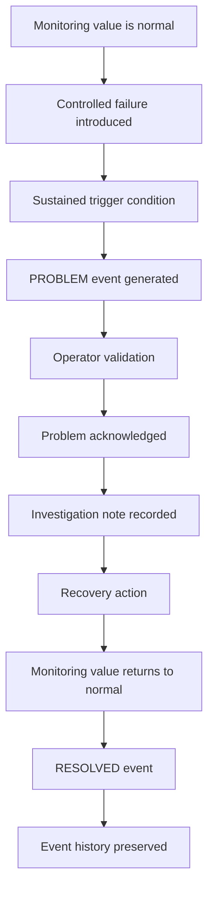

O objetivo não é apenas exibir um problema. A etapa demonstra o ciclo operacional completo, desde a detecção até a recuperação.

---

## Modelo de severidade

O laboratório utiliza os níveis de severidade do Zabbix conforme o impacto operacional esperado.

| Severidade | Utilização prevista |
|:---:|---|
| Not classified | Condições sem classificação operacional estabelecida |
| Information | Alterações informativas de estado que não exigem ação imediata |
| Warning | Comportamento degradado ou sinal inicial de possível impacto |
| Average | Problema relevante com impacto operacional limitado ou moderado |
| High | Indisponibilidade de serviço ou condição significativa que exige investigação rápida |
| Disaster | Falha crítica de plataforma ou infraestrutura com impacto abrangente |

Duas severidades foram demonstradas explicitamente nesta etapa:

| Trigger | Severidade | Justificativa operacional |
|---|:---:|---|
| Serviço HTTP indisponível | High | Representa a indisponibilidade direta do serviço dedicado monitorado |
| Resolução DNS externa indisponível | Average | Representa a perda de uma dependência externa enquanto a estação de trabalho e a plataforma de monitoramento continuam operacionais |

---

# Parte 1 — Trigger do serviço HTTP

## Item monitorado

A *trigger* HTTP utiliza o item de disponibilidade TCP criado para o alvo dedicado:

```text
net.tcp.service[tcp,monitored-web,80]
```

Valores esperados:

| Valor | Significado |
|:---:|---|
| `1` | O serviço TCP está acessível |
| `0` | O serviço TCP está indisponível |

O alvo é resolvido pela rede interna do Docker.

---

## Configuração da trigger HTTP

| Campo | Configuração |
|---|---|
| Nome da trigger | `Monitored web service is unavailable` |
| Nome do evento | `HTTP service unavailable on monitored-web` |
| Host | `Zabbix Lab Internal Services` |
| Nome técnico do host | `Internal Services - Zabbix Lab` |
| Severidade | High |
| Modo de geração de problema | Single |
| Geração de evento OK | Expression |
| Estado | Enabled |

Dados operacionais:

```text
Current TCP availability: {ITEM.LASTVALUE1}
```

Expressão da *trigger*:

```text
max(/Internal Services - Zabbix Lab/net.tcp.service[tcp,monitored-web,80],2m)=0
```

**Escopo e limitação da trigger:** Esta trigger avalia a conectividade TCP com a porta `80` do serviço `monitored-web`, por meio do item `net.tcp.service[tcp,monitored-web,80]`. Embora o nome histórico do evento seja `HTTP service unavailable on monitored-web`, a expressão detecta a indisponibilidade TCP do alvo HTTP, e não falhas da aplicação na camada HTTP. Uma porta TCP acessível não garante uma resposta HTTP bem-sucedida, um código de status válido ou o conteúdo esperado da página.

O [cenário web HTTP do Stage 04](../04-network-service-monitoring/README.pt-BR.md) disponibiliza verificações complementares na camada de aplicação, incluindo o status HTTP `200` e o texto obrigatório `Welcome to nginx!`. O experimento de interrupção controlada do contêiner permanece válido porque provocou intencionalmente a indisponibilidade TCP do serviço. Nenhuma trigger de falha na camada de aplicação ou experimento específico com erros HTTP 5xx foi validado como parte do Stage 05.

A expressão exige que o item permaneça indisponível durante a janela avaliada de dois minutos, reduzindo o risco de gerar um incidente a partir de uma falha transitória breve.

Descrição:

```text
The dedicated monitored HTTP service is unavailable on TCP port 80. Validate Docker service state, internal DNS resolution, container health, and network connectivity before escalation.
```

---

## Estado HTTP inicial

A *trigger* foi criada, habilitada, classificada com severidade **High** e inicialmente apresentou o estado normal `OK`.

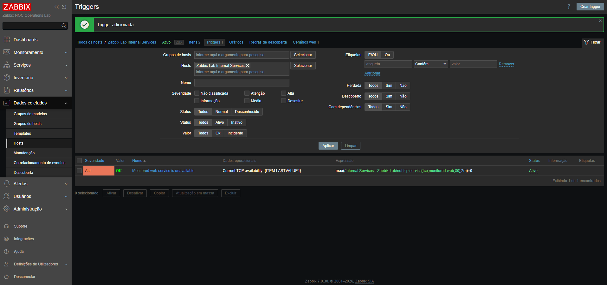

Isso confirma que sua configuração estava ativa antes da introdução da falha controlada.

---

## Falha HTTP controlada

Somente o serviço dedicado `monitored-web` foi interrompido:

```powershell
docker compose --env-file .env stop monitored-web
```

Os demais serviços da plataforma foram verificados com:

```powershell
docker compose --env-file .env ps
```

PostgreSQL, Zabbix Server e Zabbix Web permaneceram operacionais.

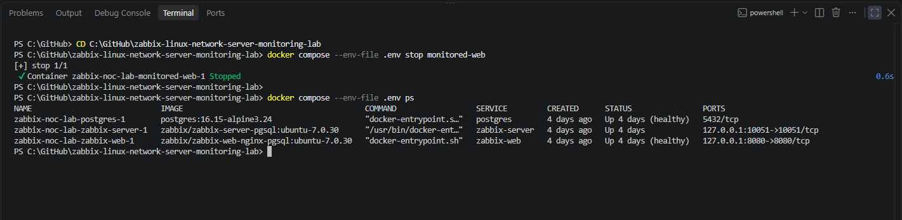

O isolamento da falha é importante porque demonstra monitoramento de um serviço específico sem desabilitar a plataforma de monitoramento.

---

## Detecção do problema HTTP

Após o período de condição persistente, o Zabbix gerou o evento esperado:

```text
HTTP service unavailable on monitored-web
```

O evento exibiu:

- severidade **High**;
- o host de serviços internos afetado;
- o serviço dedicado monitorado;
- o estado atual do incidente;
- o tempo decorrido desde o início do problema.

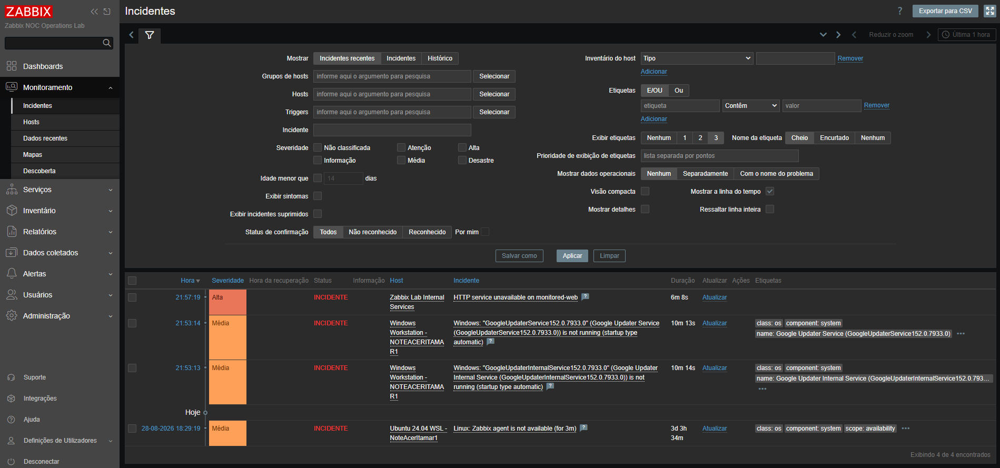

---

## Reconhecimento do incidente HTTP

O evento foi reconhecido e uma anotação operacional de investigação foi registrada.

Anotação do operador:

```text
Initial triage completed. The dedicated monitored-web service is confirmed unavailable during a controlled laboratory test. PostgreSQL, Zabbix Server, and Zabbix Web remain operational. Investigation is limited to the isolated HTTP target. Escalation is not required, and service recovery is authorized within the laboratory scope.
```

A anotação documenta:

- responsabilidade operacional assumida pelo operador;
- validação do serviço afetado;
- confirmação de que a plataforma Zabbix permaneceu operacional;
- escopo da investigação;
- decisão sobre escalonamento;
- autorização para restaurar o serviço.

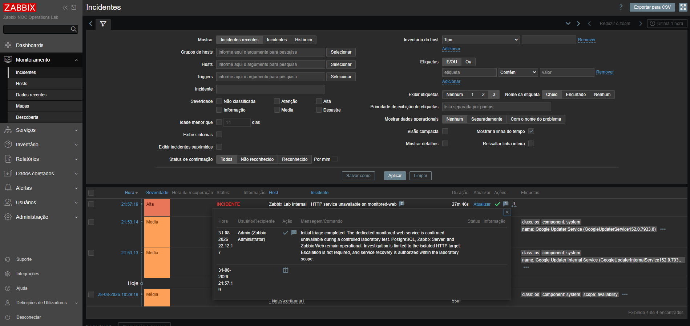

Essa atividade reproduz uma prática importante de NOC: um problema não deve apenas ser observado, mas também receber contexto operacional e uma resposta documentada.

---

## Recuperação do serviço HTTP

O serviço dedicado foi restaurado com:

```powershell
docker compose --env-file .env start monitored-web
```

O estado inicial do contêiner foi observado durante a inicialização.

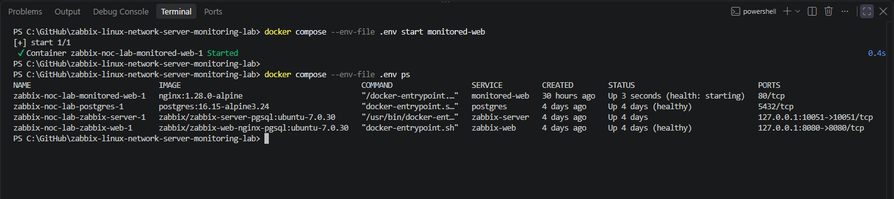

Após a conclusão da verificação de integridade (*health check*), o Docker informou que o serviço estava saudável.

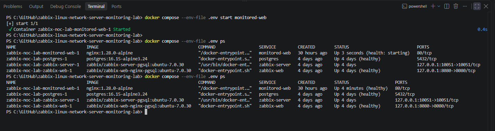

---

## Resolução do evento HTTP

Quando a disponibilidade TCP retornou a `1`, a *trigger* voltou automaticamente ao estado normal.

O Zabbix preservou:

- horário original da falha;
- horário da recuperação;
- duração total do incidente;
- severidade;
- reconhecimento;
- anotação do operador;
- ciclo completo do evento.

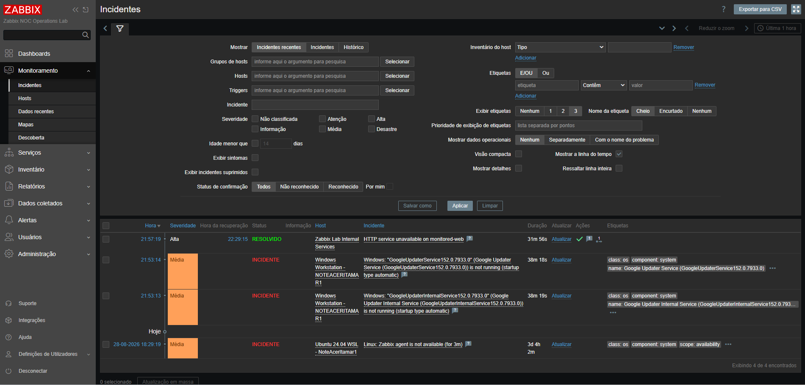

O incidente HTTP foi resolvido automaticamente, sem encerramento manual do evento.

---

# Parte 2 — Trigger de resolução DNS externa

## Item monitorado

A estação de trabalho Windows utiliza o Zabbix Agent 2 para validar a resolução DNS externa.

Chave de produção:

```text
net.dns[1.1.1.1,example.com,A,2,1,udp]
```

Parâmetros:

| Parâmetro | Valor |
|---|:---:|
| Servidor DNS | `1.1.1.1` |
| Domínio consultado | `example.com` |
| Tipo de registro | `A` |
| Tempo limite | `2` segundos |
| Número de novas tentativas | `1` |
| Protocolo | UDP |

Valores esperados:

| Valor | Significado |
|:---:|---|
| `1` | A resolução DNS foi bem-sucedida |
| `0` | A resolução DNS falhou |

---

## Configuração da trigger DNS

| Campo | Configuração |
|---|---|
| Nome da trigger | `External DNS resolution is unavailable` |
| Nome do evento | `External DNS resolution failure on Windows workstation` |
| Host | `Windows Workstation - NOTEACERITAMAR1` |
| Nome técnico do host | `NOTEACERITAMAR1` |
| Severidade | Average |
| Modo de geração de problema | Single |
| Geração de evento OK | Expression |
| Estado | Enabled |

Dados operacionais:

```text
Current DNS availability: {ITEM.LASTVALUE1}
```

Expressão da *trigger*:

```text
max(/NOTEACERITAMAR1/net.dns[1.1.1.1,example.com,A,2,1,udp],3m)=0
```

**Expressão da trigger e associação ao item:** A expressão anterior registra a configuração inicial, referenciando a chave original do item DNS com o servidor `1.1.1.1`. Durante o experimento controlado subsequente, a chave do item monitorado foi temporariamente alterada para utilizar `192.0.2.1`. As capturas preservadas confirmam a configuração inicial da trigger e o ciclo posterior de problema e recuperação, mas não exibem a expressão efetiva da trigger nem o identificador do item associado enquanto a chave temporária estava ativa. Portanto, a expressão exata apresentada nesse intervalo não pode ser reconstruída independentemente a partir das evidências disponíveis.

A expressão exige que a verificação DNS permaneça indisponível durante o período avaliado de três minutos.

Descrição:

```text
External DNS resolution through Zabbix Agent 2 is unavailable. Validate Windows Agent 2 status, UDP connectivity to the configured DNS server, local firewall rules, name resolution, and upstream network availability before escalation.
```

---

## Estado DNS inicial

A *trigger* foi criada com severidade **Average** e inicialmente apresentou `OK`.

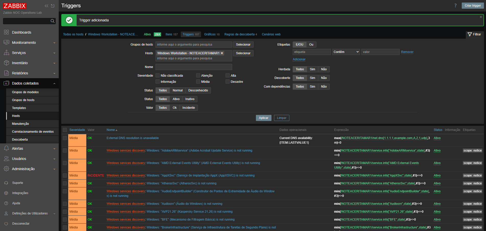

Essa segunda *trigger* demonstra que a severidade operacional deve refletir o impacto, e não apenas a existência de um erro.

---

## Tentativa inicial de injeção de falha

O primeiro teste de DNS tentou bloquear a comunicação de saída para `1.1.1.1` por meio do Firewall do Windows.

Regra inicial específica para UDP:

```powershell
New-NetFirewallRule `
  -DisplayName "Zabbix Lab - Block DNS 1.1.1.1 UDP" `
  -Direction Outbound `
  -Action Block `
  -Protocol UDP `
  -RemoteAddress 1.1.1.1 `
  -RemotePort 53
```

Uma regra mais abrangente, limitada ao mesmo destino, também foi testada:

```powershell
New-NetFirewallRule `
  -DisplayName "Zabbix Lab - Block DNS Target 1.1.1.1" `
  -Direction Outbound `
  -Action Block `
  -RemoteAddress 1.1.1.1 `
  -Profile Any
```

O teste local do Agent 2 continuou retornando:

```text
net.dns[1.1.1.1,example.com,A,2,1,udp] [s|1]
```

Como o valor monitorado permaneceu em `1`, essa tentativa não constituiu uma falha validada e não foi aceita como evidência de incidente.

A regra temporária de firewall foi removida:

```powershell
Remove-NetFirewallRule `
  -DisplayName "Zabbix Lab - Block DNS Target 1.1.1.1"
```

**Evidências históricas de limpeza:** O comando de remoção documentado identifica explicitamente a regra `Zabbix Lab - Block DNS Target 1.1.1.1`. Embora a regra anterior, específica para UDP (`Zabbix Lab - Block DNS 1.1.1.1 UDP`), também esteja documentada, o registro de execução preservado não apresenta um comando separado de remoção nem um inventário final do firewall confirmando sua ausência. Essa lacuna documental não demonstra que a regra UDP permaneceu ativa; seu estado final não pode ser verificado independentemente a partir das evidências preservadas.

**Verificação não destrutiva para validação futura:** No host Windows correspondente, o comando PowerShell abaixo permite consultar se alguma das duas regras históricas de teste está presente. O comando destina-se a verificações futuras; seus resultados não integram as evidências do Stage 05:

```powershell
# Inspect both historical DNS test rules without changing the firewall
$ruleNames = @(
    "Zabbix Lab - Block DNS 1.1.1.1 UDP"
    "Zabbix Lab - Block DNS Target 1.1.1.1"
)

Get-NetFirewallRule `
    -DisplayName $ruleNames `
    -ErrorAction SilentlyContinue |
    Select-Object Name, DisplayName, Enabled, Direction, Action
```

A ausência de resultados indicaria apenas que nenhuma regra correspondente foi encontrada no momento da consulta, sem comprovar quando ou como uma regra foi removida. Caso alguma regra seja retornada, confira sua identidade e seus parâmetros antes de considerar uma limpeza separada e expressamente autorizada; a consulta não remove nenhuma regra.

Essa tentativa malsucedida foi mantida como lição de diagnóstico:

- verificar o valor monitorado, em vez de presumir que um controle produziu a condição pretendida;
- não classificar uma captura de tela como evidência de falha sem observar a transição de estado esperada;
- remover os controles temporários após os testes;
- utilizar um método determinístico de injeção de falhas quando o método inicial não afetar o sinal monitorado.

---

## Falha DNS controlada

Uma falha determinística foi introduzida alterando temporariamente o servidor DNS no item monitorado, de:

```text
1.1.1.1
```

para o endereço reservado à documentação:

```text
192.0.2.1
```

Chave temporária utilizada no teste:

```text
net.dns[192.0.2.1,example.com,A,2,1,udp]
```

A rede `192.0.2.0/24` é reservada para documentação e exemplos de laboratório. Nesse ambiente, o endereço selecionado não forneceu resolução DNS.

A visualização *Latest Data* do Zabbix confirmou que o item passou de `1` para `0`.

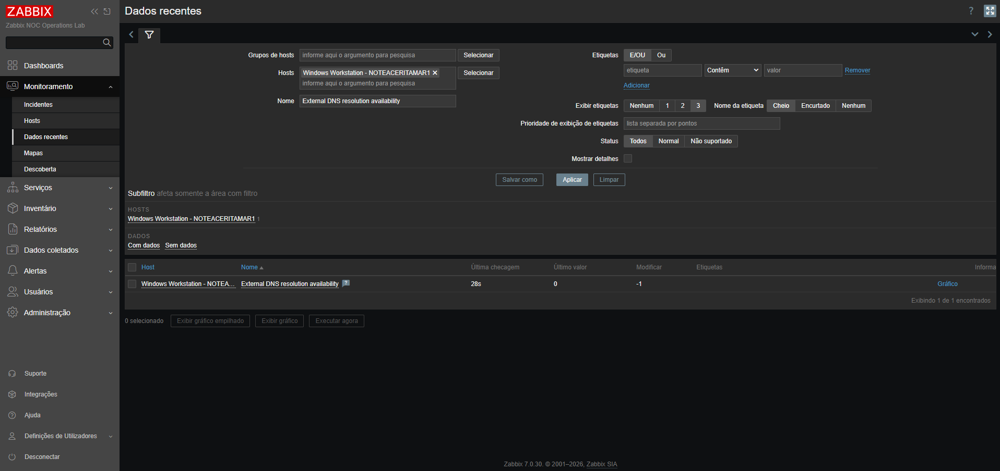

Essa evidência confirma a falha na camada dos dados monitorados antes da validação do evento da *trigger*.

**Interpretação do comportamento observado da trigger:** O item DNS passou a `0` após a alteração temporária da chave, e o evento DNS anteriormente configurado foi posteriormente gerado e resolvido após a restauração da chave original. Essa sequência observada é compatível com a continuidade da avaliação do item monitorado pela trigger. Entretanto, não demonstra independentemente se o Zabbix atualizou automaticamente a expressão exibida ou se ocorreu alguma ação adicional de configuração. Em reproduções futuras, a expressão da trigger e o item associado deverão ser inspecionados enquanto a chave temporária estiver ativa, antes que essa associação seja considerada diretamente verificada.

---

## Detecção do problema DNS

Após a condição persistente de três minutos, o Zabbix gerou:

```text
External DNS resolution failure on Windows workstation
```

O incidente apresentou corretamente:

- severidade **Average**;
- host `Windows Workstation - NOTEACERITAMAR1`;
- falha na resolução DNS externa;
- estado de incidente ativo;
- duração decorrida.

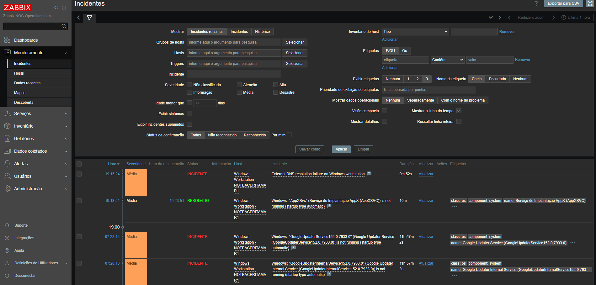

---

## Recuperação do DNS

O item monitorado foi restaurado à chave original de produção:

```text
net.dns[1.1.1.1,example.com,A,2,1,udp]
```

A visualização *Latest Data* confirmou que a disponibilidade DNS retornou a `1`.

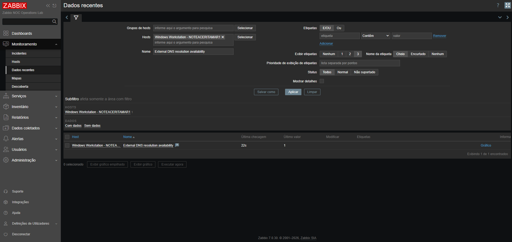

Não foi necessário reiniciar a estação de trabalho, o Agent 2 ou interromper a rede de modo geral.

---

## Resolução do evento DNS

Após a restauração do alvo DNS original, o Zabbix encerrou automaticamente o incidente.

O histórico do evento registrou:

| Campo | Resultado |
|---|:---:|
| Horário do problema | `19:15:24` |
| Horário da recuperação | `19:34:22` |
| Duração | `18m 58s` |
| Severidade | Average |
| Estado final | Resolved |
| Host | `Windows Workstation - NOTEACERITAMAR1` |

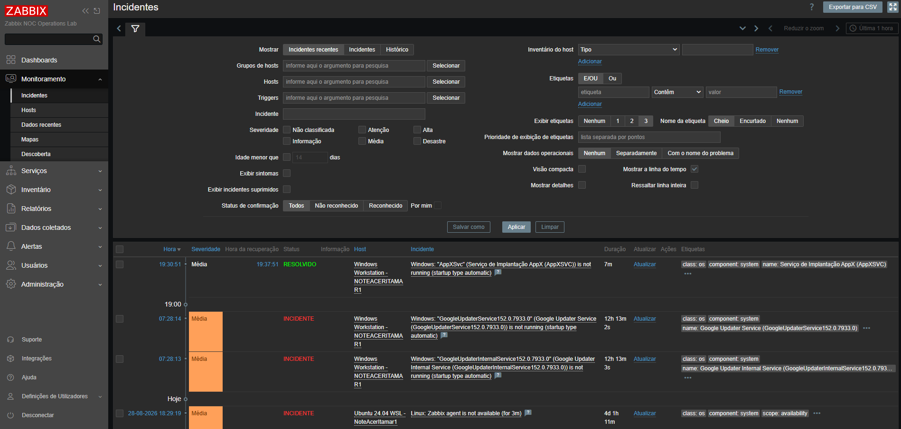

Após a recuperação, o evento inicialmente desapareceu da visualização de incidentes recentes. Por isso, a visualização histórica foi utilizada para recuperar e preservar todo o ciclo.

---

# Resumo da validação

## Validação HTTP

| Validação | Resultado |
|---|:---:|
| Trigger criada | Aprovado |
| Trigger inicialmente em `OK` | Aprovado |
| Severidade classificada como High | Aprovado |
| Interrupção controlada do serviço | Aprovado |
| Falha persistente detectada | Aprovado |
| Evento de problema gerado | Aprovado |
| Host e serviço identificados | Aprovado |
| Incidente reconhecido | Aprovado |
| Anotação do operador registrada | Aprovado |
| Decisão de escalonamento documentada | Aprovado |
| Serviço restaurado | Aprovado |
| Contêiner voltou ao estado saudável | Aprovado |
| Trigger voltou ao normal | Aprovado |
| Evento resolvido automaticamente | Aprovado |
| Histórico preservado | Aprovado |

## Validação DNS

| Validação | Resultado |
|---|:---:|
| Trigger criada | Aprovado |
| Trigger inicialmente em `OK` | Aprovado |
| Severidade classificada como Average | Aprovado |
| Tentativa inicial com firewall avaliada | Concluída sem mudança no estado monitorado |
| Evidência do teste ineficaz rejeitada | Aprovado |
| Comando de remoção da regra abrangente de firewall | Documentado; limpeza da regra específica para UDP sem verificação independente |
| Falha determinística introduzida | Aprovado |
| Item mudou de `1` para `0` | Aprovado |
| Falha persistente detectada | Aprovado |
| Evento de problema gerado | Aprovado |
| Alvo DNS original restaurado | Aprovado |
| Item mudou de `0` para `1` | Aprovado |
| Evento resolvido automaticamente | Aprovado |
| Ciclo histórico preservado | Aprovado |

---

# Constatações operacionais

## Constatação 1 — Os valores monitorados devem validar a injeção de falhas

A existência de uma regra de firewall no sistema operacional não comprova que a aplicação monitorada apresentou a falha esperada.

A sequência de validação confiável é:

```text
Control applied
    -> monitored value changes
    -> trigger expression becomes true
    -> event is generated
```

Se o valor monitorado não mudar, a falha não foi demonstrada.

---

## Constatação 2 — Condições persistentes reduzem falsos positivos

As *triggers* HTTP e DNS exigem falhas repetidas durante uma janela de tempo:

```text
HTTP: 2 minutes
DNS:  3 minutes
```

Essa abordagem evita que amostras transitórias isoladas se tornem imediatamente incidentes operacionais.

---

## Constatação 3 — A severidade representa o impacto operacional

Os dois testes geraram problemas em serviços, mas receberam intencionalmente severidades diferentes:

- indisponibilidade HTTP: **High**;
- falha na resolução DNS externa: **Average**.

A classificação por severidade ajuda os operadores a priorizar atividades conforme o impacto técnico e sobre o negócio.

---

## Constatação 4 — O reconhecimento estabelece responsabilidade operacional

O reconhecimento registra que um operador:

- identificou o problema;
- assumiu a responsabilidade pela triagem inicial;
- validou o escopo afetado;
- documentou as constatações;
- decidiu se o escalonamento era necessário.

Um reconhecimento sem anotação de investigação oferece menor valor operacional.

---

## Constatação 5 — A recuperação deve ser validada em várias camadas

Para o serviço HTTP, a recuperação foi confirmada por:

- inicialização do serviço Docker;
- integridade do contêiner;
- disponibilidade TCP;
- normalização da *trigger*;
- histórico do evento resolvido.

Para a resolução DNS, a recuperação foi confirmada por:

- restauração da chave original do item;
- valor `1` em *Latest Data*;
- normalização da *trigger*;
- evento histórico resolvido.

---

## Constatação 6 — Visualizações recentes e históricas de incidentes têm finalidades diferentes

A visualização de incidentes recentes é útil para operações em andamento.

A visualização histórica é necessária quando:

- um evento resolvido deixa de aparecer como recente;
- são necessários horários exatos de falha e recuperação;
- a duração total do incidente precisa ser documentada;
- é necessário preservar evidências do ciclo completo.

---

# Índice de evidências

| Evidência | Arquivo |
|---|---|
| Trigger HTTP inicial | [`stage-05-http-trigger-initial-ok.png`](../../docs/screenshots/stage-05-http-trigger-initial-ok.png) |
| Interrupção HTTP controlada | [`stage-05-controlled-http-service-stop.png`](../../docs/screenshots/stage-05-controlled-http-service-stop.png) |
| Problema HTTP detectado | [`stage-05-http-problem-detected.png`](../../docs/screenshots/stage-05-http-problem-detected.png) |
| Problema HTTP reconhecido | [`stage-05-http-problem-acknowledged.png`](../../docs/screenshots/stage-05-http-problem-acknowledged.png) |
| Recuperação HTTP iniciada | [`stage-05-controlled-http-service-recovery.png`](../../docs/screenshots/stage-05-controlled-http-service-recovery.png) |
| Serviço HTTP saudável | [`stage-05-http-service-health-validation.png`](../../docs/screenshots/stage-05-http-service-health-validation.png) |
| Problema HTTP resolvido | [`stage-05-http-problem-recovered.png`](../../docs/screenshots/stage-05-http-problem-recovered.png) |
| Trigger DNS inicial | [`stage-05-dns-trigger-initial-ok.png`](../../docs/screenshots/stage-05-dns-trigger-initial-ok.png) |
| Falha DNS controlada | [`stage-05-controlled-dns-failure.png`](../../docs/screenshots/stage-05-controlled-dns-failure.png) |
| Problema DNS detectado | [`stage-05-dns-problem-detected.png`](../../docs/screenshots/stage-05-dns-problem-detected.png) |
| Serviço DNS restaurado | [`stage-05-dns-service-recovery.png`](../../docs/screenshots/stage-05-dns-service-recovery.png) |
| Problema DNS resolvido | [`stage-05-dns-problem-recovered.png`](../../docs/screenshots/stage-05-dns-problem-recovered.png) |

---

# Referência para diagnóstico e resolução de problemas

## A expressão da trigger informa um host desconhecido

Confirme o nome técnico do host utilizado na expressão.

O nome visível e o nome técnico do host podem ser diferentes:

```text
Visible name: Zabbix Lab Internal Services
Host name:    Internal Services - Zabbix Lab
```

As expressões das *triggers* devem fazer referência ao nome técnico do host selecionado pelo Zabbix.

---

## A trigger permanece em `OK` após um controle de teste ser aplicado

Verifique o valor do item em:

```text
Monitoring -> Latest data
```

Não presuma que um controle de sistema operacional ou rede alterou a condição monitorada.

Valide:

1. a chave do item;
2. o valor coletado mais recente;
3. o intervalo de atualização do item;
4. a janela de avaliação da *trigger*;
5. o estado da *trigger*;
6. a associação ao host.

---

## O problema não aparece imediatamente

As *triggers* utilizam janelas de condição persistente.

Comportamento esperado:

```text
HTTP trigger: waits for the evaluated two-minute failure window
DNS trigger:  waits for the evaluated three-minute failure window
```

O intervalo de atualização do item pode acrescentar tempo até que o evento apareça na interface web.

---

## Um incidente resolvido desaparece da lista de recentes

Utilize:

```text
Monitoring -> Problems -> History
```

Filtre pelo nome do incidente e pelo intervalo de tempo apropriado.

---

## Uma configuração temporária de teste permanece ativa

Restaure imediatamente o alvo monitorado original.

Chave DNS de produção:

```text
net.dns[1.1.1.1,example.com,A,2,1,udp]
```

Verifique se *Latest Data* retorna:

```text
1
```

---

# Critérios de aceitação

A etapa 05 está concluída porque:

- [x] a *trigger* inicial de disponibilidade HTTP foi criada;
- [x] a *trigger* HTTP utiliza uma condição persistente de falha durante dois minutos;
- [x] a *trigger* HTTP recebeu severidade High;
- [x] a *trigger* HTTP foi habilitada e inicialmente apresentou `OK`;
- [x] uma falha controlada do serviço HTTP gerou um evento `PROBLEM`;
- [x] o problema HTTP apareceu com a severidade esperada;
- [x] o evento HTTP identificou o host e o serviço afetados;
- [x] o problema HTTP foi reconhecido;
- [x] uma anotação operacional de investigação foi registrada;
- [x] uma decisão de escalonamento foi documentada;
- [x] o serviço HTTP monitorado foi restaurado;
- [x] o contêiner HTTP voltou ao estado saudável;
- [x] a *trigger* HTTP retornou automaticamente ao estado normal;
- [x] o incidente HTTP foi exibido como `RESOLVED`;
- [x] o histórico do evento HTTP preservou todo o ciclo de vida;
- [x] as evidências selecionadas do incidente HTTP foram armazenadas;
- [x] uma *trigger* DNS adicional, com severidade diferente, foi configurada;
- [x] a *trigger* DNS foi habilitada e inicialmente apresentou `OK`;
- [x] uma tentativa ineficaz de injeção de falha foi identificada e rejeitada;
- [x] a remoção da regra de teste mais abrangente do Firewall do Windows foi documentada; a limpeza da regra anterior específica para UDP permanece sem verificação nas evidências preservadas;
- [x] uma falha DNS determinística foi introduzida;
- [x] o valor DNS monitorado mudou de `1` para `0`;
- [x] a *trigger* DNS gerou um incidente de severidade Average;
- [x] o alvo DNS original foi restaurado;
- [x] o valor DNS monitorado retornou de `0` para `1`;
- [x] a *trigger* DNS retornou automaticamente ao estado normal;
- [x] o incidente DNS foi exibido como `RESOLVED`;
- [x] o histórico do evento DNS preservou a falha e a recuperação;
- [x] as evidências selecionadas do incidente DNS foram armazenadas;
- [x] as constatações de diagnóstico foram documentadas;
- [x] os resultados finais da etapa 05 foram documentados.

---

# Resultado da etapa

A etapa 05 demonstrou que o laboratório consegue transformar valores brutos de monitoramento em eventos operacionalmente significativos.

A implementação agora oferece suporte ao seguinte fluxo:

```text
Monitoring signal
    -> sustained trigger condition
    -> severity classification
    -> problem event
    -> operator validation
    -> acknowledgment and investigation note
    -> recovery action
    -> automatic resolution
    -> historical operational record
```

O teste HTTP demonstrou indisponibilidade isolada de serviço com severidade **High** e tratamento formal pelo operador.

O teste DNS demonstrou falha de uma dependência com severidade **Average**, injeção de falha determinística, recuperação automática e validação histórica.

A tentativa malsucedida com o firewall também proporcionou um exercício realista de diagnóstico: alterações de configuração devem ser verificadas em relação ao sinal efetivamente monitorado antes de serem aceitas como evidência.

---

# Etapa subsequente

Ao concluir o Stage 05, o próximo marco planejado era a implementação dos fluxos de entrega de alertas e notificações operacionais. O planejamento original incluía:

- configurar um canal de notificações adequado ao laboratório;
- criar uma ação vinculada à severidade da *trigger*;
- definir condições para as ações;
- testar o conteúdo das mensagens;
- validar notificações de problemas e recuperação;
- documentar a entrega de notificações e o comportamento do diagnóstico.

Posteriormente, o Stage 06 foi concluído, implementando a entrega local de notificações SMTP por meio do Mailpit, tipos de mídia do Zabbix, ações de triggers baseadas em severidade e notificações de problema e recuperação para os serviços HTTP e DNS monitorados. A entrega foi validada pelo histórico de ações do Zabbix e pelas evidências correspondentes. Consulte a [documentação do Stage 06](../06-alert-delivery-notifications/README.pt-BR.md) para conhecer a implementação e os resultados.
