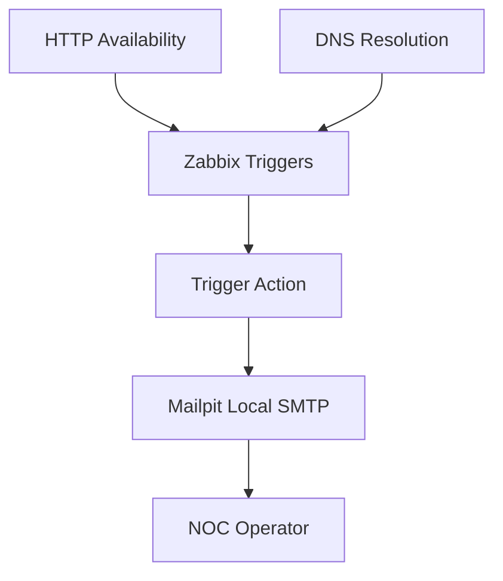
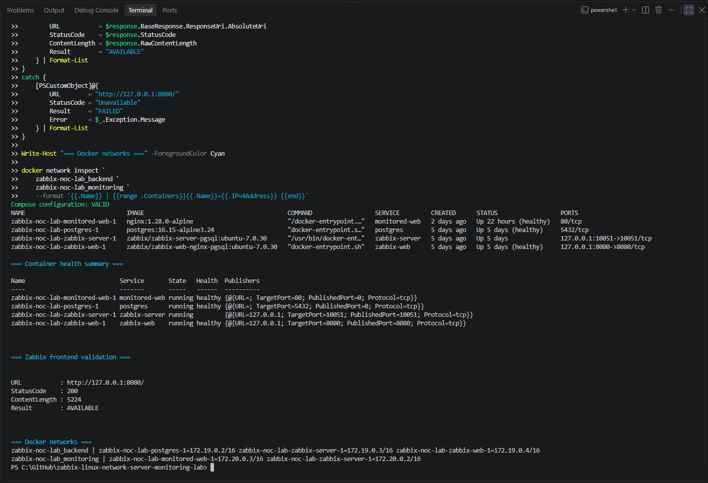
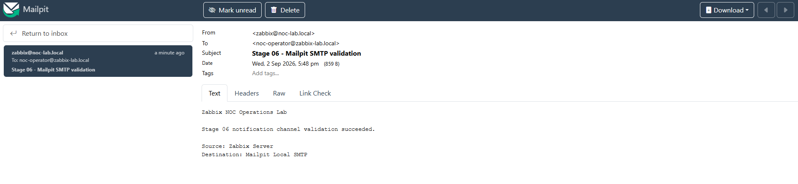
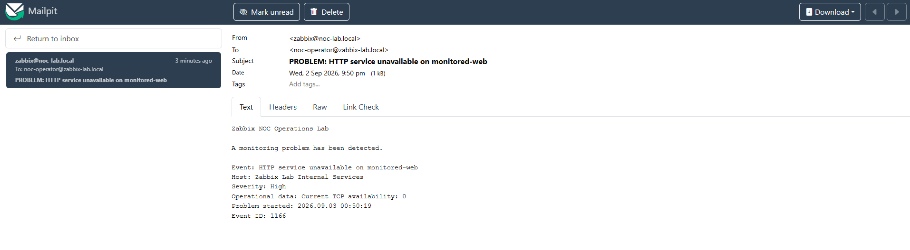
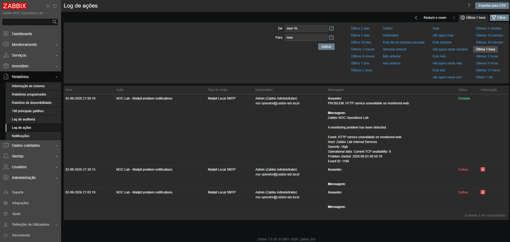
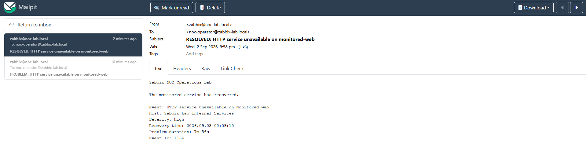
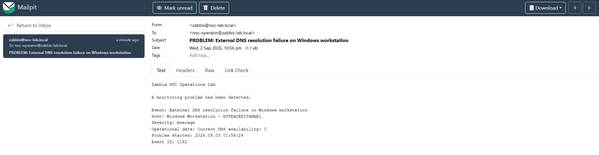
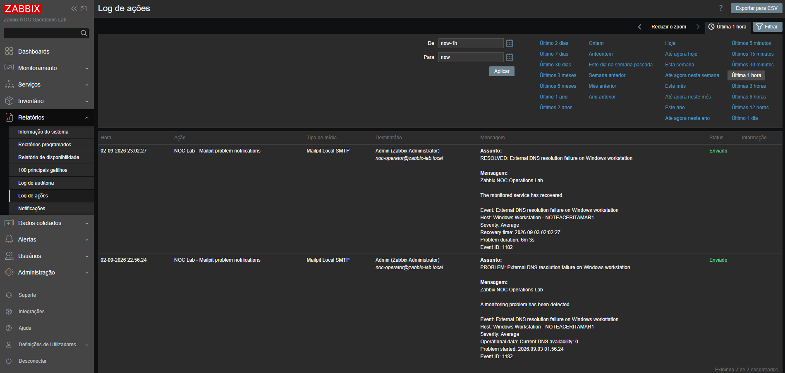

# Stage 06 — Entrega de alertas, ações e notificações

[English](README.md) | **Português (Brasil)**

[Voltar ao README principal](../../README.pt-BR.md)

## Objetivo

Os incidentes HTTP e DNS configurados na etapa 05 são utilizados aqui para testar notificações automáticas por meio de ações e tipos de mídia nativos do Zabbix.

O Mailpit captura as mensagens geradas quando o Zabbix detecta um problema e quando a condição monitorada retorna ao normal.

A etapa valida:

- um canal local de notificações SMTP;
- a configuração de tipos de mídia no Zabbix;
- a associação de mídia ao operador;
- a configuração de ações de *triggers*;
- condições de ação baseadas na severidade;
- a entrega de notificações de problemas;
- a entrega de notificações de recuperação;
- o conteúdo operacional das mensagens;
- a validação do histórico de ações;
- o diagnóstico de problemas nas notificações;
- o tratamento seguro das configurações de notificação.

## Situação da etapa

**Concluída**

Nos testes registrados de HTTP e DNS, as mensagens de problema e recuperação foram recebidas pelo Mailpit, com as operações correspondentes visíveis no histórico de ações do Zabbix.

A solução final inclui:

- Mailpit como serviço local de captura SMTP;
- um tipo de mídia de e-mail dedicado no Zabbix;
- um destinatário de laboratório associado ao administrador do Zabbix;
- uma ação de *trigger* abrangendo os incidentes HTTP e DNS;
- modelos personalizados de mensagens de problema e recuperação;
- testes controlados de falha HTTP e DNS;
- entrega bem-sucedida de notificações de problema e recuperação;
- confirmação da entrega pelo registro de ações do Zabbix;
- restauração de todas as alterações temporárias de teste.

Não foi necessário utilizar contas pessoais de e-mail, provedores SMTP externos, credenciais de produção, tokens ou segredos de *webhooks*.

## Referência da etapa anterior

A etapa 05 estabeleceu o ciclo de incidentes reutilizado nesta etapa.

| Sinal de monitoramento | Severidade | Comportamento durante o problema | Comportamento durante a recuperação |
|:---:|:---:|:---:|:---:|
| Disponibilidade do serviço HTTP dedicado | High | A falha persistente do serviço gera um evento de problema | A restauração do serviço faz a *trigger* retornar a `OK` |
| Disponibilidade da resolução DNS externa | Average | A falha persistente de DNS gera um evento de problema | A restauração do DNS faz a *trigger* retornar a `OK` |

As *triggers* existentes foram reutilizadas como fontes reais de notificações, em vez de criar *triggers* artificiais destinadas apenas a alertas.

## Arquitetura implementada



Os sinais monitorados geram transições de estado das *triggers* dentro do Zabbix.

A ação configurada avalia as condições da *trigger* e da severidade, seleciona a operação de problema ou recuperação e envia um e-mail pelo Mailpit. O operador pode, então, validar a mensagem completa e o resultado da entrega sem utilizar um provedor externo de e-mail.

## Componentes do laboratório

| Componente | Finalidade | Acesso |
|:---:|:---:|:---:|
| Zabbix Server | Processamento de eventos e execução de ações | Rede interna do Docker |
| Zabbix Web | Configuração e validação operacional | `http://127.0.0.1:8080` |
| PostgreSQL | Banco de dados de configuração e histórico do Zabbix | Rede interna do Docker |
| Serviço web monitorado | Alvo de disponibilidade HTTP para testes controlados | Rede interna do Docker |
| Zabbix Agent 2 | Monitoramento do host Windows e de DNS | Interface do host Windows |
| Mailpit | Captura SMTP local e inspeção de mensagens | `http://127.0.0.1:8025` |

A interface web do Mailpit é vinculada ao host local e não é exposta como serviço público.

## Validação inicial da plataforma

Antes de configurar as notificações, a condição inicial do laboratório foi validada.

A verificação confirmou que:

- o PostgreSQL estava saudável;
- o Zabbix Server estava em execução;
- o Zabbix Web apresentou o estado `healthy` no Docker, conforme a captura preservada da validação inicial;
- o serviço HTTP monitorado estava saudável;
- a interface web do Zabbix estava acessível;
- os serviços Docker mantinham a conectividade esperada;
- os sinais de monitoramento da etapa 05 continuavam disponíveis.



**Estado de saúde do Docker versus disponibilidade do serviço:** A captura original da validação inicial apresenta o estado Docker `healthy` para PostgreSQL, `monitored-web` e Zabbix Web. Também registra uma resposta HTTP `200` bem-sucedida da interface do Zabbix.

Embora o `compose.yaml` atual não defina explicitamente um healthcheck para `zabbix-web`, as imagens Docker podem fornecer sua própria instrução `HEALTHCHECK`. As evidências registradas do Stage 06 não permitem estabelecer a configuração efetiva do healthcheck do contêiner utilizado no experimento.

O estado de saúde Docker do Mailpit não aparece nessa captura inicial. Sua disponibilidade operacional é sustentada separadamente pelo acesso à interface web e pela captura bem-sucedida de mensagens SMTP documentada no Stage 06.

## Serviço de notificações

O Mailpit foi selecionado como canal controlado de notificações.

O serviço oferece:

- um endpoint SMTP local;
- uma caixa de mensagens acessível pelo navegador;
- captura determinística de mensagens;
- inspeção de assuntos, corpos e cabeçalhos das mensagens;
- testes reproduzíveis de problemas e recuperação;
- independência de uma conta externa de e-mail;
- ausência de necessidade de credenciais SMTP.

### Configuração do serviço Mailpit

| Configuração | Valor |
|:---:|:---:|
| Imagem do contêiner | `axllent/mailpit:v1.30` |
| Nome do serviço SMTP | `mailpit` |
| Porta SMTP | `1025` |
| Porta da interface web | `8025` |
| Vinculação da interface web | `127.0.0.1` |
| Autenticação | Não necessária |
| Segurança da conexão | Nenhuma, no laboratório controlado |

### Inicialização e validação do Mailpit para futuras execuções

**Inicialização e validação do Mailpit para futuras execuções:** Os comandos abaixo apresentam um procedimento restrito ao serviço Mailpit, utilizando a definição atual do Docker Compose. Execute-os a partir da raiz do repositório, no PowerShell do Windows, com o arquivo `.env` operacional existente e o projeto Compose correto. O serviço `mailpit` deverá ser iniciado sem recriar ou reiniciar a plataforma de monitoramento. Verifique o estado do contêiner, examine os logs de inicialização, confirme o acesso à interface web local e teste a conectividade SMTP a partir do contêiner Zabbix Server quando as ferramentas necessárias estiverem disponíveis. Após configurar o tipo de mídia do Zabbix, realize o envio de uma mensagem de teste e confirme seu recebimento no Mailpit. Os comandos são referências para futuras execuções, não procedimentos comprovadamente utilizados no experimento original do Stage 06. Nenhum resultado de nova execução é apresentado aqui.

**Pré-requisitos:** Utilize somente o projeto autorizado do laboratório. Confirme que o `.env` existente identifica o mesmo projeto Compose da stack de monitoramento em execução; não o substitua pelo `.env.example`, não exiba segredos operacionais e não utilize comandos de inicialização ou interrupção de todo o projeto. Os comandos abaixo utilizam a porta web `8025` documentada; se o `.env` existente definir outro `MAILPIT_WEB_HTTP_PORT`, utilize a porta efetiva na verificação HTTP. O listener SMTP do Mailpit permanece dentro da rede Docker `monitoring`, na porta `1025`, e **não** é publicado no host Windows pelo `compose.yaml` atual.

**A. Validar o ambiente Compose existente**

```powershell
# Validar a configuração Compose existente
docker compose --env-file .env -f compose.yaml config --quiet

# Conferir os contêineres existentes
docker compose --env-file .env -f compose.yaml ps --all
```

**B. Iniciar somente o Mailpit e inspecionar a inicialização**

```powershell
# Iniciar somente o Mailpit, sem iniciar dependências
# ou recriar um contêiner existente
docker compose --env-file .env -f compose.yaml up `
  --no-deps --no-recreate -d mailpit

# Verificar o estado do serviço
docker compose --env-file .env -f compose.yaml ps --all mailpit

# Consultar as mensagens recentes de inicialização
docker compose --env-file .env -f compose.yaml logs `
  --tail 50 mailpit
```

A opção `--no-deps` limita a inicialização ao serviço selecionado; `--no-recreate` impede recriar um contêiner existente mesmo que sua configuração tenha sido alterada. Antes de utilizar esse procedimento, confirme que qualquer contêiner existente corresponde à configuração pretendida. O estado do contêiner e os logs não comprovam, por si só, a entrega SMTP.

**C. Verificar o acesso web local e, opcionalmente, a conectividade TCP SMTP**

```powershell
# Validar a interface web do Mailpit
$response = Invoke-WebRequest `
  -Uri "http://127.0.0.1:8025/" `
  -UseBasicParsing `
  -TimeoutSec 10

$response.StatusCode
```

Para a porta documentada, uma resposta HTTP `200` demonstra que a interface web está respondendo, mas não comprova a entrega SMTP.

Se o contêiner `zabbix-server` já estiver em execução e sua imagem disponibilizar Bash com suporte a `/dev/tcp`, poderá ser realizada uma tentativa não destrutiva de conexão a partir desse contêiner:

```powershell
# Conferir a conectividade TCP SMTP a partir do Zabbix Server
docker compose --env-file .env -f compose.yaml exec -T `
  zabbix-server bash -c "true < /dev/tcp/mailpit/1025"

if ($LASTEXITCODE -ne 0) {
    throw "SMTP port 1025 is not reachable from Zabbix Server, or the probe is unsupported."
}
```

Essa consulta opcional tenta abrir uma conexão TCP, mas não envia e-mail. Se Bash ou `/dev/tcp` não estiver disponível, o resultado será inconclusivo; realize o teste real de entrega pelo tipo de mídia do Zabbix, sem presumir indisponibilidade do Mailpit.

**D. Validar a entrega de mensagens SMTP pelo Zabbix**

Depois de configurar o tipo de mídia existente `Mailpit Local SMTP` (servidor `mailpit`, porta `1025`), utilize o teste do tipo de mídia do Zabbix para enviar uma mensagem ao destinatário de laboratório já documentado abaixo. Confirme que a nova mensagem aparece na interface web do Mailpit. Essa entrega de ponta a ponta constitui a verificação funcional; contêiner em execução, ausência de erros nos logs ou HTTP `200` isoladamente são insuficientes. A captura preservada do Stage 06 comprova o envio histórico, **não a execução dos novos comandos acima**.

## Tipo de mídia do Zabbix

Foi criado um tipo de mídia de e-mail dedicado:

```text
Mailpit Local SMTP
```

### Configurações do tipo de mídia

| Configuração | Valor |
|:---:|:---:|
| Tipo | E-mail |
| Servidor SMTP | `mailpit` |
| Porta do servidor SMTP | `1025` |
| SMTP HELO | `zabbix-noc-lab.local` |
| E-mail do remetente | `zabbix@noc-lab.local` |
| Segurança da conexão | Nenhuma |
| Autenticação | Nenhuma |
| Formato da mensagem | Texto simples |
| Estado | Ativo |

Um teste direto do tipo de mídia foi executado antes de habilitar a ação de *trigger*.

A mensagem de teste foi entregue com sucesso a:

```text
noc-operator@zabbix-lab.local
```



## Associação de mídia ao operador

O tipo de mídia `Mailpit Local SMTP` foi associado ao administrador do Zabbix utilizado como operador do laboratório.

| Configuração | Valor |
|:---:|:---:|
| Usuário | Admin |
| Destinatário | `noc-operator@zabbix-lab.local` |
| Tipo de mídia | `Mailpit Local SMTP` |
| Período ativo | Sempre |
| Severidades habilitadas | Average, High e Disaster |
| Estado | Habilitado |

A faixa de severidades selecionada inclui os dois sinais de monitoramento utilizados na validação:

- falha na resolução DNS: `Average`;
- falha no serviço HTTP: `High`.

## Ação de trigger

A seguinte ação de *trigger* foi criada e habilitada:

```text
NOC Lab - Mailpit problem notifications
```

### Condições da ação

A ação utiliza estas condições:

| Condição | Valor |
|:---:|---|
| A | A *trigger* é igual à de resolução DNS externa |
| B | A *trigger* é igual à do serviço HTTP monitorado |
| C | A severidade da *trigger* é maior ou igual a Average |

O cálculo personalizado das condições é:

```text
(A or B) and C
```

Esse cálculo restringe a entrega de notificações às duas *triggers* selecionadas da etapa 05 e, ao mesmo tempo, impõe um limite mínimo de severidade.

## Operação de problema

A operação de problema envia um e-mail ao administrador do Zabbix pelo `Mailpit Local SMTP` quando qualquer uma das *triggers* selecionadas entra no estado `PROBLEM`.

### Assunto da mensagem de problema

```text
PROBLEM: {EVENT.NAME}
```

### Mensagem de problema

```text
Zabbix NOC Operations Lab

A monitoring problem has been detected.

Event: {EVENT.NAME}
Host: {HOST.NAME}
Severity: {EVENT.SEVERITY}
Operational data: {EVENT.OPDATA}
Problem started: {EVENT.DATE} {EVENT.TIME}
Event ID: {EVENT.ID}
```

A mensagem fornece o contexto operacional inicial necessário para a triagem, sem incluir credenciais ou detalhes desnecessários da plataforma.

## Operação de recuperação

A operação de recuperação envia o e-mail correspondente quando a *trigger* retorna ao estado `OK`.

### Assunto da mensagem de recuperação

```text
RESOLVED: {EVENT.NAME}
```

### Mensagem de recuperação

```text
Zabbix NOC Operations Lab

The monitored service has recovered.

Event: {EVENT.NAME}
Host: {HOST.NAME}
Severity: {EVENT.SEVERITY}
Recovery time: {EVENT.RECOVERY.DATE} {EVENT.RECOVERY.TIME}
Problem duration: {EVENT.DURATION}
Event ID: {EVENT.ID}
```

A mensagem de recuperação relaciona a condição restaurada ao evento original e informa sua duração total.

## Validação das notificações HTTP

O serviço HTTP foi selecionado para o primeiro teste de notificação de ponta a ponta, pois podia ser interrompido independentemente do PostgreSQL, do Zabbix Server, do Zabbix Web e do Mailpit.

### Falha controlada

O serviço web monitorado foi interrompido:

```powershell
docker compose --env-file .env stop monitored-web
```

A sequência esperada ocorreu:

1. o endpoint monitorado ficou indisponível;
2. o item de disponibilidade HTTP informou a falha;
3. a *trigger* de severidade High entrou no estado `PROBLEM`;
4. a ação do Zabbix correspondeu ao evento;
5. a operação de problema foi executada;
6. o Mailpit recebeu a notificação `PROBLEM`;
7. o registro de ações do Zabbix apresentou `Sent`.



O registro de ações do Zabbix confirmou a entrega da notificação de problema e preservou destinatário, tipo de mídia, assunto, corpo da mensagem, horário e status de entrega.



### Recuperação controlada

O serviço web monitorado foi iniciado novamente:

```powershell
docker compose --env-file .env up -d monitored-web
```

A sequência esperada de recuperação ocorreu:

1. o contêiner iniciou;
2. o endpoint HTTP voltou a ficar acessível;
3. o item monitorado retornou ao valor normal;
4. a *trigger* retornou a `OK`;
5. a operação de recuperação foi executada;
6. o Mailpit recebeu a notificação `RESOLVED`;
7. o registro de ações do Zabbix apresentou `Sent`.



## Validação da severidade DNS

A *trigger* DNS foi utilizada para verificar se a mesma ação também processava um evento com severidade `Average`.

### Chave normal do item DNS

```text
net.dns[1.1.1.1,example.com,A,2,1,udp]
```

### Método de falha controlada

O endereço do servidor DNS na chave do item foi temporariamente substituído pelo endereço reservado à documentação `192.0.2.1`:

```text
net.dns[192.0.2.1,example.com,A,2,1,udp]
```

Isso provocou uma falha determinística de resolução DNS, sem interromper a conexão de rede do host ou modificar o funcionamento normal do serviço Cliente DNS do Windows.

O valor monitorado mudou:

```text
1 -> 0
```

Após o intervalo configurado de falha persistente, o Zabbix gerou:

```text
External DNS resolution failure on Windows workstation
```

O evento foi classificado com severidade `Average`, correspondeu às condições da ação e gerou uma notificação de problema.



### Recuperação do DNS

A chave original foi restaurada:

```text
net.dns[1.1.1.1,example.com,A,2,1,udp]
```

O valor monitorado retornou:

```text
0 -> 1
```

A *trigger* foi resolvida automaticamente, e a operação de recuperação enviou a notificação `RESOLVED` correspondente.

O registro de ações do Zabbix confirmou ambas as entregas do ciclo de vida com status `Sent`.



O incidente DNS controlado permaneceu ativo por aproximadamente seis minutos, e a configuração original do monitoramento foi restaurada após a validação.

## Resultados da validação

| Validação | Resultado esperado | Resultado observado | Estado |
|:---:|:---:|:---:|:---:|
| Estado inicial da plataforma | Serviços centrais permanecem operacionais | Plataforma permaneceu disponível | Aprovado |
| Disponibilidade do Mailpit | Serviço local de captura SMTP está acessível | Interface web do Mailpit acessível; mensagem SMTP recebida durante a validação do tipo de mídia | Aprovado |
| Teste do tipo de mídia | E-mail de teste chega ao Mailpit | E-mail de validação recebido | Aprovado |
| Mídia do operador | Destinatário aceita as severidades selecionadas | Eventos Average e High permitidos | Aprovado |
| Problema HTTP | Notificação de problema High entregue | E-mail `PROBLEM` recebido | Aprovado |
| Recuperação HTTP | Notificação de recuperação entregue | E-mail `RESOLVED` recebido | Aprovado |
| Problema DNS | Notificação de severidade Average entregue | E-mail `PROBLEM` recebido | Aprovado |
| Recuperação DNS | Notificação de recuperação entregue | E-mail `RESOLVED` recebido | Aprovado |
| Histórico de ações | Zabbix confirma a entrega | Registros apresentaram `Sent` | Aprovado |
| Limpeza após os testes | Estado temporário removido | Serviço HTTP e chave DNS restaurados | Aprovado |

## Constatações de diagnóstico e resolução de problemas

### Ausência de modelo de mensagem

As primeiras tentativas de ação HTTP falharam com:

```text
No message defined for media type
```

O evento e as condições da ação estavam corretos, mas o tipo de mídia de e-mail não continha os modelos de mensagem exigidos pela ação de *trigger*.

O tipo de mídia foi atualizado com:

- um modelo de mensagem `Incident` para eventos de problema;
- um modelo de mensagem `Problem recovery` para eventos de recuperação.

Na interface web do Zabbix em português, o tipo de mensagem para evento normal de problema é exibido como:

```text
Incidente
```

Após adicionar os dois modelos, o teste HTTP controlado foi repetido e ambas as notificações foram entregues com sucesso.

### Teste determinístico de DNS

Uma alteração controlada do destino do item DNS produziu uma falha previsível e a recuperação subsequente, preservando o serviço DNS do sistema operacional.

O método final de teste:

- alterou apenas o destino DNS monitorado;
- manteve o item existente e a lógica da *trigger*;
- não desabilitou o serviço Cliente DNS do Windows;
- não interrompeu a conectividade geral do host;
- restaurou a chave original do item após a validação.

Esse método proporcionou um teste de severidade reproduzível para o laboratório.

## Controles de segurança

A implementação segue estes controles:

- nenhuma caixa de correio pessoal foi utilizada;
- nenhuma credencial SMTP externa foi necessária;
- nenhuma senha, token ou segredo de *webhook* foi incluído nos commits;
- a interface web do Mailpit está vinculada a `127.0.0.1`;
- a entrega SMTP permanece dentro do ambiente Docker controlado;
- os endereços de remetente e destinatário utilizam domínios exclusivos do laboratório;
- o arquivo operacional `.env` permanece fora do controle de versão;
- as capturas de tela foram revisadas antes da publicação;
- a configuração temporária dos testes foi restaurada;
- as mensagens de notificação contêm contexto operacional, mas não dados sensíveis.

O Mailpit é adequado ao desenvolvimento e à validação em ambientes controlados. Não deve ser tratado como servidor de e-mail de produção nem exposto diretamente a uma rede não confiável.

## Evidências

| Evidência | Resultado demonstrado |
|:---:|:---:|
| [Validação inicial da plataforma](../../docs/screenshots/stage-06-platform-baseline-validation.png) | Serviços centrais do Docker e Zabbix funcionando normalmente |
| [Notificação de teste do Mailpit](../../docs/screenshots/stage-06-mailpit-test-notification.png) | Teste direto do tipo de mídia recebido com sucesso |
| [Notificação de problema HTTP](../../docs/screenshots/stage-06-http-problem-notification.png) | E-mail de problema com severidade High entregue |
| [Entrega da ação de problema HTTP](../../docs/screenshots/stage-06-action-log-problem-delivery.png) | Registro de ações do Zabbix confirmando a entrega bem-sucedida |
| [Notificação de recuperação HTTP](../../docs/screenshots/stage-06-http-recovery-notification.png) | E-mail de recuperação HTTP entregue |
| [Notificação de problema DNS](../../docs/screenshots/stage-06-dns-problem-notification.png) | E-mail de problema DNS com severidade Average entregue |
| [Ciclo de ações DNS](../../docs/screenshots/stage-06-action-log-dns-lifecycle.png) | Operações de problema e recuperação DNS registradas como enviadas |

## Critérios de aceitação

A etapa 06 está concluída porque:

- [x] o estado atual da plataforma Zabbix foi validado;
- [x] um canal de notificações do laboratório foi selecionado;
- [x] o serviço de notificações foi implantado;
- [x] a conectividade com o serviço de notificações foi validada;
- [x] um tipo de mídia do Zabbix foi configurado;
- [x] um destinatário de laboratório foi associado ao operador;
- [x] a faixa de severidades do destinatário foi validada;
- [x] uma ação de *trigger* foi criada;
- [x] as condições da ação foram documentadas;
- [x] uma operação de problema foi configurada;
- [x] uma operação de recuperação foi configurada;
- [x] o conteúdo da mensagem de problema foi validado;
- [x] o conteúdo da mensagem de recuperação foi validado;
- [x] uma falha HTTP controlada gerou uma notificação;
- [x] a notificação de problema HTTP chegou ao Mailpit;
- [x] a restauração do serviço HTTP gerou uma notificação de recuperação;
- [x] a notificação de recuperação HTTP chegou ao Mailpit;
- [x] o histórico de ações do Zabbix confirmou a entrega bem-sucedida;
- [x] o comportamento baseado em severidade foi validado com a *trigger* DNS;
- [x] as notificações de problema e recuperação DNS foram entregues;
- [x] as constatações do diagnóstico das notificações foram documentadas;
- [x] a configuração temporária dos testes foi removida;
- [x] as evidências selecionadas da etapa 06 foram armazenadas;
- [x] os resultados finais da etapa 06 foram documentados.

## Lições operacionais

Os testes de notificações mostram que:

- detecção por *triggers* e entrega de notificações são camadas operacionais diferentes;
- um evento válido não garante a entrega se o tipo de mídia não contiver o modelo de mensagem necessário;
- os testes do tipo de mídia devem preceder os testes de ações de *triggers*;
- as condições das ações devem ser validadas independentemente da entrega das mensagens;
- as permissões de severidade nas mídias do usuário podem impedir notificações que seriam válidas;
- operações de problema e recuperação exigem modelos de mensagens distintos;
- o registro de ações do Zabbix é essencial para diagnosticar falhas de entrega;
- um serviço local de captura SMTP permite testar notificações de forma segura e reproduzível;
- a injeção determinística de falhas produz evidências de validação mais robustas;
- alterações temporárias de teste devem sempre ser revertidas.

## Resultado final

As falhas controladas de HTTP e DNS produziram notificações de problema recebidas pelo Mailpit. Após a recuperação das condições monitoradas, as mensagens correspondentes de recuperação também chegaram. O histórico de ações do Zabbix forneceu um registro separado dessas operações de entrega.

O diagnóstico da configuração do tipo de mídia mostrou por que os modelos de mensagem e as condições das ações precisam ser verificados independentemente da detecção das triggers. A etapa documenta os testes de entrega e a restauração das alterações temporárias, sem depender de serviços SMTP externos.
