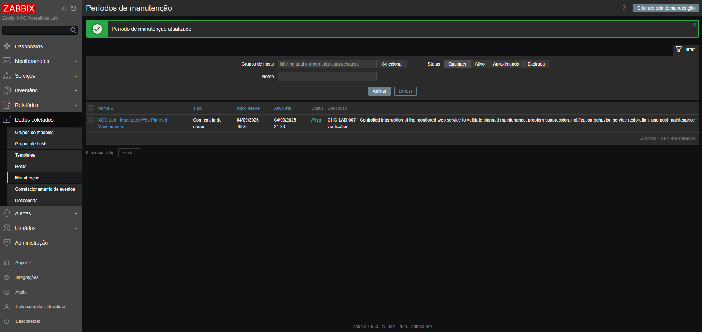
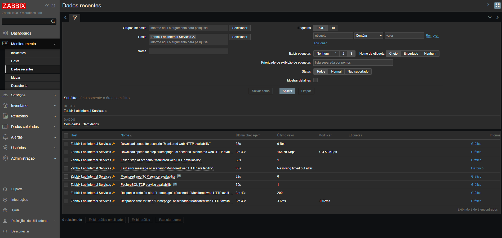
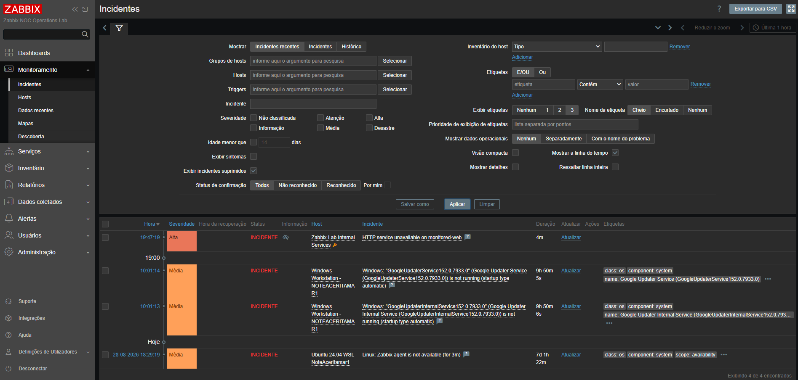
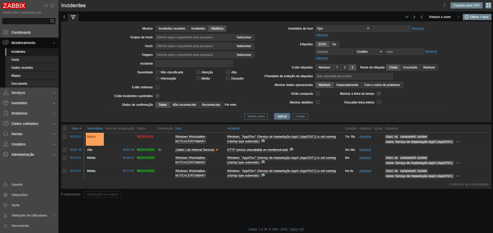
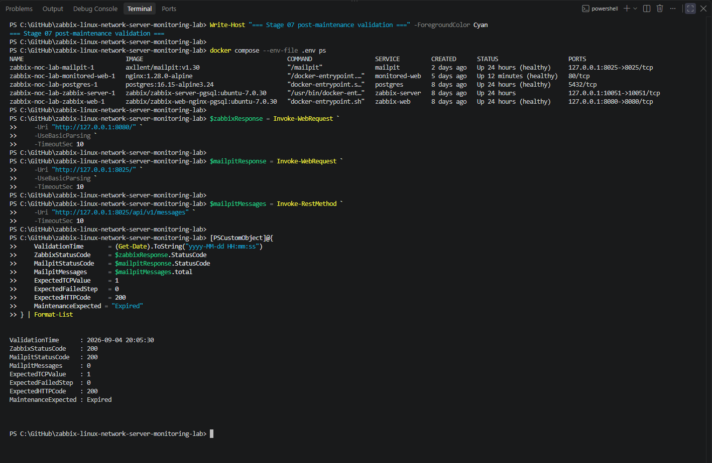

# Stage 07 — Janelas de manutenção e relatórios operacionais

[English](README.md) | **Português (Brasil)**

[Voltar ao README principal](../../README.pt-BR.md)

## Objetivo

Esta etapa introduz práticas de tratamento de manutenções planejadas e elaboração de relatórios operacionais, comuns às equipes de Centros de Operações de Rede (NOC).

A implementação valida o comportamento do Zabbix quando um serviço monitorado é interrompido intencionalmente durante uma janela de manutenção aprovada.

A etapa abrange:

- configuração de manutenção planejada;
- associação de um host a um período de manutenção ativo;
- continuidade da coleta de dados de monitoramento;
- interrupção controlada do serviço HTTP monitorado;
- supressão de eventos de problema durante o trabalho planejado;
- validação da supressão de notificações;
- restauração do serviço;
- encerramento da janela de manutenção;
- validação da integridade após a manutenção;
- documentação operacional da manutenção;
- registro do ciclo de vida do incidente;
- relatório de passagem de turno;
- notas de diagnóstico e evidências selecionadas.

## Situação atual

**Concluída**

A etapa 07 validou com sucesso todo o ciclo de manutenção planejada do serviço `monitored-web`.

A implementação final confirmou:

- criação de um período de manutenção com coleta de dados;
- associação desse período ao host `Zabbix Lab Internal Services`;
- continuidade da coleta de dados dos itens e do cenário web;
- interrupção controlada do serviço HTTP;
- geração do evento de problema esperado;
- supressão do problema durante o período de manutenção;
- prevenção de notificações indesejadas ao Mailpit;
- restauração bem-sucedida do serviço;
- recuperação automática do problema;
- encerramento formal da manutenção;
- remoção do indicador de manutenção do host;
- monitoramento normal após a manutenção;
- elaboração dos registros de manutenção e passagem de turno.

## Componentes do laboratório

| Componente | Finalidade | Impacto da manutenção |
|:---:|:---:|:---:|
| PostgreSQL | Banco de dados de configuração e histórico do Zabbix | Permaneceu disponível |
| Zabbix Server | Monitoramento e processamento de eventos | Permaneceu disponível |
| Zabbix Web | Configuração e validação de incidentes | Permaneceu disponível |
| Mailpit | Captura local de notificações | Permaneceu disponível |
| `monitored-web` | Alvo de monitoramento HTTP para testes controlados | Interrompido intencionalmente |
| `Zabbix Lab Internal Services` | Host lógico para monitoramento dos serviços internos | Colocado em manutenção |

## Estado inicial antes da manutenção

A validação inicial confirmou que:

- o PostgreSQL estava saudável;
- o Zabbix Server estava em execução;
- o Zabbix Web estava saudável e retornava status HTTP `200`;
- o Mailpit estava saudável e retornava status HTTP `200`;
- o contêiner HTTP monitorado estava saudável;
- a disponibilidade TCP de monitored-web era `1`;
- o cenário HTTP retornava código de status `200`;
- o cenário HTTP não apresentava etapa com falha;
- não existia incidente HTTP ativo para `Zabbix Lab Internal Services`;
- a caixa de mensagens do Mailpit continha zero mensagens.

Havia incidentes não relacionados envolvendo um serviço Windows e o agente Ubuntu no WSL, mas eles não afetavam o alvo selecionado para a manutenção.

## Alvo da manutenção

| Campo | Valor |
|:---:|:---:|
| Identificador da mudança | `CHG-LAB-007` |
| Host no Zabbix | `Zabbix Lab Internal Services` |
| Serviço | `monitored-web` |
| Sinal de monitoramento | Disponibilidade do serviço HTTP |
| Valor TCP normal esperado | `1` |
| Ação controlada | Interrupção temporária do contêiner |
| Tipo de manutenção | Com coleta de dados |
| Expectativa de notificações | Nenhuma notificação relacionada à manutenção |
| Expectativa de recuperação | Serviço retorna ao estado normal |

## Configuração da manutenção

Um período de manutenção dedicado foi criado no Zabbix para a atividade controlada.

| Configuração | Valor |
|:---:|:---:|
| Nome | `NOC Lab - Monitored Web Planned Maintenance` |
| Tipo de manutenção | Com coleta de dados |
| Host associado | `Zabbix Lab Internal Services` |
| Tipo de agendamento | Uma única vez |
| Período ativo inicial | 4 de setembro de 2026, das 19h25 às 21h30 |
| Período de teste | 4 de setembro de 2026, começando às 19h29, com duração de uma hora |
| Referência da mudança | `CHG-LAB-007` |

O tipo de manutenção permitiu que o Zabbix continuasse coletando dados dos itens e do cenário web, ao mesmo tempo em que suprimia as ações operacionais associadas à interrupção planejada.

**Agendamento da manutenção e intervalo efetivo:** Os campos iniciais `Active since` e `Active till` estabeleceram os limites gerais de validade da manutenção, das `19:25` às `21:30` de 4 de setembro de 2026. Separadamente, a configuração `Periods` utilizou `One time only`, com início às `19:29` e duração de uma hora, resultando no intervalo agendado de `19:29–20:29`. O intervalo efetivo da manutenção depende da sobreposição entre essas configurações; o valor de `Active since`, isoladamente, não ativa a manutenção. Esses horários representam a configuração original, não eventos distintos de interrupção do serviço.

**Escopo da manutenção e considerações sobre a supressão de notificações:** O experimento controlado interrompeu intencionalmente apenas o contêiner `monitored-web`. Entretanto, o período de manutenção foi associado ao host lógico do Zabbix `Zabbix Lab Internal Services`, que também contém itens de monitoramento da disponibilidade TCP do PostgreSQL.

No Zabbix, uma manutenção associada ao host, sem condições restritivas por tags de triggers, pode suprimir problemas de outras triggers pertencentes ao mesmo host. As evidências preservadas do Stage 07 confirmam a supressão do incidente esperado de disponibilidade HTTP, mas não permitem estabelecer independentemente se existiam restrições por tags configuradas ou se um eventual incidente não relacionado do PostgreSQL também teria sido suprimido.

Para futuras manutenções específicas por serviço, recomenda-se avaliar os filtros por tags de triggers disponibilizados pelo Zabbix ou a separação dos serviços monitorados em hosts lógicos dedicados. Essas alternativas exigem configuração e validação experimental antes da implementação. A configuração original da manutenção, os resultados de monitoramento e as evidências de notificações do Stage 07 permanecem inalterados.

## Configuração da supressão de notificações

A ação de *trigger* existente foi revisada antes da interrupção controlada:

`NOC Lab - Mailpit problem notifications`

A opção da ação `Pause operations for suppressed incidents` foi habilitada.

Essa configuração preservou o evento de problema no Zabbix e impediu a execução da operação de notificação associada durante o período de manutenção ativo.

A caixa de mensagens do Mailpit continha zero mensagens antes do teste.

## Fluxo da manutenção

A seguinte sequência foi concluída:

1. a atividade planejada foi registrada como `CHG-LAB-007`;
2. um período de manutenção foi configurado no Zabbix;
3. `Zabbix Lab Internal Services` foi associado à manutenção;
4. a coleta de dados de monitoramento foi mantida habilitada;
5. foi confirmado que o período de manutenção estava ativo;
6. a contagem inicial de mensagens no Mailpit foi registrada;
7. o serviço `monitored-web` foi interrompido intencionalmente;
8. as falhas monitoradas de TCP e HTTP foram validadas;
9. a criação do evento de problema suprimido foi confirmada;
10. foi confirmado que nenhuma notificação desnecessária chegou ao Mailpit;
11. o serviço monitorado foi restaurado;
12. a recuperação de TCP e HTTP foi validada;
13. a resolução automática do problema foi confirmada;
14. o período de manutenção foi encerrado;
15. a remoção do estado de manutenção do host foi confirmada;
16. o estado normal da plataforma após a manutenção foi validado;
17. os registros de manutenção e passagem de turno foram concluídos.

## Linha do tempo da execução

| Horário | Atividade | Resultado |
|:---:|:---:|:---:|
| 19:25 | Início do limite geral `Active since` | Início agendado da manutenção às `19:29` |
| 19:46:05 | Início do teste controlado | Mailpit continha zero mensagens |
| 19:46 | `monitored-web` foi interrompido | Início da interrupção controlada |
| 19:47:19 | Problema HTTP foi gerado | Incidente de severidade High criado e suprimido |
| 19:49:08 | Validação da supressão concluída | Mailpit permaneceu com zero mensagens |
| 19:52:36 | Início da restauração do serviço | `monitored-web` foi iniciado |
| 19:53:15 | Problema HTTP recuperado | Incidente mudou para `RESOLVED` |
| 19:58:58 | Validação da recuperação concluída | Serviço e monitoramento retornaram ao normal |
| 20:04 | Período de manutenção encerrado | Estado da manutenção mudou para `Expired` |
| 20:05:30 | Validação final concluída | Plataforma confirmada como operacional |

## Interrupção controlada do serviço

Apenas o serviço `monitored-web` foi interrompido.

A interrupção produziu o comportamento esperado do monitoramento:

| Sinal de monitoramento | Esperado durante a falha | Observado | Resultado |
|:---:|:---:|:---:|:---:|
| Disponibilidade TCP de monitored-web | `0` | `0` | Aprovado |
| Etapa com falha no cenário HTTP | `1` | `1` | Aprovado |
| Disponibilidade TCP do PostgreSQL | `1` | `1` | Aprovado |
| Severidade do problema HTTP | High | High | Aprovado |
| Supressão do problema | Habilitada | Confirmada | Aprovado |

Os demais serviços Docker continuaram funcionando normalmente.

## Validação do problema suprimido

O Zabbix gerou o incidente esperado:

`HTTP service unavailable on monitored-web`

O incidente foi criado às `19:47:19`, com severidade High.

A visualização do incidente confirmou que:

- o problema estava associado a `Zabbix Lab Internal Services`;
- o host estava em manutenção ativa;
- o problema estava marcado como suprimido;
- o evento permanecia disponível para análise operacional;
- a coleta de dados de monitoramento continuava;
- as operações de notificação não foram executadas.

## Validação da supressão de notificações

O Mailpit foi consultado antes e depois do intervalo de falha.

| Medição | Valor |
|:---:|:---:|
| Mensagens antes da interrupção | `0` |
| Mensagens após a geração do problema | `0` |
| Novas mensagens durante a manutenção | `0` |
| Novas mensagens esperadas | `0` |

Nenhuma notificação de problema relacionada à manutenção foi entregue.

Isso confirmou que a ação de *trigger* respeitou a configuração para incidentes suprimidos.

## Restauração do serviço

O serviço `monitored-web` foi iniciado após o intervalo de falha controlada.

A validação da restauração confirmou que:

- o contêiner retornou ao estado `healthy`;
- a disponibilidade TCP de monitored-web retornou a `1`;
- o valor da etapa com falha no cenário HTTP retornou a `0`;
- o código de resposta HTTP retornou a `200`;
- a disponibilidade TCP do PostgreSQL permaneceu em `1`;
- o problema HTTP se recuperou automaticamente;
- o Mailpit continuou contendo zero mensagens.

O incidente HTTP se recuperou às `19:53:15`, após uma duração de `5m 56s`.

## Encerramento da manutenção

Após o retorno do serviço monitorado ao estado normal, o período de manutenção foi formalmente encerrado.

O valor de término da atividade foi ajustado para `20:04`, e o estado da manutenção mudou para `Expired`.

**Encerramento antecipado da janela de manutenção:** Após a recuperação do serviço, o campo `Active till` foi alterado manualmente de `21:30` para `20:04`. Considerando que o período original de execução única (`19:29–20:29`) permaneceu inalterado, essa modificação reduziu o intervalo efetivo da manutenção para `19:29–20:04`. A captura preservada confirma o novo valor de `Active till` e o estado `Expired`, mas não apresenta independentemente a configuração final do bloco `Periods`. A duração agendada de uma hora não deve ser interpretada como a duração efetiva após esse ajuste.

Isso confirmou que:

- a janela de manutenção aprovada havia terminado;
- o host não estava mais em manutenção;
- o indicador de manutenção foi removido;
- os incidentes futuros seriam processados fora do contexto da manutenção concluída.

## Validação após a manutenção

A validação final da plataforma confirmou:

| Validação | Esperado | Observado | Resultado |
|:---:|:---:|:---:|:---:|
| Contêiner PostgreSQL | Healthy | Healthy | Aprovado |
| Contêiner Zabbix Server | Running | Running | Aprovado |
| Contêiner Zabbix Web | Healthy | Healthy | Aprovado |
| Contêiner `monitored-web` | Healthy | Healthy | Aprovado |
| Contêiner Mailpit | Healthy | Healthy | Aprovado |
| Interface web Zabbix | HTTP `200` | HTTP `200` | Aprovado |
| Interface web Mailpit | HTTP `200` | HTTP `200` | Aprovado |
| Disponibilidade TCP de monitored-web | `1` | `1` | Aprovado |
| Etapa com falha no cenário HTTP | `0` | `0` | Aprovado |
| Código de resposta HTTP | `200` | `200` | Aprovado |
| Mensagens no Mailpit | `0` | `0` | Aprovado |
| Estado da manutenção | Expired | Expired | Aprovado |

O indicador de manutenção do host deixou de aparecer, e não havia incidente ativo de disponibilidade HTTP.

## Documentação operacional

A atividade de manutenção produziu dois registros operacionais dedicados.

### Registro de manutenção planejada

O registro de manutenção documenta:

- o escopo da mudança;
- objetivos e riscos;
- pré-condições;
- configuração da manutenção;
- linha do tempo da execução;
- resultados do monitoramento;
- comportamento das notificações;
- restauração do serviço;
- encerramento da manutenção;
- resultado final.

[Consultar o registro de manutenção planejada](maintenance-record.pt-BR.md)

### Relatório de passagem de turno

O relatório de passagem de turno documenta:

- trabalho concluído durante o turno;
- estado atual da plataforma;
- valores atuais de monitoramento;
- resumos de incidentes e notificações;
- alertas pendentes não relacionados;
- ações para o turno seguinte;
- critérios de escalonamento;
- estado do rollback;
- índice de evidências.

[Consultar o relatório de passagem de turno](shift-handover-report.pt-BR.md)

## Índice de evidências

| Evidência | Arquivo no repositório |
|:---:|:---:|
| Período de manutenção ativo | `docs/screenshots/stage-07-active-maintenance-period.png` |
| Indisponibilidade HTTP controlada | `docs/screenshots/stage-07-controlled-http-unavailability.png` |
| Problema HTTP suprimido | `docs/screenshots/stage-07-suppressed-http-problem.png` |
| Recuperação HTTP suprimida | `docs/screenshots/stage-07-suppressed-http-recovery.png` |
| Período de manutenção expirado | `docs/screenshots/stage-07-expired-maintenance-period.png` |
| Validação após a manutenção | `docs/screenshots/stage-07-post-maintenance-platform-validation.png` |

## Segurança e escopo

O fluxo de trabalho ficou restrito ao ambiente de laboratório controlado.

O banco de dados PostgreSQL, Zabbix Server, Zabbix Web, Mailpit, Windows Agent 2 e hosts monitorados não relacionados não foram interrompidos intencionalmente.

O serviço `monitored-web` foi o único alvo de manutenção controlada.

Nenhum sistema de produção, serviço SMTP externo, conta pessoal de e-mail, credencial, token ou infraestrutura pública foi utilizado.

## Notas de diagnóstico e resolução de problemas

### A manutenção inicialmente ultrapassou o período necessário ao teste

O período de manutenção foi inicialmente configurado com um horário de término posterior ao necessário para o teste operacional.

Após a recuperação do serviço, o horário final foi ajustado para encerrar formalmente a manutenção e confirmar seu estado `Expired`.

### Incidente suprimido ocultado pelo filtro padrão

O problema HTTP não apareceu na visualização padrão dos incidentes porque os incidentes suprimidos não estavam sendo exibidos.

A habilitação de `Show suppressed incidents` permitiu visualizar o evento de problema esperado, relacionado à manutenção.

### Falha de monitoramento versus falha de notificação

A ausência de uma mensagem no Mailpit não indicava falha de monitoramento.

O Zabbix detectou corretamente a interrupção do serviço e gerou o evento de problema esperado. Apenas a operação de notificação foi pausada porque o evento estava suprimido durante a manutenção.

### Erro histórico do cenário web após a recuperação

A última mensagem de erro HTTP permaneceu temporariamente visível nos dados recentes após a recuperação do cenário web.

O valor TCP atual, o valor da etapa com falha, o código de resposta, o estado do incidente e a integridade do contêiner foram utilizados para confirmar a situação operacional real.

## Principais aprendizados

Esta etapa demonstrou que:

- a manutenção não interrompe necessariamente a coleta de dados de monitoramento;
- o trabalho planejado pode gerar eventos de problema, ao mesmo tempo em que suprime ações operacionais;
- incidentes suprimidos permanecem disponíveis para auditoria e investigação;
- os filtros de incidentes devem incluir eventos suprimidos ao validar o comportamento da manutenção;
- a supressão de notificações deve ser validada independentemente da detecção do problema;
- a recuperação do serviço deve ser confirmada por múltiplos sinais de monitoramento;
- períodos de manutenção precisam ser formalmente encerrados após o trabalho planejado;
- a passagem de turno deve distinguir eventos de manutenção de alertas não relacionados;
- as evidências operacionais devem preservar todo o ciclo de vida da mudança;
- a documentação faz parte do processo técnico de manutenção.

## Resultado final

A etapa 07 demonstrou com sucesso o ciclo completo de manutenção planejada:

1. validação do estado inicial;
2. ativação da manutenção;
3. continuidade da coleta de dados;
4. interrupção controlada do serviço;
5. detecção do problema;
6. supressão do incidente;
7. supressão da notificação;
8. restauração do serviço;
9. recuperação automática;
10. encerramento da manutenção;
11. validação após a manutenção;
12. elaboração de relatórios operacionais.

O laboratório retornou ao estado normal, o período de manutenção expirou, o incidente HTTP foi resolvido e nenhuma notificação indesejada foi entregue.

**Etapa 07 concluída com sucesso.**
