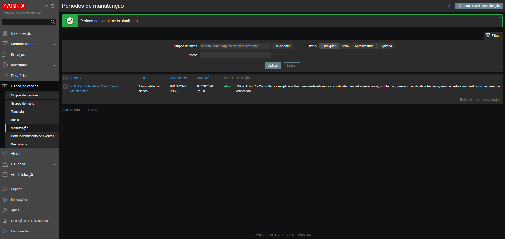
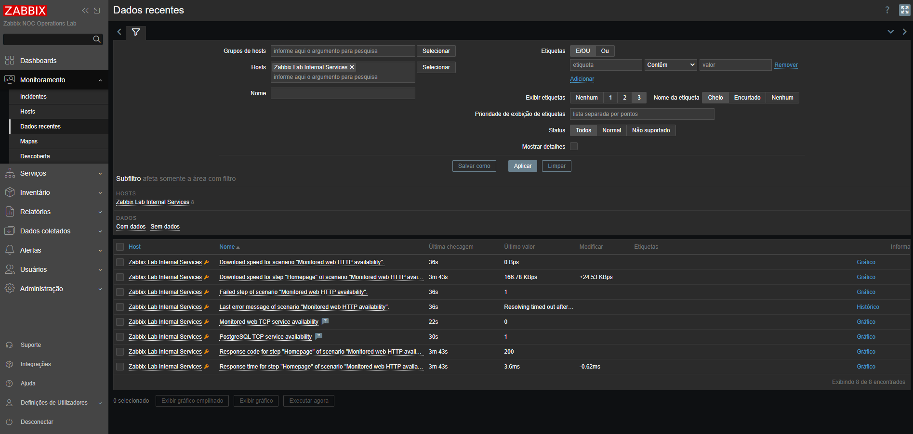
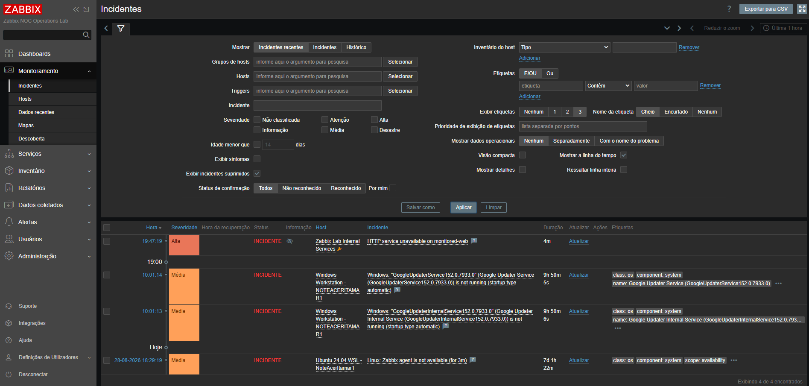
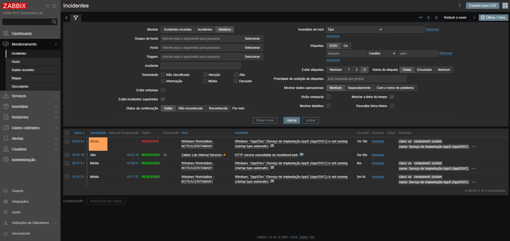
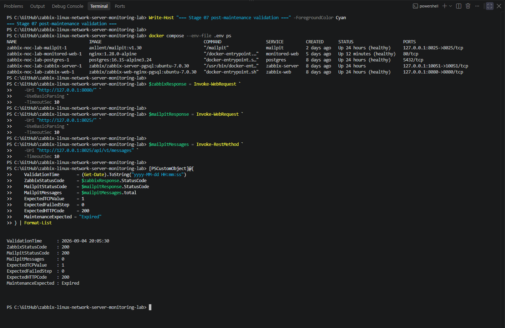

# Registro de manutenção planejada — CHG-LAB-007

[English](maintenance-record.md) | **Português (Brasil)**

[Voltar ao Stage 07](README.pt-BR.md)

## Resumo da mudança

| Campo | Valor |
|:---:|:---:|
| ID da mudança | `CHG-LAB-007` |
| Tipo de mudança | Manutenção planejada |
| Ambiente | Zabbix NOC Operations Lab |
| Serviço | `monitored-web` |
| Host no Zabbix | `Zabbix Lab Internal Services` |
| Nome da manutenção | `NOC Lab - Monitored Web Planned Maintenance` |
| Modo de manutenção | Com coleta de dados |
| Data de execução | 4 de setembro de 2026 |
| Início planejado | 19:25 |
| Interrupção controlada | 19:46 |
| Restauração do serviço | 19:52 |
| Encerramento da manutenção | 20:04 |
| Validação final | 20:05 |
| Estado final | Concluída com sucesso |

## Objetivo

O objetivo desta manutenção planejada foi validar o comportamento operacional do Zabbix quando um serviço HTTP monitorado é interrompido intencionalmente durante uma janela de manutenção aprovada.

A atividade foi planejada para confirmar que:

- os dados de monitoramento continuavam sendo coletados;
- a falha do serviço HTTP era detectada;
- um evento de problema era gerado;
- o problema era identificado como suprimido;
- as operações de notificação eram pausadas para o incidente suprimido;
- nenhuma mensagem indesejada era entregue ao Mailpit;
- o serviço podia ser restaurado normalmente;
- o evento de problema se recuperava após a restauração;
- o período de manutenção podia ser encerrado formalmente;
- a plataforma retornava ao estado operacional normal.

## Escopo

### Dentro do escopo

- o serviço Docker `monitored-web`;
- o host `Zabbix Lab Internal Services`;
- o item dedicado de disponibilidade TCP;
- o cenário web HTTP monitorado;
- a *trigger* dedicada de disponibilidade HTTP;
- a configuração de manutenção do Zabbix;
- a caixa de mensagens de notificação do Mailpit;
- a validação da plataforma após a manutenção.

### Fora do escopo

- interrupção do PostgreSQL;
- interrupção do Zabbix Server;
- interrupção da interface web do Zabbix;
- interrupção do Mailpit;
- alterações nos hosts Linux ou Windows monitorados;
- entrega SMTP externa;
- infraestrutura de produção.

## Avaliação de riscos

| Risco | Impacto esperado | Mitigação |
|:---:|:---:|:---:|
| Monitoramento HTTP fica indisponível | Limitado ao serviço `monitored-web` do laboratório | Somente o contêiner-alvo foi interrompido |
| Notificação de alerta indesejada | Uma mensagem relacionada à manutenção poderia chegar ao Mailpit | As operações de incidentes suprimidos foram pausadas na ação de *trigger* |
| Perda de dados de monitoramento | O comportamento da manutenção não poderia ser validado | A manutenção foi configurada com coleta de dados |
| Falha na restauração do serviço | A disponibilidade HTTP poderia continuar comprometida | A integridade do contêiner e os valores dos itens Zabbix foram verificados após a inicialização |
| Manutenção permanece ativa | Incidentes posteriores poderiam continuar suprimidos | O horário de término foi atualizado e o estado `Expired` foi confirmado |

## Pré-condições

Antes da interrupção controlada, foram confirmadas as seguintes condições:

- os cinco serviços Docker Compose estavam em execução;
- o PostgreSQL estava saudável;
- o Zabbix Server estava em execução;
- o Zabbix Web estava saudável;
- `monitored-web` estava saudável;
- o Mailpit estava saudável;
- a interface web do Zabbix retornava status HTTP `200`;
- a interface web do Mailpit retornava status HTTP `200`;
- o valor da disponibilidade TCP de monitored-web era `1`;
- o cenário web HTTP retornava código de status `200`;
- não havia incidente de disponibilidade HTTP ativo;
- a caixa de mensagens do Mailpit continha zero mensagens.

## Configuração da manutenção

O seguinte período de manutenção foi criado no Zabbix:

| Configuração | Valor |
|:---:|:---:|
| Nome | `NOC Lab - Monitored Web Planned Maintenance` |
| Tipo de manutenção | Com coleta de dados |
| Host | `Zabbix Lab Internal Services` |
| Tipo de agendamento | Uma única vez |
| Período ativo inicial | 4 de setembro de 2026, das 19:25 às 21:30 |
| Período de teste | 4 de setembro de 2026, com início às 19:29 e duração de uma hora |
| Descrição | `CHG-LAB-007 - Controlled interruption of the monitored-web service to validate planned maintenance, problem suppression, notification behavior, service restoration, and post-maintenance verification.` |

## Controle de supressão de notificações

A ação de *trigger* utilizada pelo laboratório foi revisada antes da interrupção:

`NOC Lab - Mailpit problem notifications`

A seguinte opção da ação foi habilitada:

`Pause operations for suppressed incidents`

Essa configuração permitiu que o Zabbix criasse e preservasse o evento de problema, evitando a execução da operação de notificação associada durante a janela de manutenção aprovada.

## Linha do tempo da execução

| Horário | Atividade | Resultado |
|:---:|:---:|:---:|
| 19:25 | Janela de manutenção tornou-se ativa | Host entrou em manutenção planejada |
| 19:46:05 | Teste controlado iniciado | Mailpit continha zero mensagens |
| 19:46 | `monitored-web` foi interrompido | Contêiner-alvo entrou no estado de parado |
| 19:47:19 | Problema de disponibilidade HTTP foi gerado | Incidente criado com severidade High |
| 19:49:08 | Validação da supressão concluída | Mailpit continuava com zero mensagens |
| 19:52:36 | Restauração do serviço iniciada | `monitored-web` foi iniciado |
| 19:53:15 | Problema HTTP recuperado | Incidente mudou para `RESOLVED` |
| 19:58:58 | Validação da recuperação concluída | Serviço saudável e Mailpit ainda vazio |
| 20:04 | Período de manutenção encerrado | Estado da manutenção mudou para `Expired` |
| 20:05:30 | Validação final da plataforma concluída | Plataforma retornou ao estado normal |

## Interrupção controlada do serviço

Somente o serviço HTTP monitorado foi interrompido com o comando `docker compose --env-file .env stop monitored-web`.

A interrupção produziu as condições de monitoramento esperadas:

| Sinal de monitoramento | Valor esperado | Valor observado | Resultado |
|---|:---:|:---:|:---:|
| Disponibilidade TCP de monitored-web | `0` | `0` | Aprovado |
| Etapa com falha do cenário HTTP | `1` | `1` | Aprovado |
| Disponibilidade TCP do PostgreSQL | `1` | `1` | Aprovado |
| Severidade do problema | High | High | Aprovado |
| Supressão do problema | Habilitada | Confirmada | Aprovado |
| Novas mensagens no Mailpit | `0` | `0` | Aprovado |

A coleta de dados de monitoramento continuou durante o período de manutenção, conforme exigido pelo tipo de manutenção selecionado.

## Validação do problema suprimido

O Zabbix gerou o seguinte problema:

`HTTP service unavailable on monitored-web`

O evento foi criado às `19:47:19`, com severidade High.

A visualização de incidentes confirmou que:

- o evento de problema existia;
- o evento pertencia a `Zabbix Lab Internal Services`;
- o host estava em manutenção;
- o incidente estava marcado como suprimido;
- o problema permanecia visível operacionalmente quando os incidentes suprimidos eram exibidos.

## Validação das notificações

O Mailpit foi consultado antes e depois da interrupção controlada.

| Medição | Valor |
|:---:|:---:|
| Mensagens antes da interrupção | `0` |
| Mensagens após a ativação da *trigger* | `0` |
| Novas mensagens durante a manutenção | `0` |
| Novas mensagens esperadas | `0` |

Nenhuma notificação de problema indesejada foi entregue.

Isso confirmou que a ação de *trigger* respeitou a configuração de pausar operações relativas a incidentes suprimidos.

## Restauração do serviço

O serviço HTTP monitorado foi restaurado com o comando `docker compose --env-file .env start monitored-web`.

Após a restauração:

- o contêiner retornou ao estado `healthy`;
- a disponibilidade TCP de monitored-web retornou a `1`;
- o valor da etapa com falha no cenário HTTP retornou a `0`;
- o código de resposta HTTP retornou a `200`;
- a disponibilidade TCP do PostgreSQL permaneceu em `1`;
- o problema de disponibilidade HTTP se recuperou;
- o Mailpit continuava contendo zero mensagens.

O problema se recuperou às `19:53:15`, resultando em uma duração total de `5m 56s`.

## Encerramento da manutenção

Após a recuperação do serviço e a validação de sua integridade, o período de manutenção foi encerrado formalmente, alterando seu horário de término para `20:04`.

A lista de manutenções passou a exibir o estado `Expired`.

Isso confirmou que o host não estava mais em manutenção e que os incidentes futuros não herdariam o contexto da manutenção concluída.

## Validação após a manutenção

A validação final da plataforma confirmou:

| Validação | Esperado | Observado | Resultado |
|:---:|:---:|:---:|:---:|
| Contêiner PostgreSQL | Healthy | Healthy | Aprovado |
| Contêiner Zabbix Server | Running | Running | Aprovado |
| Contêiner Zabbix Web | Healthy | Healthy | Aprovado |
| Contêiner monitored-web | Healthy | Healthy | Aprovado |
| Contêiner Mailpit | Healthy | Healthy | Aprovado |
| Interface web do Zabbix | HTTP `200` | HTTP `200` | Aprovado |
| Interface web do Mailpit | HTTP `200` | HTTP `200` | Aprovado |
| Disponibilidade TCP de monitored-web | `1` | `1` | Aprovado |
| Etapa com falha no cenário HTTP | `0` | `0` | Aprovado |
| Código de resposta HTTP | `200` | `200` | Aprovado |
| Mensagens no Mailpit | `0` | `0` | Aprovado |
| Estado da manutenção | Expired | Expired | Aprovado |

O indicador de manutenção não era mais exibido para `Zabbix Lab Internal Services`, confirmando que o host havia retornado ao estado normal de monitoramento.

## Resultado

A manutenção planejada foi concluída com sucesso.

O teste demonstrou que o Zabbix:

- continuou coletando dados de monitoramento durante a manutenção;
- detectou a interrupção intencional do serviço HTTP;
- gerou o evento de problema esperado;
- associou o evento ao período de manutenção ativo;
- marcou o problema como suprimido;
- impediu a entrega de notificações indesejadas;
- detectou a recuperação do serviço;
- preservou o ciclo completo do incidente;
- removeu o estado de manutenção após o encerramento;
- retornou o serviço monitorado à operação normal.

Não foi necessário executar rollback, nenhum serviço não relacionado do laboratório foi interrompido e nenhuma notificação foi entregue ao Mailpit durante a atividade.

## Estado final

**CHG-LAB-007 — CONCLUÍDA COM SUCESSO**
