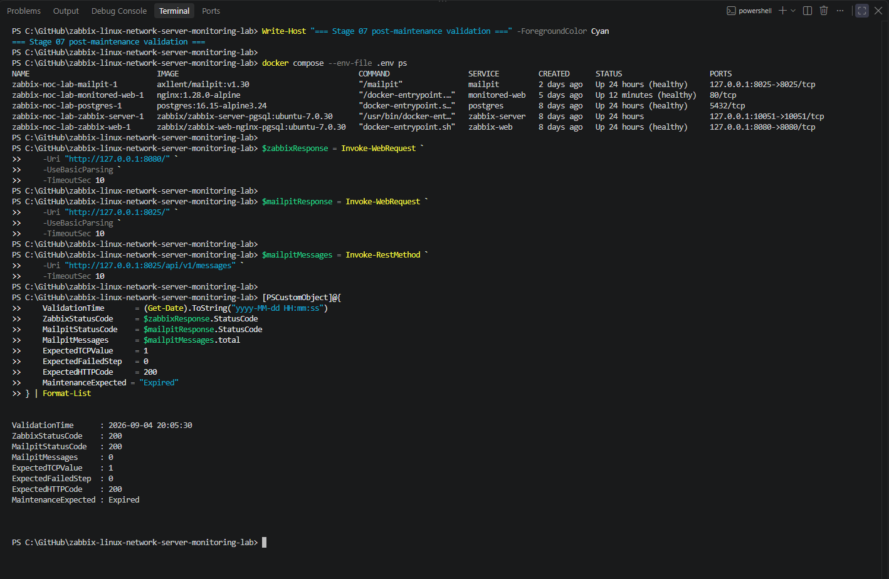
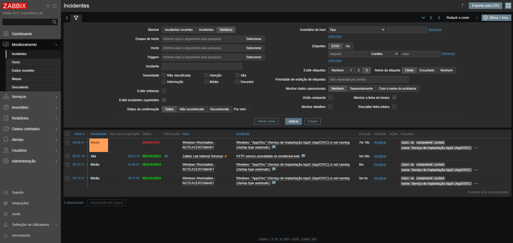
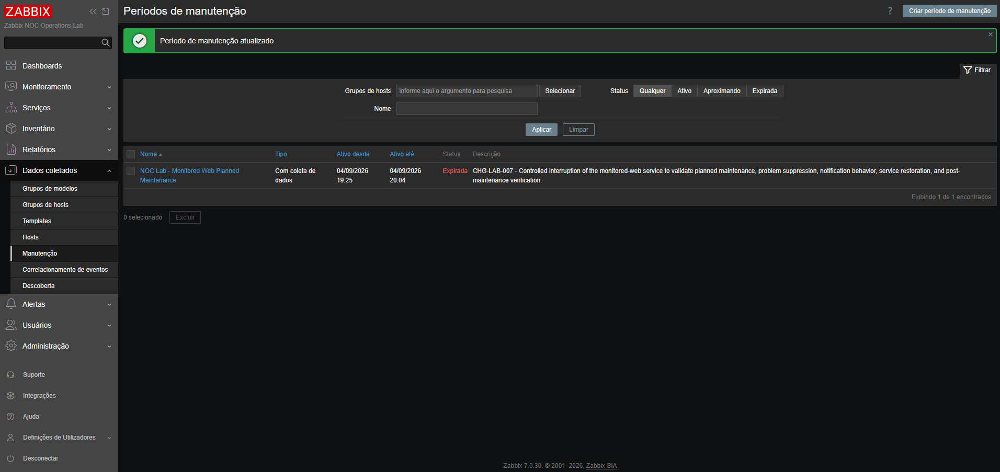

# Relatório de passagem de turno do NOC — Stage 07

[English](shift-handover-report.md) | **Português (Brasil)**

[Voltar ao Stage 07](README.pt-BR.md)

## Resumo da passagem de turno

| Campo | Valor |
|:---:|:---:|
| Ambiente | Zabbix NOC Operations Lab |
| Data da passagem de turno | 4 de setembro de 2026 |
| Mudança relacionada | `CHG-LAB-007` |
| Atividade | Manutenção planejada de monitored-web |
| Host no Zabbix | `Zabbix Lab Internal Services` |
| Serviço afetado | `monitored-web` |
| Estado da manutenção | Expired |
| Estado do serviço | Restaurado e saudável |
| Estado das notificações | Nenhuma mensagem relacionada à manutenção foi entregue |
| Resultado geral | Bem-sucedido |
| Necessidade de acompanhamento | Nenhuma ação corretiva necessária |

## Resumo executivo

A atividade de manutenção planejada identificada como `CHG-LAB-007` foi concluída com sucesso.

O serviço `monitored-web` foi interrompido intencionalmente enquanto seu host no Zabbix estava sob um período de manutenção ativo, configurado com coleta de dados.

O Zabbix continuou coletando dados de monitoramento, detectou a interrupção do serviço, criou o problema esperado de disponibilidade HTTP, marcou o incidente como suprimido e impediu a operação de notificação correspondente ao Mailpit.

O serviço foi restaurado com sucesso, o problema se recuperou automaticamente, o período de manutenção foi encerrado e a plataforma retornou ao estado operacional normal.

## Trabalho concluído durante o turno

As seguintes atividades foram concluídas:

- validou-se o estado inicial da plataforma Docker;
- foi confirmado o acesso às interfaces web do Zabbix e do Mailpit;
- o período de manutenção planejada foi criado;
- a manutenção foi associada a `Zabbix Lab Internal Services`;
- a coleta de dados de monitoramento foi mantida durante a manutenção;
- a configuração de supressão na ação de *trigger* foi verificada;
- a contagem inicial de mensagens no Mailpit foi registrada;
- apenas o serviço `monitored-web` foi interrompido;
- as falhas de monitoramento TCP e HTTP foram confirmadas;
- a criação do evento de problema esperado foi confirmada;
- a supressão do incidente foi confirmada;
- foi confirmado que nenhuma notificação indesejada chegou ao Mailpit;
- o serviço `monitored-web` foi restaurado;
- a recuperação TCP e HTTP foi confirmada;
- a resolução automática do incidente foi confirmada;
- o período de manutenção foi encerrado;
- a validação após a manutenção foi concluída;
- as evidências operacionais foram preservadas no repositório.

## Linha do tempo da mudança

| Horário | Evento | Resultado operacional |
|:---:|:---:|:---:|
| 19:25 | Manutenção tornou-se ativa | Host entrou em manutenção planejada |
| 19:46:05 | Teste controlado iniciado | Contagem inicial do Mailpit registrada como zero |
| 19:46 | `monitored-web` foi interrompido | Início da interrupção controlada do serviço |
| 19:47:19 | Problema HTTP foi criado | Incidente de severidade High detectado e suprimido |
| 19:49:08 | Verificação das notificações concluída | Mailpit permaneceu com zero mensagens |
| 19:52:36 | Restauração do serviço iniciada | Contêiner `monitored-web` foi iniciado |
| 19:53:15 | Problema HTTP recuperado | Incidente mudou para `RESOLVED` |
| 19:58:58 | Verificações de recuperação concluídas | Serviço saudável e valores de monitoramento normais |
| 20:04 | Manutenção encerrada | Estado da manutenção mudou para `Expired` |
| 20:05:30 | Validação final concluída | Plataforma confirmada em operação normal |

## Estado atual da plataforma

| Componente | Estado atual | Observação operacional |
|:---:|:---:|:---:|
| PostgreSQL | Healthy | Serviço de banco de dados permaneceu disponível |
| Zabbix Server | Running | Processamento de eventos permaneceu operacional |
| Zabbix Web | Healthy | Interface web retornou status HTTP `200` |
| Serviço web monitorado | Healthy | Serviço restaurado com sucesso |
| Mailpit | Healthy | Interface web retornou status HTTP `200` |
| Manutenção no Zabbix | Expired | Host não está mais em manutenção |

## Estado atual do monitoramento

| Sinal de monitoramento | Valor atual | Valor esperado | Estado |
|:---:|:---:|:---:|:---:|
| Disponibilidade TCP de monitored-web | `1` | `1` | Normal |
| Etapa com falha no cenário HTTP | `0` | `0` | Normal |
| Código de resposta HTTP | `200` | `200` | Normal |
| Disponibilidade TCP do PostgreSQL | `1` | `1` | Normal |
| Incidente de disponibilidade HTTP | Resolved | Resolved | Normal |
| Indicador de manutenção | Não exibido | Não exibido | Normal |

O host `Zabbix Lab Internal Services` não apresenta mais o indicador de manutenção.

## Resumo do incidente

A interrupção controlada gerou o incidente esperado:

| Campo | Valor |
|---|---|
| Incidente | `HTTP service unavailable on monitored-web` |
| Severidade | High |
| Horário do problema | 19:47:19 |
| Horário da recuperação | 19:53:15 |
| Duração | 5 minutos e 56 segundos |
| Estado de supressão | Suprimido durante a manutenção |
| Entrega de notificação | Não executada |
| Estado final | Resolved |

O ciclo de vida do incidente permanece disponível no histórico do Zabbix para análise operacional.

## Resumo das notificações

| Medição do Mailpit | Valor |
|---|:---:|
| Mensagens antes da interrupção | `0` |
| Mensagens durante a falha | `0` |
| Mensagens após a restauração do serviço | `0` |
| Mensagens após o encerramento da manutenção | `0` |
| Notificações inesperadas | `0` |

A ausência de mensagens relacionadas à manutenção era o resultado esperado.

A ação de *trigger* configurada pausou as operações de notificação porque o incidente foi suprimido pelo período de manutenção ativo.

## Encerramento da manutenção

O período denominado `NOC Lab - Monitored Web Planned Maintenance` foi formalmente encerrado após a recuperação do serviço.

Seu estado final é `Expired`.

Nenhuma janela de manutenção ativa permanece associada ao teste, e os eventos futuros do host serão processados fora do contexto da manutenção concluída.

## Alertas pendentes

O incidente HTTP da etapa 07 está resolvido e não requer outras ações corretivas.

Outros alertas exibidos na visualização de incidentes do Zabbix pertencem a hosts Windows e Linux monitorados separadamente. Eles já existiam fora do escopo de `CHG-LAB-007` e não foram causados pela atividade de manutenção planejada.

Esses alertas não relacionados devem continuar sendo tratados conforme sua própria prioridade operacional e seus procedimentos de diagnóstico e resolução de problemas.

## Ações para o turno seguinte

Nenhuma ação imediata é necessária para `CHG-LAB-007`.

O operador que assume o turno deve:

- manter os serviços Docker do laboratório em execução enquanto forem necessárias validações adicionais;
- confirmar que `monitored-web` permanece saudável;
- confirmar que a disponibilidade TCP permanece em `1`;
- confirmar que o código de resposta HTTP permanece em `200`;
- verificar se o indicador de manutenção não reaparece inesperadamente;
- tratar qualquer novo problema de disponibilidade HTTP como incidente normal, não suprimido;
- investigar separadamente os alertas não relacionados de Windows ou Linux;
- preservar as evidências e os registros operacionais da etapa 07.

## Critérios de escalonamento

O escalonamento é necessário se ocorrer qualquer uma das seguintes condições:

- o contêiner `monitored-web` sair do estado saudável;
- a disponibilidade TCP de monitored-web mudar de `1` para `0`;
- o cenário web HTTP informar uma etapa com falha;
- o código de resposta HTTP for diferente de `200`;
- o período de manutenção concluído voltar a ficar ativo;
- um problema HTTP permanecer suprimido fora de uma janela de manutenção aprovada;
- o Mailpit receber uma notificação inesperada relacionada à manutenção;
- o problema de disponibilidade HTTP retornar após a restauração do serviço.

## Estado do rollback

Nenhum rollback foi necessário.

A interrupção controlada foi revertida iniciando o contêiner existente `monitored-web`. Nenhuma imagem, rede, volume, banco de dados, *trigger*, item, ação ou configuração de tipo de mídia exigiu restauração.

## Índice de evidências

| Evidência | Arquivo no repositório |
|---|---|
| Período de manutenção ativo | `docs/screenshots/stage-07-active-maintenance-period.png` |
| Indisponibilidade HTTP controlada | `docs/screenshots/stage-07-controlled-http-unavailability.png` |
| Problema HTTP suprimido | `docs/screenshots/stage-07-suppressed-http-problem.png` |
| Recuperação HTTP suprimida | `docs/screenshots/stage-07-suppressed-http-recovery.png` |
| Período de manutenção expirado | `docs/screenshots/stage-07-expired-maintenance-period.png` |
| Validação após a manutenção | `docs/screenshots/stage-07-post-maintenance-platform-validation.png` |

## Documentação relacionada

- [Documentação da etapa 07](README.pt-BR.md)
- [Registro de manutenção planejada](maintenance-record.pt-BR.md)
- [Documentação principal do repositório](../../README.pt-BR.md)

## Estado da passagem de turno

**PASSAGEM DE TURNO CONCLUÍDA — PLATAFORMA OPERACIONAL**
