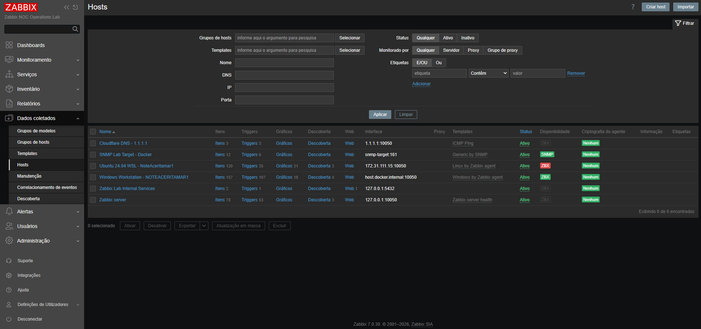
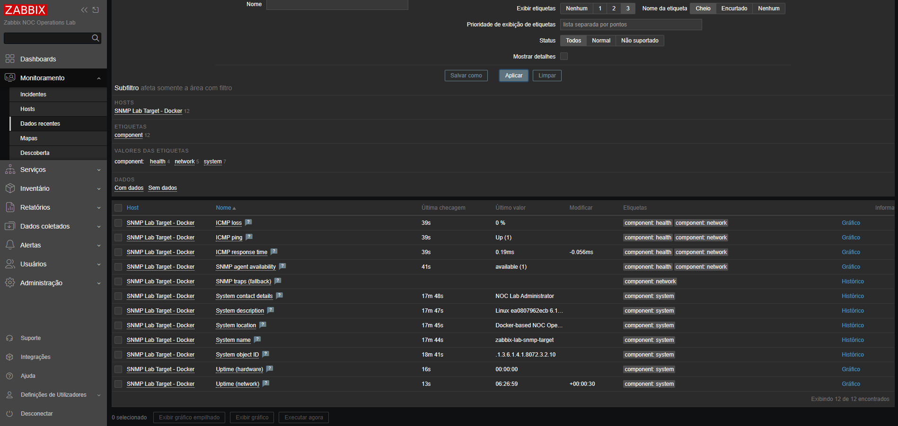
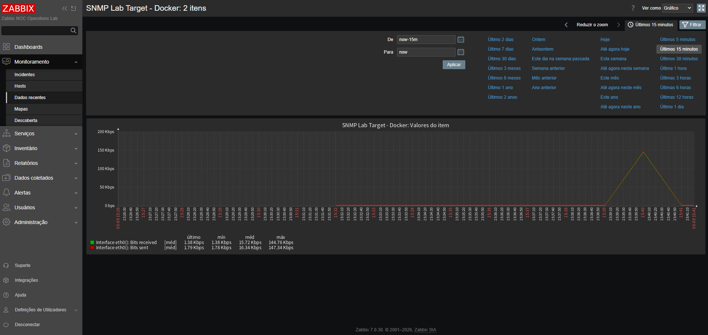
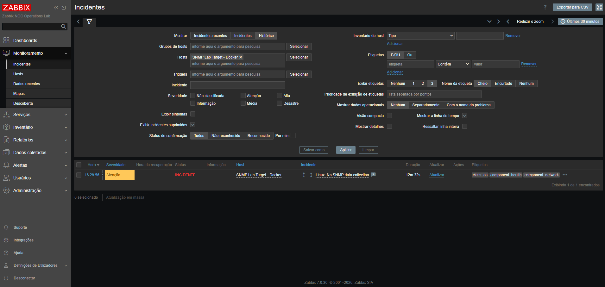
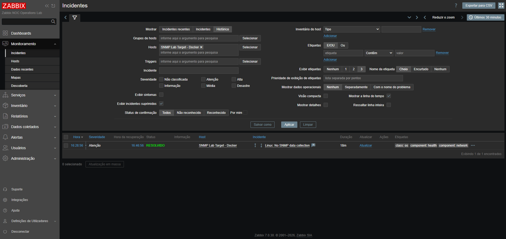

# Stage 08 — Monitoramento de rede via SNMP e decisão sobre o Grafana

[English](README.md) | **Português (Brasil)**

[Voltar ao README principal](../../README.pt-BR.md)

## Objetivo

Um alvo Docker controlado, executando Net-SNMP, fornece os dados utilizados neste exercício de monitoramento SNMP com Zabbix.

Os testes abrangem consultas diretas, cadastro do host, descoberta de interfaces, coleta de tráfego e uma falha controlada de autenticação seguida de recuperação.

O Grafana foi mantido como uma decisão opcional, e não como dependência obrigatória. A etapa foi concluída com o monitoramento nativo do Zabbix porque os resultados operacionais exigidos foram alcançados sem adicionar outra plataforma de visualização.

## Situação da etapa

**Concluída**

A configuração registrada inclui:

- um alvo SNMP dedicado com Alpine Linux;
- agente Net-SNMP e ferramentas de linha de comando;
- configuração SNMP baseada em variáveis de ambiente;
- comunidade privada SNMPv2c armazenada fora do controle de versão;
- integração com Docker Compose;
- endpoint UDP publicado apenas na interface de loopback;
- validação da integridade do contêiner;
- consultas SNMP diretas;
- cadastro do host no Zabbix por uma interface SNMP;
- macro secreta do host Zabbix para a comunidade;
- template oficial `Linux by SNMP`;
- descoberta de informações do sistema e de interfaces de rede;
- coleta de tráfego de entrada e saída;
- gráficos nativos do Zabbix;
- falha controlada de autenticação;
- detecção e recuperação automática de problemas;
- rotação da comunidade após exposição acidental durante testes locais;
- evidências técnicas selecionadas.

## Arquitetura implementada

| Componente | Responsabilidade |
|:---:|:---:|
| Alvo SNMP controlado | Disponibiliza dados de sistema Linux e de interfaces por UDP `161`, de maneira reproduzível |
| Zabbix Server | Consulta OIDs SNMP, descobre interfaces, armazena valores e avalia *triggers* |
| Zabbix Web | Configura o host SNMP e disponibiliza itens, incidentes e gráficos nativos |
| PostgreSQL | Armazena configuração, histórico, tendências e eventos do Zabbix |
| Rede de monitoramento do Docker | Fornece resolução de nomes gerenciada pelo Docker e conectividade entre os contêineres conectados à rede bridge de monitoramento. Essa rede não está configurada com `internal: true`. |
| Operador NOC | Valida a coleta, executa a injeção controlada de falhas e confirma a recuperação |

## Alvo SNMP

O alvo controlado é implementado como o serviço Docker Compose:

`snmp-target`

A imagem dedicada utiliza como base:

`alpine:3.22`

A imagem instala:

- `gettext-envsubst`;
- `net-snmp`;
- `net-snmp-tools`.

O contêiner inicia o daemon Net-SNMP e disponibiliza a porta UDP `161`.

O endpoint publicado na estação de trabalho Windows fica restrito a:

`127.0.0.1:161/udp`

O Zabbix Server não depende do endpoint publicado na estação de trabalho. Ele acessa o alvo diretamente pela rede interna de monitoramento do Docker, em:

`snmp-target:161`

A verificação de integridade (*health check*) do contêiner realiza uma consulta SNMP autenticada ao endereço atribuído ao próprio contêiner.

## Configuração do ambiente

O arquivo `.env.example` versionado documenta as variáveis SNMP necessárias:

- `SNMP_AGENT_PORT`;
- `SNMP_COMMUNITY`;
- `SNMP_ALLOWED_NETWORK`;
- `SNMP_SYSTEM_NAME`;
- `SNMP_SYSTEM_LOCATION`;
- `SNMP_SYSTEM_CONTACT`.

A comunidade operacional é gerada localmente e armazenada somente no arquivo `.env` ignorado pelo Git.

O arquivo `.env` é excluído pelo `.gitignore` e nunca deve ser incluído em commits, em evidências publicadas ou copiado para a documentação.

## Seleção do protocolo

O alvo controlado utiliza SNMPv2c.

| Configuração | Valor implementado |
|:---:|:---:|
| Protocolo | SNMP |
| Versão | SNMPv2c |
| Transporte | UDP |
| Porta do agente | `161` |
| Modo de acesso | Somente leitura |
| Armazenamento da comunidade | Arquivo `.env` local ignorado pelo Git e macro secreta do host Zabbix |
| Exposição na estação de trabalho | `127.0.0.1:161/udp` |
| Destino do Zabbix | `snmp-target:161` |
| Origem do monitoramento | Contêiner Zabbix Server |

O SNMPv2c é adequado a este laboratório isolado, pois permite examinar diretamente OIDs, comportamento das consultas, conectividade e falhas de autenticação.

O SNMPv3 continua sendo a opção recomendada para produção quando são necessários autenticação, proteção de integridade e criptografia.

## Controles de segurança

A implementação aplica os seguintes controles:

- o alvo é restrito ao laboratório controlado;
- o acesso SNMP é somente de leitura;
- a comunidade real não está inserida em arquivos versionados;
- a macro da comunidade no Zabbix utiliza texto secreto;
- a porta UDP `161` é vinculada apenas à interface de loopback da estação de trabalho;
- o Zabbix acessa o alvo pela rede interna do Docker;
- nenhum equipamento de rede de produção é consultado;
- nenhum roteador, switch, ponto de acesso ou dispositivo administrado pelo provedor de internet é modificado;
- as evidências publicadas são revisadas quanto à exposição de segredos;
- uma comunidade do laboratório que havia sido exposta foi rotacionada imediatamente;
- o alvo e a macro do Zabbix foram sincronizados após a rotação.

**Autorização de origem SNMP e isolamento de rede:** O arquivo `.env.example` versionado especifica `SNMP_ALLOWED_NETWORK=172.16.0.0/12`. O template do Net-SNMP utiliza esse CIDR como restrição de origem para a comunidade somente de leitura. Essa faixa é mais ampla que a sub-rede histórica de monitoramento Docker e não deve ser interpretada como uma autorização exclusiva para o Zabbix Server.

A publicação da porta UDP restrita ao loopback da estação limita o endpoint publicado no host, mas não restringe a comunicação entre contêineres conectados à mesma rede bridge do Docker. A rede `monitoring` não está configurada com `internal: true`, diferentemente da rede `backend`; isso, isoladamente, não demonstra exposição externa.

O CIDR efetivamente autorizado, as conexões de rede e os endereços dos contêineres devem ser verificados no ambiente em execução antes de formular conclusões de segurança ou restringir a configuração. Qualquer redução futura da faixa autorizada também deverá considerar o healthcheck autenticado do próprio contêiner SNMP.

### Verificações não destrutivas de autorização de rede para futuras execuções

Os comandos PowerShell abaixo consultam as redes atuais do contêiner e o CIDR configurado sem exibir a comunidade SNMP. Execute-os somente no projeto Compose previsto, com o `.env` operacional existente; são verificações de referência para uso futuro, sem resultados de inspeção operacional apresentados aqui.

```powershell
# Inspecionar o contêiner SNMP e as redes conectadas
docker compose --env-file .env -f compose.yaml ps snmp-target

$snmpId = docker compose --env-file .env -f compose.yaml ps -q snmp-target

if (-not $snmpId) {
    throw "SNMP target container not found."
}

docker inspect $snmpId `
  --format '{{json .NetworkSettings.Networks}}'

# Consultar a rede de origem autorizada sem exibir
# a comunidade SNMP secreta
docker compose --env-file .env -f compose.yaml exec -T `
  snmp-target printenv SNMP_ALLOWED_NETWORK

# Listar as redes Docker para inspeção adicional
docker network ls
```

A variável de ambiente, isoladamente, não comprova a autorização efetiva presente na configuração Net-SNMP gerada. Qualquer futura inspeção do `snmpd.conf` gerado deverá evitar imprimir ou publicar a linha completa `rocommunity`, pois ela contém a comunidade secreta. Estas consultas não alteram o contêiner, a rede nem as regras de acesso.

## Incidente com finais de linha

A primeira inicialização do contêiner SNMP falhou com código de saída `127`.

A inspeção da linha *shebang* do script de inicialização retornou:

`23 21 2f 62 69 6e 2f 73 68 0d 0a`

A sequência final `0d 0a` demonstrou que o script utilizava finais de linha Windows CRLF. Dentro do contêiner Linux, o caractere de retorno de carro passou a fazer parte do caminho do interpretador e impediu a execução.

A correção incluiu:

- normalizar os finais de linha do *entrypoint* e do template SNMP durante a construção da imagem;
- preservar as permissões de execução;
- reconstruir a imagem sem utilizar o cache;
- confirmar uma linha *shebang* com LF do Linux;
- adicionar regras de final de linha ao repositório por meio de `.gitattributes`.

Após a correção, a linha *shebang* terminava com:

`23 21 2f 62 69 6e 2f 73 68 0a`

O contêiner SNMP recriado passou a apresentar estado saudável e permaneceu estável.

## Validação SNMP direta

As consultas diretas SNMPv2c ao alvo controlado foram bem-sucedidas antes do cadastro no Zabbix.

| Sinal | Resultado validado |
|:---:|:---:|
| Nome do sistema | `zabbix-lab-snmp-target` |
| Localização do sistema | `Docker-based NOC Operations Lab` |
| Contato do sistema | `NOC Lab Administrator` |
| Descrição do sistema | Net-SNMP em execução no Linux |
| Identificador de objeto do sistema | OID empresarial do Net-SNMP |
| Tempo de atividade do sistema | Retornado com sucesso |
| Quantidade de interfaces | Retornada com sucesso |

Esses resultados permitiram separar a validação do SNMP no alvo da configuração no Zabbix.

Para futuras consultas SNMP diretas e uma verificação opcional e controlada de divergência da macro e recuperação, consulte o [runbook de validação SNMP](snmp-validation-runbook.pt-BR.md). O runbook apresenta procedimentos para testes futuros, não resultados adicionais do experimento original do Stage 08.

## Configuração do host no Zabbix

O alvo SNMP foi cadastrado com a seguinte configuração final:

| Campo | Valor |
|:---:|:---:|
| Nome do host | `zabbix-lab-snmp-target` |
| Nome visível | `SNMP Lab Target - Docker` |
| Grupo de hosts | `Network services` |
| Template | `Linux by SNMP` |
| Tipo de interface | SNMP |
| Método de conexão | DNS |
| Nome DNS | `snmp-target` |
| Porta | `161` |
| Versão SNMP | SNMPv2 |
| Comunidade | `{$SNMP_COMMUNITY}` |
| Origem do monitoramento | Zabbix Server |
| Estado | Ativo |

O template inicial `Generic by SNMP` validou a conectividade básica e os OIDs de sistema. Em seguida, ele foi substituído por `Linux by SNMP`, que oferece monitoramento Linux mais abrangente, descoberta de baixo nível, métricas de interfaces, *triggers* e gráficos.

A macro `{$SNMP_COMMUNITY}` contém o mesmo valor privado armazenado no arquivo `.env` local. Seu tipo é texto secreto e sua descrição não contém o valor operacional.

## Resultados do monitoramento

Após a inicialização do template e a descoberta, o host disponibilizou:

| Recurso do Zabbix | Quantidade observada |
|:---:|:---:|
| Itens | `53` |
| Triggers | `15` |
| Gráficos | `8` |
| Regras de descoberta | `5` |

Os dados coletados incluíram:

- disponibilidade SNMP;
- nome, descrição, contato, localização e identificador de objeto do sistema;
- tempo de atividade do sistema e da rede;
- informações sobre o sistema operacional Linux;
- descoberta de interfaces;
- tipo e estado operacional das interfaces;
- tráfego recebido e transmitido;
- erros de pacotes de entrada e saída;
- pacotes de entrada e saída descartados.

A interface `eth0` foi descoberta automaticamente. Os valores de tráfego recebido e transmitido variaram entre as verificações, demonstrando coleta ativa de séries temporais, e não apenas configuração estática.

O template também disponibilizou oito gráficos nativos do Zabbix para visualização operacional direta, sem depender de uma camada adicional de dashboards.

## Falha controlada e recuperação

A falha controlada testou o caminho de autenticação SNMP sem interromper PostgreSQL, Zabbix Server, Zabbix Web, Mailpit, serviço HTTP monitorado ou hosts monitorados não relacionados.

A sequência do teste foi:

1. confirmar a disponibilidade SNMP normal;
2. preservar a comunidade operacional no arquivo `.env` ignorado pelo Git;
3. substituir somente a macro secreta do host Zabbix por um valor inválido do laboratório;
4. aguardar verificações SNMP consecutivas com falha;
5. observar o problema `Linux: No SNMP data collection`;
6. restaurar a comunidade correta a partir do `.env`;
7. confirmar a disponibilidade SNMP indicada em verde;
8. confirmar a recuperação automática do evento.

| Sinal | Estado normal | Estado de falha | Estado de recuperação |
|:---:|:---:|:---:|:---:|
| Contêiner do alvo SNMP | Healthy | Healthy | Healthy |
| Autenticação SNMP no Zabbix | Válida | Inválida | Válida |
| Disponibilidade SNMP | Disponível | Indisponível | Disponível |
| Coleta de dados | Atualizada | Interrompida | Retomada |
| Evento de problema | Ausente | `Linux: No SNMP data collection` | Resolvido |

Esse método isolou a dependência de autenticação e demonstrou que um alvo saudável ainda pode ficar indisponível para o monitoramento quando as credenciais não correspondem.

## Decisão sobre a validação de notificações

Uma ação dedicada, denominada `NOC Lab - SNMP problem notifications`, foi configurada durante o diagnóstico. Dois incidentes SNMP controlados foram gerados. Não foram observados registros correspondentes de operações de notificação na visualização consultada do Action Log do Zabbix, e nenhuma mensagem foi recebida no Mailpit durante esses testes. As evidências preservadas não permitem estabelecer os filtros exatos do Action Log, o intervalo de tempo selecionado ou as permissões efetivas de visualização; portanto, a ausência de registros visíveis não deve ser interpretada como comprovação definitiva de que nenhuma operação de notificação foi iniciada.

As condições da ação foram revisadas, substituindo uma referência herdada de *trigger* por uma combinação de host e nome de evento. O segundo teste também não resultou em entrega. Por isso, a ação não validada foi desabilitada, em vez de ser apresentada como evidência de sucesso.

**Limitação da validação:** A ação de notificações SNMP permaneceu sem validação e foi desabilitada. A ausência de entrega de mensagens foi observada, mas sua causa exata não foi isolada conclusivamente. Uma investigação futura deverá correlacionar os detalhes dos eventos afetados com `Reports → Action log`, verificar o intervalo de tempo selecionado, os filtros, as permissões do usuário, a configuração do tipo de mídia, as condições e operações da ação e comparar os resultados com o Mailpit. Essas verificações são recomendações para diagnóstico futuro, não procedimentos adicionais comprovadamente executados no experimento original do Stage 08.

A entrega de e-mails SNMP não foi mantida como requisito de aceitação da etapa 08 porque o fluxo completo de notificações de problema e recuperação entre Zabbix e Mailpit já havia sido validado e documentado na etapa 06. A etapa 08 permanece concentrada em seu novo escopo técnico: consultas SNMP, descoberta, monitoramento de interfaces, falha de autenticação e recuperação.

Esse resultado é registrado de maneira transparente como diagnóstico adiado, e não como resultado bem-sucedido.

## Exposição e rotação da comunidade

Durante testes locais, a comunidade operacional foi inserida acidentalmente em um campo visível e apareceu em uma captura de tela que não foi publicada.

A resposta corretiva incluiu:

- impedir a publicação da evidência afetada;
- corrigir a descrição da macro;
- alterar o tipo da macro para texto secreto;
- gerar uma nova comunidade privada;
- atualizar o arquivo `.env` ignorado pelo Git;
- recriar somente o serviço `snmp-target`;
- atualizar a macro secreta do host no Zabbix;
- confirmar o restabelecimento da disponibilidade SNMP;
- utilizar apenas o valor rotacionado nos testes subsequentes.

Nenhum valor da comunidade operacional está documentado neste repositório.

## Decisão sobre o Grafana

A integração com o Grafana foi avaliada e intencionalmente adiada.

A decisão baseou-se nos seguintes resultados:

- a descoberta nativa de interfaces pelo Zabbix foi bem-sucedida;
- as métricas de tráfego foram coletadas com sucesso;
- os gráficos nativos do Zabbix estavam disponíveis;
- a detecção da falha controlada foi bem-sucedida;
- a recuperação automática foi bem-sucedida;
- o repositório já demonstra o fluxo operacional de NOC pretendido;
- adicionar o Grafana duplicaria um trabalho de visualização já abordado em projetos separados de observabilidade.

Manter o Grafana como opcional preserva o escopo deste repositório como laboratório de operações NOC centrado no Zabbix. Uma etapa futura poderá reavaliar o Grafana caso ele introduza um resultado operacional distinto, em vez de apenas outra visualização dos mesmos dados.

## Evidências

### Disponibilidade do host SNMP no Zabbix

A lista de hosts mostra o alvo ativo, a interface interna `snmp-target:161`, o template `Linux by SNMP` associado e o indicador verde de disponibilidade SNMP.



### Coleta de dados SNMP

A visualização de dados recentes demonstra os valores SNMP atuais coletados do alvo controlado.



### Descoberta de interfaces e coleta de tráfego

A visualização de dados recentes mostra a interface `eth0` descoberta, seu estado operacional, tipo de interface e tráfego recebido e transmitido.



### Detecção de problema SNMP

A visualização de incidentes mostra `Linux: No SNMP data collection` após a incompatibilidade controlada da comunidade interromper as consultas autenticadas.



### Recuperação SNMP

O histórico de incidentes mostra a resolução automática após a restauração da comunidade secreta correta.



## Critérios de aceitação

- [x] Criar um alvo SNMP controlado e reproduzível.
- [x] Restringir o endpoint UDP publicado à interface de loopback.
- [x] Manter a comunidade privada fora dos arquivos versionados.
- [x] Construir e validar a imagem SNMP dedicada.
- [x] Corrigir a incompatibilidade de finais de linha entre Windows e Linux.
- [x] Confirmar o estado saudável do contêiner.
- [x] Realizar consultas SNMP diretas.
- [x] Cadastrar o host SNMP no Zabbix.
- [x] Configurar a interface SNMP por DNS interno.
- [x] Armazenar a comunidade em uma macro secreta do host.
- [x] Associar o template `Linux by SNMP`.
- [x] Confirmar a disponibilidade SNMP indicada em verde.
- [x] Coletar informações padronizadas do sistema.
- [x] Validar a descoberta de interfaces de rede.
- [x] Validar a coleta de tráfego de entrada e saída.
- [x] Confirmar os gráficos nativos do Zabbix.
- [x] Simular uma falha isolada de autenticação SNMP.
- [x] Validar a detecção do problema.
- [x] Restaurar a comunidade correta com segurança.
- [x] Validar a recuperação automática da coleta.
- [x] Validar o evento resolvido.
- [x] Rotacionar uma comunidade de laboratório exposta.
- [x] Confirmar o estado final saudável da plataforma.
- [x] Avaliar e adiar a integração opcional com o Grafana.
- [x] Incluir em commit as evidências selecionadas da etapa 08.
- [x] Documentar os resultados da implementação e do diagnóstico.

## Lições de diagnóstico

Esta etapa demonstrou a importância de validar cada camada de forma independente:

- o estado saudável no Docker não comprova a autenticação no Zabbix;
- consultas diretas permitem separar o comportamento do alvo da configuração do Zabbix;
- serviços UDP exigem verificações de conectividade adequadas ao protocolo;
- o DNS dos serviços Docker deve ser utilizado para consultas entre contêineres;
- valores secretos nunca devem ser colocados em descrições nem em capturas de tela;
- arquivos de configuração locais podem conter arquivos ignorados mesmo quando o Git não os inclui;
- finais de linha CRLF do Windows podem impedir a execução de *entrypoints* Linux;
- a escolha do template determina os itens, as regras de descoberta, as *triggers* e os gráficos disponíveis;
- uma referência de *trigger* herdada pode não se comportar como esperado em uma condição de ação;
- uma visualização vazia ou filtrada do Action Log não comprova, isoladamente, que nenhuma operação de notificação foi executada; a verificação deve considerar o evento relevante, o intervalo de tempo, os filtros e as permissões disponíveis;
- integrações opcionais malsucedidas não devem ser apresentadas como evidências validadas;
- a recuperação precisa ser confirmada nas visualizações de disponibilidade e de histórico de eventos.

## Assuntos técnicos abordados

- fundamentos de SNMP e consultas SNMPv2c;
- interpretação de OIDs e conhecimento das MIBs;
- descoberta de interfaces de rede Linux;
- monitoramento de tráfego de entrada e saída;
- validação de serviços UDP;
- engenharia de imagens Docker;
- redes do Docker Compose;
- projeto de verificações de integridade dos contêineres;
- diagnóstico de *entrypoints* Linux;
- interoperabilidade de finais de linha entre Windows e Linux;
- tratamento de segredos por variáveis de ambiente;
- rotação de segredos e sincronização de configurações;
- configuração de hosts SNMP e macros no Zabbix;
- avaliação e substituição de templates do Zabbix;
- descoberta de baixo nível;
- disponibilização de gráficos nativos;
- injeção controlada de falhas;
- validação de problemas e recuperações;
- diagnóstico do caminho de notificações;
- revisão de evidências e boas práticas de segurança;
- registro dos procedimentos, resultados e limitações dos testes.

## Resultado final

Ao término dos testes registrados, as consultas SNMP e o monitoramento de interfaces estavam funcionando, o incidente de falha de autenticação havia sido recuperado e a comunidade operacional havia sido rotacionada. Os resultados do alvo e do monitoramento foram registrados nas evidências da etapa 08.

A ação opcional de notificações SNMP permaneceu desabilitada porque a entrega de mensagens não havia sido validada. O Grafana não foi acrescentado: os gráficos nativos do Zabbix atenderam às necessidades de visualização deste exercício.
